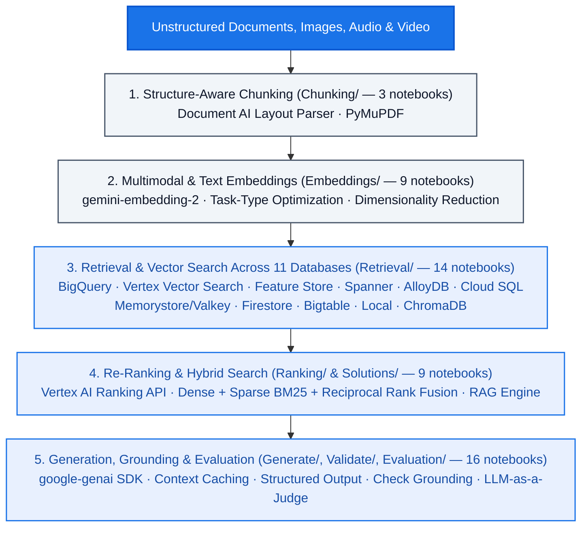

<!--- header table --->
<table>
<tr>     
  <td style="text-align: center">
    <a href="https://github.com/statmike/gcp-mlops/blob/main/Applied%20GenAI/readme.md">
      
       View on GitHub
    </a>
  </td>
</tr>
<tr>
  <td style="text-align: right">
    <b>Share On: </b> 
     
     
     
     
  </td>
</tr>
<tr>
  <td style="text-align: right">
    <b>Connect With Author On: </b> 
    
     
    
     
    
  </td>
</tr>
<tr>
  <td style="text-align: right">
     <a href="https://raw.githubusercontent.com/statmike/gcp-mlops/main/Applied%20GenAI/readme.md">Download File</a> <i>(right-click and "Save As")</i>
  </td>
</tr>
</table>  

---
# Applied Generative AI
> You are here: `gcp-mlops/Applied GenAI/readme.md` ([⬅ Back to Repository Front Door](../readme.md))

This section covers workflows for working with [Generative AI on Google Cloud](https://cloud.google.com/vertex-ai/generative-ai/docs/learn/overview), which are large models trained to continue inputs with likely outputs (**58 active notebooks**, plus 23 legacy notebooks). While simply prompting an LLM to get helpful responses is a great starting point, the tools around these models unlock even more use cases and scalability. This enables you to quickly trial, iterate, and develop ideas into solutions. To jump right into generation, head over to the [Generate](./Generate/readme.md) section and learn all about Gemini models and Imagen. You can also use the following diagram and breakdown to jump to a section of interest, or keep reading to discover this content as part of a narrative overview on applying generative AI.

## Content Overview (58 Active Notebooks)

- **[Retrieval & Vector Search Across 11 Databases (`Retrieval/`)](./Retrieval/readme.md)** (14 notebooks) — Implements and benchmarks exact and approximate nearest-neighbor search across **BigQuery**, **Vertex AI Vector Search (Matching Engine)**, **Vertex AI Feature Store**, **Spanner**, **AlloyDB (`pgvector` / `ScaNN`)**, **Cloud SQL (`pgvector`)**, **Memorystore for Redis / Valkey**, **Firestore**, **Bigtable**, **Chrome/Local Vector Stores**, and **ChromaDB**, comparing setup complexity, recall, latency, and cost.
- **[Generate (`Generate/`)](./Generate/readme.md)** (13 notebooks) — Google Gen AI SDK (`google-genai`), Gemini multimodal prompting, controlled structured output, context caching, token management, long-context retrieval, Imagen, and Veo.
- **[Embeddings (`Embeddings/`)](./Embeddings/readme.md)** (9 notebooks) — Text and multimodal embeddings (`gemini-embedding-2`), task-type optimization, dimensionality reduction, the linear algebra of cosine/dot-product/Euclidean similarity, cross-modal retrieval, and interactive visualization.
- **[Solutions (`Solutions/`)](./Solutions/readme.md)** (7 notebooks) & **[RAG Engine (`rag-engine/`)](./rag-engine/readme.md)** (1 notebook) — Production-grade multi-format document parsing combined with hybrid search (dense vector + sparse BM25 + Reciprocal Rank Fusion reranking) and Vertex AI RAG Engine custom backends.
- **[Chunking (`Chunking/`)](./Chunking/readme.md)** (3 notebooks) — Structure-aware document parsing and chunking with Document AI Layout Parser and PyMuPDF.
- **[Evaluation (`Evaluation/`)](./Evaluation/readme.md)** (2 notebooks), **[Ranking (`Ranking/`)](./Ranking/readme.md)** (1 notebook), & **[Validate (`Validate/`)](./Validate/readme.md)** (1 notebook) — LLM-as-a-judge evaluation, prompt optimization, cross-encoder re-ranking with the Vertex AI Ranking API, and grounding verification with Check Grounding.

  <table>
    <thead>
      <tr>
        <th colspan="3">
            

                
            

            Links To Content Sections
          </th> 
      </tr>
      <tr>
        <th style="text-align: center;">Building with Generative AI</th>
        <th style="text-align: center;">Customize</th>
        <th style="text-align: center;">Augment</th>
      </tr>
    </thead>
    <tbody>
      <tr>
        <td style="text-align: center;"><a href="./Chunking/readme.md">Process</a></td>
        <td style="text-align: center;">Tuning</td>
        <td style="text-align: center;">Function Calling</td>
      </tr>
      <tr>
        <td style="text-align: center;"><a href="./Embeddings/readme.md">Embeddings</a></td>
        <td style="text-align: center;"><a href="./Evaluation/readme.md">Evaluation</a></td>
        <td style="text-align: center;">Extensions</td>
      </tr> 
      <tr>
        <td style="text-align: center;"><a href="./Retrieval/readme.md">Index & Retrieve</a></td>
        <td style="border-bottom: none;"></td>
        <td style="border-bottom: none;"></td>
      </tr> 
      <tr>
        <td style="text-align: center;"><a href="./Ranking/readme.md">Ranking</a></td>
        <td style="border-bottom: none;"></td>
        <td style="border-bottom: none;"></td>
      </tr> 
      <tr>
        <td style="text-align: center;"><a href="./Generate/readme.md">Generate</a></td>
        <td style="border-bottom: none;"></td>
        <td style="border-bottom: none;"></td>
      </tr>
      <tr>
        <td style="text-align: center;"><a href="./Validate/readme.md">Validate</a></td>
        <td style="border-bottom: none;"></td>
        <td style="border-bottom: none;"></td>
      </tr>
    </tbody>
    <thead>
      <tr>
        <th colspan="3" style="text-align: center;"><a href="./Solutions/readme.md">Solution Workflows</a></th>
      </tr>
    </thead>
    <tbody>
      <tr>
        <td style="text-align: center;" colspan="3"><a href="./rag-engine/readme.md">Vertex AI RAG Engine</a></td>
      </tr>
      <tr>
        <td style="text-align: center;" colspan="3"><a href="./Solutions/multi-type-parsing-and-vector-search-2/readme.md">Multi-Type File Parsing And Vertex Vector Search 2</a></td>
      </tr>
    </tbody>
  </table>

## But What About Prompting?

The core of generation is the prompt—that piece of information provided as input to an LLM. The concept of prompt engineering centers around how to craft this input. In this series, we think about this task from an ML side rather than treating an LLM like an oracle. 

ML models generate predictions based on inputs. These predictions are the most likely outcomes to expect given the inputs. With LLMs, we have flexibility on the input side. It is important to think of this input as the information needed to lead to the correct response. 

Guess what? There are probably more than one, even many ways to do this for a given prompt. This section is all about how to provide the best context to ground the request to the LLM in order to make the output the most likely correct response.

Prompt structure is important and many valuable insights can be found in this documentation section: [Introduction To Prompt Design](https://cloud.google.com/vertex-ai/generative-ai/docs/learn/prompts/introduction-prompt-design).
  
## So How Do LLMs Work?
  
The following workflow uses an LLM to show how LLMs operate.  It makes a fun exercise out of word guessing when the next word in a pattern is from a famous passage of literature. Check it out for a brief overview to help with intuition when working with LLMs:
- [Understanding LLMs](./Understanding%20LLMs.ipynb) 
 
---
## Older Content Moved

If you visited this page in the past and are back to find a file that you remembered but it is not here:
- Files moved to the [/legacy](./legacy/readme.md) folder

---