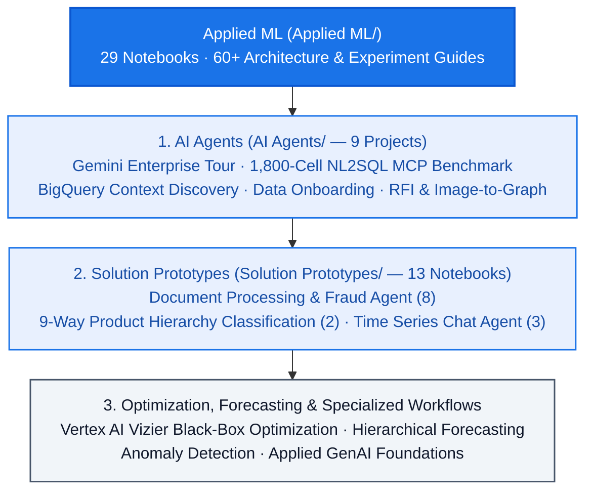

<!--- header table --->
<table>
<tr>     
  <td style="text-align: center">
    <a href="https://github.com/statmike/gcp-mlops/blob/main/Applied%20ML/readme.md">
      
       View on GitHub
    </a>
  </td>
</tr>
<tr>
  <td style="text-align: right">
    <b>Share On: </b> 
     
     
     
     
  </td>
</tr>
<tr>
  <td style="text-align: right">
    <b>Connect With Author On: </b> 
    
     
    
     
    
  </td>
</tr>
<tr>
  <td style="text-align: right">
     <a href="https://raw.githubusercontent.com/statmike/gcp-mlops/main/Applied%20ML/readme.md">Download File</a> <i>(right-click and "Save As")</i>
  </td>
</tr>
</table>  

---
# Applied ML, AI Agents & Solution Prototypes
> You are here: `gcp-mlops/Applied ML/readme.md` ([⬅ Back to Repository Front Door](../readme.md))

Where [MLOps/Serving](../MLOps/Serving/readme.md) focuses on how to deploy and scale a model, **Applied ML** is the next step: what you actually build *with* the response. In forecasting, you use a forecasted horizon to adjust inventory or interact with customers; with generative models and foundation models, you orchestrate tools, data context, and multi-step reasoning into autonomous agents or multi-service applications.

The workflows in this section combine:
- Multiple frameworks covered in [Framework Workflows](../Framework%20Workflows/readme.md)
- Serving, feature store, and pipeline patterns covered in [MLOps](../MLOps/readme.md)
- In-database ML and AI functions covered in [Data + AI](../data+ai/readme.md)

---

## [AI Agents (`AI Agents/`)](./AI%20Agents/readme.md) — 9 projects (16 notebooks)

Built with the **[Agent Development Kit (ADK)](https://google.github.io/adk-docs/)**, **Model Context Protocol (MCP)**, **MCP Toolbox for Databases**, and the **Agent-to-Agent (A2A)** protocol:

- **[Agent Building — A Tour of the Gemini Enterprise Agent Platform (`agent-building/`)](./AI%20Agents/agent-building/README.md)** — One multi-agent retail system exercised across every pillar of the platform:
  - *Build*: Concierge router delegating to sub-agents for unstructured Q&A (`AI.GENERATE` over BigQuery Object Tables), live analytics (Conversational Analytics API), and a remote specialist over **A2A** — running an intentional mixed-model fleet (Gemini 3 Pro, Flash, Flash-Lite, and Claude on Vertex).
  - *Scale, Govern, & Optimize*: Deployed to Agent Runtime with Sessions and Memory Bank; governed with Agent Identity, Agent Registry, and Agent Gateway / Model Armor; evaluated with two evaluation engines and BigQuery event-log observability; integrated with hosted MCP servers, Example Store, RAG Engine, and Skill Registry.
- **[Data MCP Sandbox — Comparing NL2SQL Approaches on Google Cloud (`data-mcp-sandbox/`)](./AI%20Agents/data-mcp-sandbox/README.md)** — A controlled 1,800-cell empirical experiment (not a demo) asking a practical question: *does data governance actually make an agent more accurate, and what does each BigQuery connection pattern cost?*
  - Tests **12 MCP/agent arms** across **4 architectures** (**Raw Data Builder**, **Semantic Router** over Looker, **Governed Context** with Dataplex catalog/aspects/glossary/quality scans, and **Managed Conversational Analytics** over BigQuery and Looker) at **2 governance tiers** across 15 questions (5 replicates each) against a deliberately hostile warehouse (`txn_amt_x2` gross-not-net traps, inverted `status_flg` booleans, dormant `is_active` flags).
  - *Measured findings*: Documenting your data roughly **triples** accuracy on every architecture — yet an agent writing its own SQL still reads a two-part business rule, restates it out loud, and applies only half of it; and token cost is dominated by **tool schema size, not tool count** ($r = 0.97$ vs. $r = 0.14$, with one vendor tool declaration weighing in at 78,214 characters re-sent every turn). Includes an offline re-scorer requiring no cloud account.
- **[BigQuery Context Discovery (`bigquery-context/`)](./AI%20Agents/bigquery-context/readme.md)** — Benchmarks 5 parallel multi-agent strategies for finding the right BigQuery tables (`ADK BigQueryToolset`, `Dataplex Search`, cached `Dataplex lookupContext`, LLM Pre-Filter, and Combined Semantic Context) with a shared Gemini reranker and precision/recall scoring.
- **[Data Onboarding & Multi-Persona Chat (`data-onboarding/`)](./AI%20Agents/data-onboarding/readme.md)** — Two multi-agent systems: an **onboarding pipeline** (`acquire → discover → understand → design → implement → validate`) that ingests files/archives from URLs into BigQuery with Dataplex lineage, and a **3-persona chat agent** (Data Analyst, Data Engineer, Catalog Explorer).
- **[RFI Response Agent (`rfi-agent/`)](./AI%20Agents/rfi-agent/README.md)** — Multi-agent pipeline (`extract → qualify → answer → critique → write back`) that extracts questions with cell/paragraph coordinates from DOCX, Excel, and PDF files, answers them using hybrid internal knowledge + Google Search grounding, critiques quality, and writes answers back into the native document formats.
- **[Image-to-Graph Agent (`image-to-graph/`)](./AI%20Agents/image-to-graph/readme.md)** — Converts complex flowcharts, schematics, and network diagrams into structured JSON/Pydantic graphs using iterative visual cropping, optional OpenCV contour detection, interactive HTML/Mermaid rendering, and a graph Q&A sub-agent.
- **[Agentic Retrieval with BigQuery (`concept-bq/`)](./AI%20Agents/concept-bq/readme.md)** (6 notebooks) — Compares custom Python BigQuery tools, MCP Toolbox for Databases, ADK built-in BigQuery tools, Conversational Analytics API, and `AI.FORECAST` visualization tools, complete with Agent Engine deployment templates.
- **[Conversational Analytics API (`conversational-analytics-api/`)](./AI%20Agents/conversational-analytics-api/readme.md)** — Walkthrough of stateful, stateless, and inline modes over BigQuery, Looker, and Looker Studio.
- **[Travel Planner with A2A (`travel-planner/`)](./AI%20Agents/travel-planner/README.md)** & **[Vertex AI Agent Engine Deployment (`vertex-agent-engine/`)](./AI%20Agents/vertex-agent-engine/readme.md)** — Remote multi-agent communication over the A2A protocol and a minimal, repeatable pattern for deploying ADK packages to Agent Engine.

---

## [Solution Prototypes (`Solution Prototypes/`)](./Solution%20Prototypes/readme.md) — 13 notebooks

End-to-end reference architectures that combine multiple Google Cloud services to solve complete business scenarios:

- **[Document Processing & Fraud Detection (`document-processing/`)](./Solution%20Prototypes/document-processing/readme.md)** (8 notebooks) — End-to-end vendor invoice pipeline: Document AI Custom Extractor (zero-shot, few-shot, fine-tuned), BigQuery Object Tables + `ML.PROCESS_DOCUMENT`, multimodal embeddings (`ML.GENERATE_EMBEDDING`), `VECTOR_SEARCH` vendor classification, anomaly detection for layout/format shifts, Gemini side-by-side visual comparison, and an ADK investigative agent deployed to Agent Engine.
- **[Product Hierarchy Classification (`product-hierarchy/`)](./Solution%20Prototypes/product-hierarchy/README.md)** (2 comprehensive notebooks) — Classifies products into a `Department → Category` taxonomy using **9 approaches across 3 paradigms** (Flat: Spark Levenshtein, Embedding k-NN, Centroid Matching, Gradient Boosting; Local Top-Down Cascades; and Keras Multi-Task Learning with shared layers), implemented both Python-first and SQL/BigQuery-first (~29K products), plus exporting the Keras MTL model back into BigQuery ML (`ML.PREDICT`).
- **[Conversational Time Series Forecasting (`time-series/`)](./Solution%20Prototypes/time-series/readme.md)** (3 notebooks) — ADK agent paired with MCP Toolbox for Databases and BigQuery's `AI.FORECAST` to answer natural-language demand questions with interactive charts.

---

## Optimization, Forecasting & Specialized Application Areas

- **[Optimization with Vertex AI Vizier (`Optimization/`)](./Optimization/readme.md)** — Systematic black-box optimization and hyperparameter tuning: multi-objective Pareto frontiers, safety thresholds and constraints, contextual bandits, conditional parameter spaces, and comparisons with `scipy.optimize` (continuous) and Google OR-Tools (discrete/combinatorial).
- **[Hierarchical Forecasting (`Forecasting/`)](./Forecasting/readme.md)** — Time-series trend and seasonality exploration plus bottom-up and top-down forecast reconciliation in BigQuery ML using forecast proportions (see also [`Applied Forecasting`](../Applied%20Forecasting/readme.md) and [`data+ai/bq-ml/workflows/hierarchical_forecasting/`](../data+ai/bq-ml/workflows/hierarchical_forecasting/)).
- **[Anomaly Detection (`Anomaly Detection/`)](./Anomaly%20Detection/readme.md)** — Model-based anomaly recognition across custom Keras autoencoders, BigQuery ML (`PCA`, `KMEANS`, `AUTOENCODER`), and univariate/multivariate `ARIMA_PLUS` time-series anomaly detection.
- **[Generative AI Foundations (`GenAI/`)](./GenAI/readme.md)** — Early RAG, prompt evaluation, supervised tuning, and controlled generation patterns (expanded in the top-level [`Applied GenAI`](../Applied%20GenAI/readme.md) pillar).
