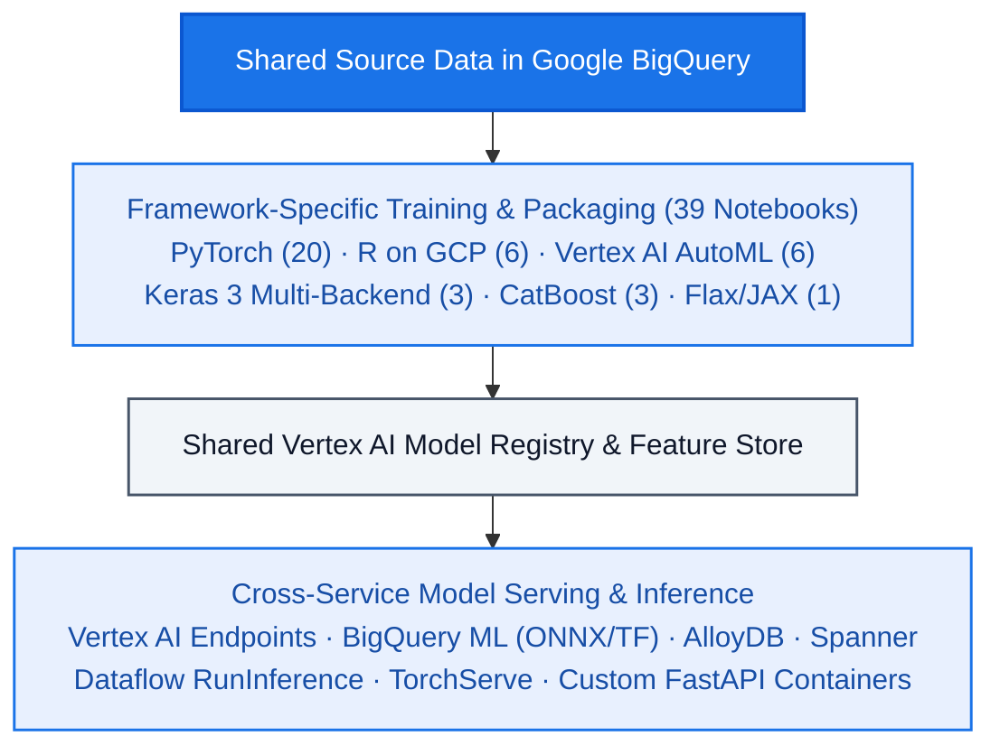

<!--- header table --->
<table>
<tr>     
  <td style="text-align: center">
    <a href="https://github.com/statmike/gcp-mlops/blob/main/Framework%20Workflows/readme.md">
      
       View on GitHub
    </a>
  </td>
</tr>
<tr>
  <td style="text-align: right">
    <b>Share On: </b> 
     
     
     
     
  </td>
</tr>
<tr>
  <td style="text-align: right">
    <b>Connect With Author On: </b> 
    
     
    
     
    
  </td>
</tr>
<tr>
  <td style="text-align: right">
     <a href="https://raw.githubusercontent.com/statmike/gcp-mlops/main/Framework%20Workflows/readme.md">Download File</a> <i>(right-click and "Save As")</i>
  </td>
</tr>
</table>  

---
# Framework Workflows
> You are here: `gcp-mlops/Framework Workflows/readme.md` ([⬅ Back to Repository Front Door](../readme.md))

Using the tools from [MLOps](../MLOps/readme.md) and [Data + AI](../data+ai/readme.md) in end-to-end workflows for specific ML frameworks (**39 notebooks**). For each framework, the workflows focus on a common task so you can compare them directly:
> Training and serving models on shared data stored in Google BigQuery

Information and cloud resources are intentionally shared across frameworks:
- **Shared Source Data**: Every framework trains on the same source data in BigQuery with consistent preparation and splits.
- **Shared Vertex AI Resources**:
  - **Vertex AI Model Registry** — Models register as versions under a shared registry structure.
  - **Vertex AI Feature Store** — Online feature serving is shared across framework examples.
  - **Vertex AI Prediction Endpoints** — Endpoints follow the same deployment and cleanup lifecycle.

## Frameworks

- **[PyTorch (`PyTorch/`)](./PyTorch/readme.md)** (20 notebooks) — Custom autoencoder training plus 19 serving patterns spanning Vertex AI Endpoints, BigQuery ML (via ONNX), AlloyDB, Spanner, Dataflow `RunInference`, TorchServe, and load testing.
- **[R on Google Cloud (`R/`)](./R/readme.md)** (6 notebooks) — One shared Generalized Linear Model (GLM) workflow executed across four GCP runtimes (interactive notebook, Vertex AI Custom Training container, Dataproc Serverless SparkR, and Vertex AI Pipelines), plus high-throughput BigQuery-to-R reads via Apache Iceberg/`arrow` and custom R model serving.
- **[Vertex AI AutoML (`Vertex AI AutoML/`)](./Vertex%20AI%20AutoML/readme.md)** (6 notebooks) — Tabular classification, neural architecture inspection, TabNet, Wide & Deep, and feature engineering.
- **[Keras (`Keras/`)](./Keras/readme.md)** (3 notebooks) — Multi-backend Keras 3 running on JAX and TensorFlow backends, autoencoder training, and BigQuery serving.
- **[CatBoost (`CatBoost/`)](./CatBoost/readme.md)** (3 notebooks) — Gradient boosted trees served via custom FastAPI containers with Feature Store integration.
- **[Flax / JAX (`Flax/`)](./Flax/readme.md)** (1 notebook) — Neural network training and serving with JAX and Flax.
- **[BigQuery ML (`BQML/`)](./BQML/readme.md)** — Connects this shared dataset to BigQuery ML (for the full 62-notebook BigQuery ML curriculum, see [`data+ai/bq-ml/`](../data+ai/bq-ml/README.md)).

### Additional Foundational Framework Series at Repo Root
- **[`04 - scikit-learn`](../04%20-%20scikit-learn/readme.md)** (12 notebooks) & **[`05 - TensorFlow`](../05%20-%20TensorFlow/readme.md)** (28 notebooks) — Custom training jobs (script, source distribution, custom container), hyperparameter tuning, Vertex AI Pipelines, explainability, and serving.

