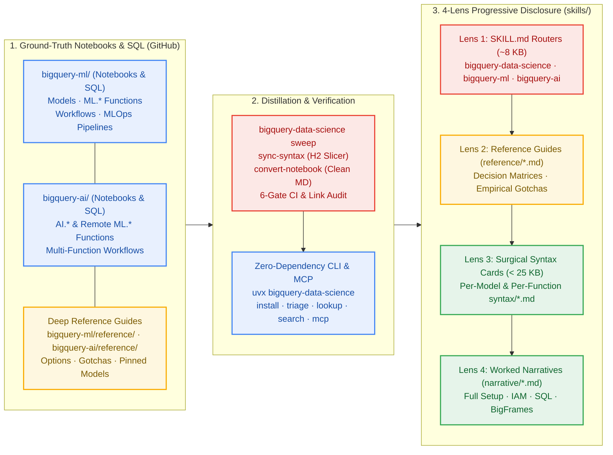

<!--- header table --->
<table>
<tr>     
  <td style="text-align: center">
    <a href="https://github.com/statmike/gcp-mlops/blob/main/agent-skills/README.md">
      
      <br>View on<br>GitHub
    </a>
  </td>
</tr>
<tr>
  <td style="text-align: right">
    <b>Share On: </b> 
    <a href="https://www.linkedin.com/sharing/share-offsite/?url=https://github.com/statmike/gcp-mlops/blob/main/agent-skills/README.md"></a> 
    <a href="https://reddit.com/submit?url=https://github.com/statmike/gcp-mlops/blob/main/agent-skills/README.md"></a> 
    <a href="https://bsky.app/intent/compose?text=https://github.com/statmike/gcp-mlops/blob/main/agent-skills/README.md"></a> 
    <a href="https://x.com/intent/post?url=https://github.com/statmike/gcp-mlops/blob/main/agent-skills/README.md"></a> 
  </td>
</tr>
<tr>
  <td style="text-align: right">
    <b>Connect With Author On: </b> 
    <a href="https://www.linkedin.com/in/statmike"></a>
    <a href="https://github.com/statmike"></a> 
    <a href="https://www.youtube.com/@statmike-channel"></a>
    <a href="https://bsky.app/profile/statmike.bsky.social"></a> 
    <a href="https://x.com/statmike"></a>
  </td>
</tr>
<tr>
  <td style="text-align: right">
    <a href="https://raw.githubusercontent.com/statmike/gcp-mlops/main/agent-skills/README.md"></a> <a href="https://raw.githubusercontent.com/statmike/gcp-mlops/main/agent-skills/README.md">Download File</a> <i>(right-click and "Save As")</i>
  </td>
</tr>
</table><br/><br/>

---
# Agent Skills for BigQuery ML & BigQuery AI (`bigquery-data-science`)
> You are here: `gcp-mlops/agent-skills/README.md` ([⬅ Back to Repository Front Door](../readme.md) · [Data + AI Hub](../data+ai/readme.md))

[](https://pypi.org/project/bigquery-data-science/)
[](https://github.com/statmike/bigquery-data-science)
[](https://github.com/statmike/bigquery-data-science/tree/main/bigquery-ml)
[](https://github.com/statmike/bigquery-data-science/tree/main/bigquery-ai)
[](https://github.com/statmike/bigquery-data-science/blob/main/skills/PLANS.md)

> [!IMPORTANT]
> **Graduated to a Standalone Repository & PyPI Package (`bigquery-data-science`):**
> The BigQuery Agent Skills (`bigquery-data-science`, `bigquery-ml`, `bigquery-ai`), their ground-truth notebooks, standalone SQL scripts, and verification CLI live in a dedicated public repository — **[`statmike/bigquery-data-science`](https://github.com/statmike/bigquery-data-science)** — and are published on PyPI as **[`bigquery-data-science`](https://pypi.org/project/bigquery-data-science/)**.
>
> Instead of copying files by hand, install the skills into any workspace or global agent profile with a single command (`uvx bigquery-data-science install` or `npx skills add statmike/bigquery-data-science`), query the catalog from your terminal, or attach the zero-dependency stdio MCP server.

---

## Why `bigquery-data-science` Exists: Ground Truth $\to$ 4 Progressive Lenses

General-purpose LLMs frequently hallucinate BigQuery SQL options, confuse the `ML.*` and `AI.*` namespaces, miss silent data-leakage traps, or waste context windows loading monolithic reference documents.

`bigquery-data-science` solves this by pairing **live-executed BigQuery notebooks and SQL scripts** with an automated distillation pipeline (`bigquery-data-science sweep`) that compiles verified SQL patterns and empirical gotchas into **4 progressive lenses**:



---

## Install & Use the Skills (`uvx`, `uv`, `pip`, `pipx`, `npx skills`, or MCP)

The core [`bigquery-data-science`](https://pypi.org/project/bigquery-data-science/) package on PyPI has **zero third-party runtime dependencies** (`< 1.5 MB` wheel) and installs all three skills (`bigquery-data-science`, `bigquery-ml`, `bigquery-ai`) into `.agents/skills/` and `.claude/skills/`:

```bash
# Option A — Zero-install ephemeral CLI via uvx (recommended for instant setup):
uvx bigquery-data-science install                     # installs into ./.agents/skills & ./.claude/skills
uvx bigquery-data-science install --global            # installs into ~/.agents/skills & ~/.claude/skills
uvx bigquery-data-science install --target agents     # only .agents/skills (Antigravity, Cursor, Codex, Windsurf)
uvx bigquery-data-science install --target claude     # only .claude/skills (Claude Code)

# Option B — Persistent CLI install via uv tool, pipx, or pip:
uv tool install bigquery-data-science && bigquery-data-science install
pipx install bigquery-data-science && bigquery-data-science install
pip install bigquery-data-science && bigquery-data-science install

# Option C — Add to an existing Python project (uv or pip):
uv add bigquery-data-science && uv run bigquery-data-science install
pip install bigquery-data-science && python3 -m bigquery_data_science.cli install

# Option D — skills.sh CLI (installs all 3 skills or an individual skill from GitHub):
npx skills add statmike/bigquery-data-science
npx skills add statmike/bigquery-data-science --skill bigquery-ml

# Option E — Claude Code plugin marketplace & stdio MCP server:
# In Claude Code: /plugin marketplace add statmike/bigquery-data-science
#                 /plugin install bigquery-data-science
claude mcp add bigquery-data-science -- uvx bigquery-data-science mcp
```

### Triage Tasks & Look Up Syntax from the Terminal

You can also query the bundled catalog directly from your terminal without launching an agent:

```bash
# 1. List bundled skills and lens counts:
uvx bigquery-data-science list

# 2. Triage an ambiguous BigQuery ML vs BigQuery AI task (empirical head-to-head comparisons):
uvx bigquery-data-science triage "forecast daily retail sales with holiday promotions"

# 3. Fetch the surgical syntax card (< 25 KB) for any model or function:
uvx bigquery-data-science lookup ARIMA_PLUS
uvx bigquery-data-science lookup AI.FORECAST
uvx bigquery-data-science lookup ML.ENTITY_FEATURES_AT_TIME

# 4. Search across all syntax cards, reference guides, and narratives:
uvx bigquery-data-science search "point-in-time feature leakage"
```

---

## The 3 Bundled Skills

| Skill | Canonical Role | What It Covers | GitHub Entry Point |
| :--- | :--- | :--- | :--- |
| **[`bigquery-data-science`](https://github.com/statmike/bigquery-data-science/blob/main/skills/bigquery-data-science/SKILL.md)** | **Umbrella Router & Namespace Decoder** (`Workflow` + `Reviewer`) | Routes between trained `CREATE MODEL` (`bigquery-ml`), zero-shot `AI.*`/`ML.*` (`bigquery-ai`), and hybrid pipelines; empirical head-to-head task comparisons; complete `ML.*` vs `AI.*` prerequisite matrix ([`namespace-matrix.md`](https://github.com/statmike/bigquery-data-science/blob/main/skills/bigquery-data-science/reference/namespace-matrix.md)). | [`skills/bigquery-data-science/SKILL.md`](https://github.com/statmike/bigquery-data-science/blob/main/skills/bigquery-data-science/SKILL.md) |
| **[`bigquery-ml`](https://github.com/statmike/bigquery-data-science/blob/main/skills/bigquery-ml/SKILL.md)** | **Trained Models, Preprocessing & Pipelines** (`Workflow` + `Generator` + `Tool Wrapper` + `Reviewer`) | Supervised, unsupervised, time-series, recommendation, and imported/remote `CREATE MODEL` types (`LINEAR_REG`, `BOOSTED_TREE_*`, `ARIMA_PLUS`, `ARIMA_PLUS_XREG`, `KMEANS`, `PCA`, `MATRIX_FACTORIZATION`, `DNN_*`, `AUTOML_*`, `CONTRIBUTION_ANALYSIS`), model-free `ML.*` preprocessing/drift/feature-time functions, causal & predictive SQL workflows, and production orchestration patterns. | [`skills/bigquery-ml/SKILL.md`](https://github.com/statmike/bigquery-data-science/blob/main/skills/bigquery-ml/SKILL.md) |
| **[`bigquery-ai`](https://github.com/statmike/bigquery-data-science/blob/main/skills/bigquery-ai/SKILL.md)** | **Foundation Models, Embeddings, Search & Document AI** (`Workflow` + `Generator` + `Tool Wrapper` + `Reviewer`) | SQL functions across `AI.GENERATE*`, `AI.IF`/`SCORE`/`CLASSIFY`/`AGG`, `AI.EMBED` + `VECTOR_SEARCH` + `AI.SEARCH`, `AI.FORECAST` + `AI.DETECT_ANOMALIES` (TimesFM), `AI.PREDICT` + `AI.EVALUATE` (TabFM), `AI.KEY_DRIVERS`, `AI.PARSE_DOCUMENT` + `ML.PROCESS_DOCUMENT`, and Cloud AI `ML.TRANSLATE`/`UNDERSTAND_TEXT`/`ANNOTATE_IMAGE`/`TRANSCRIBE`, plus composed multi-function workflows. | [`skills/bigquery-ai/SKILL.md`](https://github.com/statmike/bigquery-data-science/blob/main/skills/bigquery-ai/SKILL.md) |

---

## How the 4 Progressive Lenses Prevent Context Bloat

| Lens | Skill Path | Typical Size | When the Agent Loads It |
| :--- | :--- | :--- | :--- |
| **Lens 1 — Router & Guardrails** | [`skills/*/SKILL.md`](https://github.com/statmike/bigquery-data-science/tree/main/skills) | `~6–9 KB` | **Always first.** Task routing tree, critical SQL generation rules, cross-cutting empirical gotchas, and pre-delivery verification checklist. |
| **Lens 2 — Decision & Gotcha Guide** | `skills/*/reference/*.md` | `~15–45 KB` | **When comparing options within a family** (e.g., choosing among forecasting models, orchestration engines, or `AI.IF` vs `AI.CLASSIFY` vs `AI.GENERATE_TABLE`). |
| **Lens 3 — Surgical Syntax Card** | `skills/*/syntax/*.md` ([`ML Index`](https://github.com/statmike/bigquery-data-science/blob/main/skills/bigquery-ml/syntax/INDEX.md) · [`AI Index`](https://github.com/statmike/bigquery-data-science/blob/main/skills/bigquery-ai/syntax/INDEX.md)) | `4–15 KB` (`< 25 KB` enforced) | **When writing SQL for a specific model or function.** Sliced automatically by H2 (`## `) from `reference/*.md` so agents never load a monolithic reference file. |
| **Lens 4 — Worked Textbook Narrative** | `skills/*/narrative/*.md` | `~15–30 KB` | **Only when building a full end-to-end pipeline** (including GCP IAM, Cloud Resource Connections, reservations, and multi-step SQL / BigFrames choreography). Never loads raw `.ipynb` JSON. |

---

## Explore the Source Notebooks & Reference Hubs

- **Standalone Repository Front Door:** **[`statmike/bigquery-data-science`](https://github.com/statmike/bigquery-data-science)**
- **PyPI Package:** **[`pypi.org/project/bigquery-data-science`](https://pypi.org/project/bigquery-data-science/)**
- **Skill Authoring & Verification Standard:** **[`skills/PLANS.md`](https://github.com/statmike/bigquery-data-science/blob/main/skills/PLANS.md)**
- **BigQuery ML Signpost & Hub:** **[`../data+ai/bq-ml/README.md`](../data+ai/bq-ml/README.md)** · **[`statmike/bigquery-data-science/bigquery-ml`](https://github.com/statmike/bigquery-data-science/tree/main/bigquery-ml)**
- **BigQuery AI Signpost & Hub:** **[`../data+ai/bq-ai-functions/README.md`](../data+ai/bq-ai-functions/README.md)** · **[`statmike/bigquery-data-science/bigquery-ai`](https://github.com/statmike/bigquery-data-science/tree/main/bigquery-ai)**
