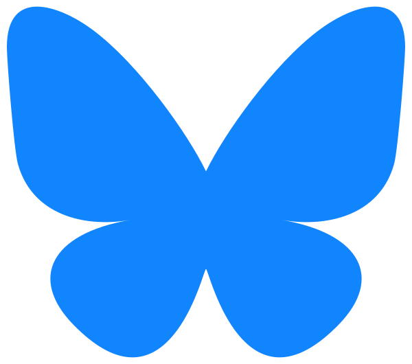

<!--- header table --->
<table>
<tr>     
  <td style="text-align: center">
    <a href="https://github.com/statmike/gcp-mlops/blob/main/architectures/headers/icons/readme.md">
      
       View on GitHub
    </a>
  </td>
</tr>
<tr>
  <td style="text-align: right">
    <b>Share On: </b> 
     
     
     
     
  </td>
</tr>
<tr>
  <td style="text-align: right">
    <b>Connect With Author On: </b> 
    
     
    
     
    
  </td>
</tr>
<tr>
  <td style="text-align: right">
     <a href="https://raw.githubusercontent.com/statmike/gcp-mlops/main/architectures/headers/icons/readme.md">Download File</a> <i>(right-click and "Save As")</i>
  </td>
</tr>
</table>  

---
# Repository Header Icons & Brand Attribution

This folder stores the 11 icon assets referenced by [`add_headers.ipynb`](../add_headers.ipynb) and [`sync_headers.py`](../sync_headers.py) across the notebooks and markdown documents in `statmike/gcp-mlops`.

Hosting these assets directly in the repository (served via `https://raw.githubusercontent.com/statmike/gcp-mlops/main/architectures/headers/icons/<file>`) ensures that:
1. Icons render reliably whether a notebook is viewed on GitHub, opened as a standalone file in Colab / Colab Enterprise / BigQuery Studio / Vertex AI Workbench, or used in a cloned repository.
2. Header rendering never breaks due to third-party hotlink rate-limiting (such as `HTTP 429` responses) or external URL reorganizations.

---

## Icon Inventory & Attribution

All product, service, and social media logos remain the trademarks and intellectual property of their respective owners. They are included here strictly for nominative navigation ("Open in...", "Share on...", and "Connect on..." links).

| Preview | Local File | Service / Action | Brand / Owner | Original Source & License Note |
| :---: | :--- | :--- | :--- | :--- |
|  | [`bigquery.svg`](./bigquery.svg) | Open in BigQuery Studio | Google LLC | [Google Cloud Official Icons (`gstatic.com`)](https://www.gstatic.com/images/branding/gcpiconscolors/bigquery/v1/32px.svg) — Google Cloud brand asset |
|  | [`colab.svg`](./colab.svg) | Run in Google Colab | Google LLC | [Google Colaboratory Icon (`gstatic.com`)](https://www.gstatic.com/pantheon/images/bigquery/welcome_page/colab-logo.svg) — Google brand asset |
|  | [`ecolab.png`](./ecolab.png) | Run in Colab Enterprise | Google LLC | [Google Cloud Colab Enterprise Icon (`googleusercontent.com`)](https://lh3.googleusercontent.com/JmcxdQi-qOpctIvWKgPtrzZdJJK-J3sWE1RsfjZNwshCFgE_9fULcNpuXYTilIR2hjwN) — Google Cloud brand asset |
|  | [`vertex.svg`](./vertex.svg) | Open in Vertex AI Workbench | Google LLC | [Google Cloud Official Icons (`gstatic.com`)](https://www.gstatic.com/images/branding/gcpiconscolors/vertexai/v1/32px.svg) — Google Cloud brand asset |
|  | [`github.svg`](./github.svg) | View on GitHub / Author Profile | GitHub, Inc. | [GitHub Mark (`svgrepo.com/show/217753/github.svg`)](https://www.svgrepo.com/svg/217753/github) — GitHub brand asset |
|  | [`linkedin.svg`](./linkedin.svg) | Share / Connect on LinkedIn | LinkedIn Corporation | [Wikimedia Commons (`LinkedIn_icon.svg`)](https://commons.wikimedia.org/wiki/File:LinkedIn_icon.svg) — Public domain / trademarked brand icon |
|  | [`reddit.png`](./reddit.png) | Share on Reddit | Reddit, Inc. | [Reddit Brand Asset (`Reddit_Logo.png`)](https://redditinc.com/hubfs/Reddit%20Inc/Brand/Reddit_Logo.png) — Reddit brand asset |
|  | [`bluesky.svg`](./bluesky.svg) | Share / Connect on Bluesky | Bluesky Social, PBC | [Wikimedia Commons (`Bluesky_Logo.svg`)](https://commons.wikimedia.org/wiki/File:Bluesky_Logo.svg) — CC BY-SA 4.0 / Bluesky brand icon |
|  | [`x.svg`](./x.svg) | Share / Connect on X (Twitter) | X Corp. | [Wikimedia Commons (`X_icon_2.svg`)](https://commons.wikimedia.org/wiki/File:X_icon_2.svg) — Public domain / trademarked brand icon |
|  | [`youtube.svg`](./youtube.svg) | Connect on YouTube | Google LLC | [Wikimedia Commons (`YouTube_full-color_icon_(2024).svg`)](https://commons.wikimedia.org/wiki/File:YouTube_full-color_icon_(2024).svg) — Public domain / trademarked brand icon |
|  | [`download.svg`](./download.svg) | Download Notebook / File | SVG Repo | [Download Button Icon (`svgrepo.com/show/5445/download-button.svg`)](https://www.svgrepo.com/svg/5445/download-button) — CC0 1.0 Public Domain |
