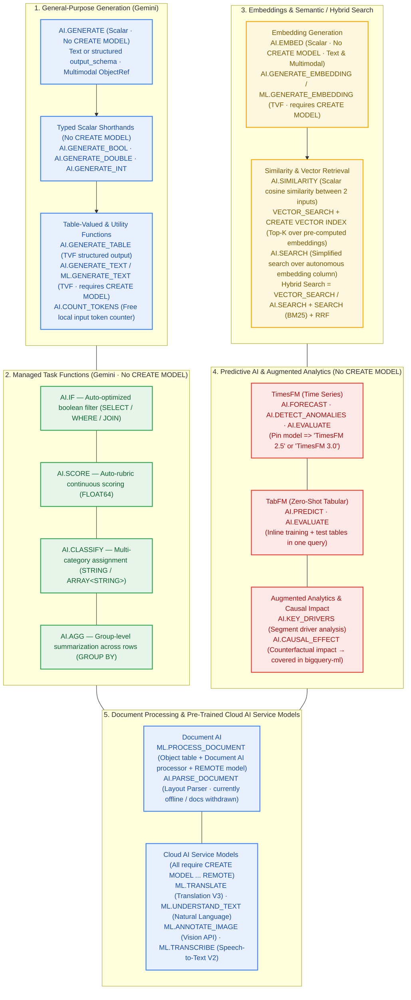

<!--- header table --->
<table>
<tr>     
  <td style="text-align: center">
    <a href="https://github.com/statmike/gcp-mlops/blob/main/data%2Bai/bq-ai-functions/README.md">
      
      <br>View on<br>GitHub
    </a>
  </td>
</tr>
<tr>
  <td style="text-align: right">
    <b>Share On: </b> 
    <a href="https://www.linkedin.com/sharing/share-offsite/?url=https://github.com/statmike/gcp-mlops/blob/main/data%252Bai/bq-ai-functions/README.md"></a> 
    <a href="https://reddit.com/submit?url=https://github.com/statmike/gcp-mlops/blob/main/data%252Bai/bq-ai-functions/README.md"></a> 
    <a href="https://bsky.app/intent/compose?text=https://github.com/statmike/gcp-mlops/blob/main/data%252Bai/bq-ai-functions/README.md"></a> 
    <a href="https://x.com/intent/post?url=https://github.com/statmike/gcp-mlops/blob/main/data%252Bai/bq-ai-functions/README.md"></a> 
  </td>
</tr>
<tr>
  <td style="text-align: right">
    <b>Connect With Author On: </b> 
    <a href="https://www.linkedin.com/in/statmike"></a>
    <a href="https://github.com/statmike"></a> 
    <a href="https://www.youtube.com/@statmike-channel"></a>
    <a href="https://bsky.app/profile/statmike.bsky.social"></a> 
    <a href="https://x.com/statmike"></a>
  </td>
</tr>
<tr>
  <td style="text-align: right">
    <a href="https://raw.githubusercontent.com/statmike/gcp-mlops/main/data%2Bai/bq-ai-functions/README.md"></a> <a href="https://raw.githubusercontent.com/statmike/gcp-mlops/main/data%2Bai/bq-ai-functions/README.md">Download File</a> <i>(right-click and "Save As")</i>
  </td>
</tr>
</table><br/><br/>

---
# BigQuery AI (`bigquery-ai`)
> You are here: `gcp-mlops/data+ai/bq-ai-functions/README.md` ([⬅ Back to Data + AI](../readme.md) · [Repository Front Door](../../readme.md) · [Agent Skills](../../agent-skills/README.md))

[](https://pypi.org/project/bigquery-data-science/)
[](https://github.com/statmike/bigquery-data-science/tree/main/bigquery-ai)
[-8E24AA?style=for-the-badge)](https://github.com/statmike/bigquery-data-science/blob/main/skills/bigquery-ai/SKILL.md)
[](../bq-ml/README.md)

> [!IMPORTANT]
> **Dedicated Repository & PyPI Package (`statmike/bigquery-data-science`):**
> The complete **BigQuery AI** notebook curriculum, standalone `.sql` scripts, deep reference guides, and **4-Lens `bigquery-ai` Agent Skill** live in **[`statmike/bigquery-data-science/bigquery-ai`](https://github.com/statmike/bigquery-data-science/tree/main/bigquery-ai)** and ship on PyPI as **[`bigquery-data-science`](https://pypi.org/project/bigquery-data-science/)**.
>
> Call Gemini, generate embeddings, run semantic and hybrid search, forecast with TimesFM, predict on tabular data with TabFM, and process multimodal documents directly in BigQuery SQL (`AI.*` and remote `ML.*` functions) — with no ML training infrastructure to manage.

---

## How BigQuery AI Functions Relate



---

## Navigate the BigQuery AI Hub (`statmike/bigquery-data-science/bigquery-ai`)

| Category / Folder | What It Covers | Direct Entry Points in `statmike/bigquery-data-science` |
| :--- | :--- | :--- |
| **Start Here & Reference Guides** | Interactive tour of BigQuery AI, connections/models/permissions setup, synthetic PDF generator (`data/documents/`), and the complete `AI.*` + remote `ML.*` reference index. | [**`bigquery-ai/README.md`**](https://github.com/statmike/bigquery-data-science/blob/main/bigquery-ai/README.md) · [`overview.ipynb`](https://github.com/statmike/bigquery-data-science/blob/main/bigquery-ai/overview.ipynb) · [`RESOURCES.md`](https://github.com/statmike/bigquery-data-science/blob/main/bigquery-ai/RESOURCES.md) · [`setup/`](https://github.com/statmike/bigquery-data-science/tree/main/bigquery-ai/setup) · [`reference/`](https://github.com/statmike/bigquery-data-science/tree/main/bigquery-ai/reference) |
| **1. General-Purpose Generation (`functions/`)** | Free-form text, structured schemas (`output_schema`), multimodal `ObjectRef` inputs, and free local token counting: `AI.GENERATE`, `AI.GENERATE_TABLE`, `AI.GENERATE_TEXT`, `ML.GENERATE_TEXT`, `AI.GENERATE_BOOL`, `AI.GENERATE_DOUBLE`, `AI.GENERATE_INT`, and `AI.COUNT_TOKENS`. | [**`bigquery-ai/functions/`**](https://github.com/statmike/bigquery-data-science/tree/main/bigquery-ai/functions) · [`reference/general-purpose-functions.md`](https://github.com/statmike/bigquery-data-science/blob/main/bigquery-ai/reference/general-purpose-functions.md) |
| **2. Managed Task Functions (`functions/`)** | Simplified, prompt-optimized Gemini functions that require no `CREATE MODEL`: `AI.IF` (boolean filter in `SELECT`/`WHERE`/`JOIN`), `AI.SCORE` (auto-rubric `FLOAT64`), `AI.CLASSIFY` (single or multi-label categories), and `AI.AGG` (group-level summarization across rows). | [**`bigquery-ai/functions/`**](https://github.com/statmike/bigquery-data-science/tree/main/bigquery-ai/functions) · [`reference/managed-functions.md`](https://github.com/statmike/bigquery-data-science/blob/main/bigquery-ai/reference/managed-functions.md) |
| **3. Embeddings, Vector Search & Hybrid Search (`functions/`)** | Text & multimodal embeddings (`AI.EMBED`, `AI.GENERATE_EMBEDDING`, `ML.GENERATE_EMBEDDING`), pairwise cosine similarity (`AI.SIMILARITY`), indexed nearest-neighbor search (`VECTOR_SEARCH` + `CREATE VECTOR INDEX`), autonomous search (`AI.SEARCH`), and **Hybrid Search** (semantic + BM25 lexical + Reciprocal Rank Fusion reach math). | [**`bigquery-ai/functions/`**](https://github.com/statmike/bigquery-data-science/tree/main/bigquery-ai/functions) · [`reference/embedding-generation-and-semantic-search.md`](https://github.com/statmike/bigquery-data-science/blob/main/bigquery-ai/reference/embedding-generation-and-semantic-search.md) |
| **4. Predictive AI & Augmented Analytics (`functions/`)** | Zero-training foundation models in SQL: **TimesFM** (`AI.FORECAST`, `AI.DETECT_ANOMALIES`, `AI.EVALUATE` across `TimesFM 2.5` and `TimesFM 3.0`), **TabFM** (`AI.PREDICT`, `AI.EVALUATE` for inline zero-shot tabular regression/classification), segment driver discovery (`AI.KEY_DRIVERS`), and counterfactual impact (`AI.CAUSAL_EFFECT`). | [**`bigquery-ai/functions/`**](https://github.com/statmike/bigquery-data-science/tree/main/bigquery-ai/functions) · [`reference/predictive-ai.md`](https://github.com/statmike/bigquery-data-science/blob/main/bigquery-ai/reference/predictive-ai.md) · [`reference/augmented-analytics.md`](https://github.com/statmike/bigquery-data-science/blob/main/bigquery-ai/reference/augmented-analytics.md) |
| **5. Document Processing & Cloud AI Service Models (`functions/`)** | Object tables (`OBJ.MAKE_REF`, `ObjectRef`), Document AI (`ML.PROCESS_DOCUMENT`, `AI.PARSE_DOCUMENT`), and versioned Cloud AI APIs (`ML.TRANSLATE`, `ML.UNDERSTAND_TEXT`, `ML.ANNOTATE_IMAGE`, `ML.TRANSCRIBE`). | [**`bigquery-ai/functions/`**](https://github.com/statmike/bigquery-data-science/tree/main/bigquery-ai/functions) · [`reference/document-processing.md`](https://github.com/statmike/bigquery-data-science/blob/main/bigquery-ai/reference/document-processing.md) · [`reference/cloud-ai-service-models.md`](https://github.com/statmike/bigquery-data-science/blob/main/bigquery-ai/reference/cloud-ai-service-models.md) · [`reference/unstructured-data-infrastructure.md`](https://github.com/statmike/bigquery-data-science/blob/main/bigquery-ai/reference/unstructured-data-infrastructure.md) |
| **[`workflows/`](https://github.com/statmike/bigquery-data-science/tree/main/bigquery-ai/workflows)**<br/>*End-to-End Composed Multi-Function Workflows* | Complete pipelines composing multiple `AI.*` and `ML.*` functions: Web-Grounded Data Enrichment + TabFM, Content Analysis & Moderation, Semantic Search (3 ways), Hybrid Product Catalog Search (RRF analysis), RAG Pipeline, Document RAG & Intelligence, Time Series Intelligence, Zero-Shot Tabular Prediction, Metric Diagnostics (with placebo causal checks), Log Triage, Multimodal Analysis, and Image Deduplication. | [**`bigquery-ai/workflows/`**](https://github.com/statmike/bigquery-data-science/tree/main/bigquery-ai/workflows) · [`skills/bigquery-ai/reference/workflows.md`](https://github.com/statmike/bigquery-data-science/blob/main/skills/bigquery-ai/reference/workflows.md) |
| **[`skills/bigquery-ai/`](https://github.com/statmike/bigquery-data-science/tree/main/skills/bigquery-ai)**<br/>*4-Lens Agent Skill* | Decision trees, empirically verified gotchas, surgical `< 25 KB` per-function syntax cards ([`syntax/INDEX.md`](https://github.com/statmike/bigquery-data-science/blob/main/skills/bigquery-ai/syntax/INDEX.md)), and clean markdown textbook narratives (`narrative/*.md`). | [**`skills/bigquery-ai/SKILL.md`**](https://github.com/statmike/bigquery-data-science/blob/main/skills/bigquery-ai/SKILL.md) · [`syntax/INDEX.md`](https://github.com/statmike/bigquery-data-science/blob/main/skills/bigquery-ai/syntax/INDEX.md) · [`skills/bigquery-data-science/SKILL.md`](https://github.com/statmike/bigquery-data-science/blob/main/skills/bigquery-data-science/SKILL.md) |

---

## Quickstart — Skills, CLI, MCP & Notebooks

```bash
# 1. Install the 4-Lens Agent Skills (bigquery-data-science, bigquery-ml, bigquery-ai):
uvx bigquery-data-science install                     # into ./.agents/skills & ./.claude/skills
uvx bigquery-data-science install --global            # into ~/.agents/skills & ~/.claude/skills
npx skills add statmike/bigquery-data-science         # via skills.sh CLI
pip install bigquery-data-science && bigquery-data-science install

# 2. Triage tasks & look up exact BigQuery AI syntax from the terminal:
uvx bigquery-data-science triage "extract structured fields from PDF invoices"
uvx bigquery-data-science lookup AI.GENERATE_TABLE
uvx bigquery-data-science lookup AI.FORECAST
uvx bigquery-data-science search "hybrid search reciprocal rank fusion"

# 3. Attach the zero-dependency stdio MCP server to Claude Code:
claude mcp add bigquery-data-science -- uvx bigquery-data-science mcp

# 4. Clone & run the BigQuery AI notebooks locally:
git clone https://github.com/statmike/bigquery-data-science.git
cd bigquery-data-science
uv sync --extra all && uv run bigquery-data-science kernel --user
```
