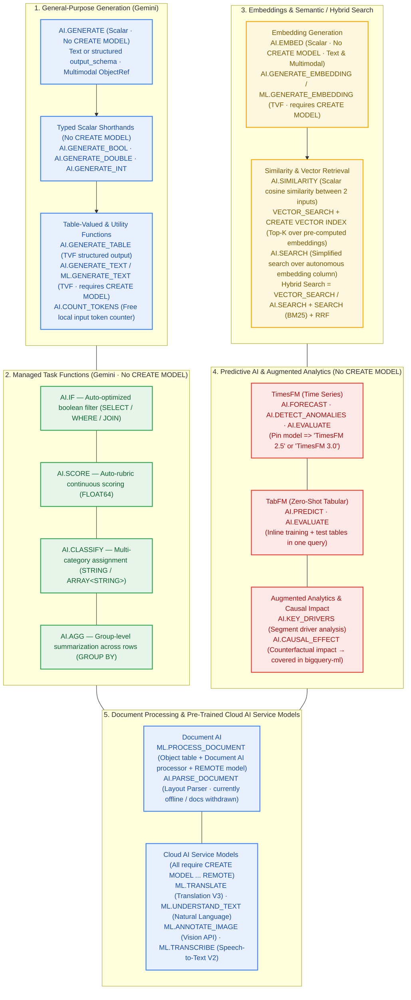

<!--- header table --->
<table>
<tr>     
  <td style="text-align: center">
    <a href="https://github.com/statmike/gcp-mlops/blob/main/data%2Bai/bq-ai-functions/README.md">
      
      <br>View on<br>GitHub
    </a>
  </td>
</tr>
<tr>
  <td style="text-align: right">
    <b>Share On: </b> 
    <a href="https://www.linkedin.com/sharing/share-offsite/?url=https://github.com/statmike/gcp-mlops/blob/main/data%252Bai/bq-ai-functions/README.md"></a> 
    <a href="https://reddit.com/submit?url=https://github.com/statmike/gcp-mlops/blob/main/data%252Bai/bq-ai-functions/README.md"></a> 
    <a href="https://bsky.app/intent/compose?text=https://github.com/statmike/gcp-mlops/blob/main/data%252Bai/bq-ai-functions/README.md"></a> 
    <a href="https://x.com/intent/post?url=https://github.com/statmike/gcp-mlops/blob/main/data%252Bai/bq-ai-functions/README.md"></a> 
  </td>
</tr>
<tr>
  <td style="text-align: right">
    <b>Connect With Author On: </b> 
    <a href="https://www.linkedin.com/in/statmike"></a>
    <a href="https://github.com/statmike"></a> 
    <a href="https://www.youtube.com/@statmike-channel"></a>
    <a href="https://bsky.app/profile/statmike.bsky.social"></a> 
    <a href="https://x.com/statmike"></a>
  </td>
</tr>
<tr>
  <td style="text-align: right">
    <a href="https://raw.githubusercontent.com/statmike/gcp-mlops/main/data%2Bai/bq-ai-functions/README.md"></a> <a href="https://raw.githubusercontent.com/statmike/gcp-mlops/main/data%2Bai/bq-ai-functions/README.md">Download File</a> <i>(right-click and "Save As")</i>
  </td>
</tr>
</table><br/><br/>

---
# BigQuery AI (`bigquery-ai`)
> You are here: `gcp-mlops/data+ai/bq-ai-functions/README.md` ([⬅ Back to Data + AI](../readme.md) · [Repository Front Door](../../readme.md) · [Agent Skills](../../agent-skills/README.md))

[](https://pypi.org/project/bigquery-data-science/)
[](https://github.com/statmike/bigquery-data-science/tree/main/bigquery-ai)
[-8E24AA?style=for-the-badge)](https://github.com/statmike/bigquery-data-science/blob/main/skills/bigquery-ai/SKILL.md)
[](../bq-ml/README.md)

> [!IMPORTANT]
> **Dedicated Repository & PyPI Package (`statmike/bigquery-data-science`):**
> All **43 BigQuery AI notebooks**, **29 standalone SQL scripts**, **8 deep reference guides**, and the **4-Lens `bigquery-ai` Agent Skill** now live in **[`statmike/bigquery-data-science/bigquery-ai`](https://github.com/statmike/bigquery-data-science/tree/main/bigquery-ai)** and ship on PyPI as **[`bigquery-data-science`](https://pypi.org/project/bigquery-data-science/)**.
>
> This page serves as the full catalog and architecture signpost inside `statmike/gcp-mlops` — every function, workflow, notebook, `.sql` script, and reference link below opens directly in `statmike/bigquery-data-science`.

### Quickstart — Skills, CLI, MCP & Notebooks

```bash
# 1. Install the 4-Lens Agent Skills (bigquery-data-science, bigquery-ml, bigquery-ai):
uvx bigquery-data-science install                     # into ./.agents/skills & ./.claude/skills
uvx bigquery-data-science install --global            # into ~/.agents/skills & ~/.claude/skills
npx skills add statmike/bigquery-data-science         # via skills.sh CLI
pip install bigquery-data-science && bigquery-data-science install

# 2. Triage tasks & look up exact BigQuery AI syntax from the terminal:
uvx bigquery-data-science triage "extract structured fields from PDF invoices"
uvx bigquery-data-science lookup AI.GENERATE_TABLE
uvx bigquery-data-science lookup AI.FORECAST
uvx bigquery-data-science search "hybrid search reciprocal rank fusion"

# 3. Clone & run the 43 BigQuery AI notebooks locally:
git clone https://github.com/statmike/bigquery-data-science.git
cd bigquery-data-science
uv sync --extra all && uv run bigquery-data-science kernel --user
```

---

Use generative AI, embeddings, semantic and hybrid search, forecasting, anomaly detection, and tabular prediction directly in BigQuery SQL — no ML infrastructure to manage.

This project provides a progressive learning system: start with a quick overview of all available functions, drill into individual functions with hands-on examples (SQL, `%%bigquery` magics, and BigFrames), then compose functions together in end-to-end workflows.

## Start Here

| Resource | Description |
|----------|-------------|
| [Interactive Overview](https://github.com/statmike/bigquery-data-science/blob/main/bigquery-ai/overview.ipynb) | Runnable notebook tour — one example per category |
| [Setup Reference](https://github.com/statmike/bigquery-data-science/tree/main/bigquery-ai/setup) | Connections, models, endpoints, quotas, and permissions |
| [Detailed Function Reference](https://github.com/statmike/bigquery-data-science/blob/main/bigquery-ai/RESOURCES.md) | Index to the deep reference — complete syntax, inputs, outputs, and limitations for every function, one page per category under [`reference/`](https://github.com/statmike/bigquery-data-science/tree/main/bigquery-ai/reference) |
| [Agent Skill](https://github.com/statmike/bigquery-data-science/blob/main/skills/bigquery-ai/SKILL.md) | Packaged, use-case-organized reference for AI coding agents — see below |

### Using this project with an AI coding agent

This project's Agent Skill content lives centrally in [`skills/`](https://github.com/statmike/bigquery-data-science/tree/main/skills) at the repo root (alongside every other skill built from this repo), not inside this folder — see the [`bigquery-ai` skill](https://github.com/statmike/bigquery-data-science/blob/main/skills/bigquery-ai/SKILL.md), a use-case-organized (generation, classification/scoring, embeddings/search, predictive AI, driver analysis, document processing, workflows), gotcha-rich distillation of `RESOURCES.md` built for coding agents, not just human readers.

- **Claude Code** — picked up automatically from `.claude/skills/bigquery-ai` (a repo-root symlink into `skills/`) anywhere in this repo; no setup needed. It activates automatically when your request matches — generating/classifying/scoring content, embeddings and semantic or hybrid search, zero-training forecasting and tabular prediction, document processing — or invoke it explicitly.
- **Google Antigravity, Codex, and other `.agents/skills/`-compatible tools** — discovered from the repo-root `.agents/skills/bigquery-ai/` symlink, using the same `SKILL.md` files.
- **Standalone / other repos** — the whole `skills/bigquery-ai/` folder is self-contained and can be copied into any other project.

Not sure whether BigQuery AI Functions or [BigQuery ML](https://github.com/statmike/bigquery-data-science/tree/main/bigquery-ml) fits your task? The [`bigquery-data-science`](https://github.com/statmike/bigquery-data-science/blob/main/skills/bigquery-data-science/SKILL.md) skill triages between the two.

---

## Workflows

Workflows compose multiple AI functions together for end-to-end scenarios. See [workflows/](https://github.com/statmike/bigquery-data-science/tree/main/bigquery-ai/workflows) for the full list.

| Workflow | Functions Used | Description |
|----------|---------------|-------------|
| [Data Enrichment](https://github.com/statmike/bigquery-data-science/tree/main/bigquery-ai/workflows/data_enrichment) | AI.GENERATE (Google Search grounding + output_schema), AI.PREDICT | Fix misspellings and correct errors using grounded web lookups, then fill a missing structured attribute with TabFM |
| [Content Analysis Pipeline](https://github.com/statmike/bigquery-data-science/tree/main/bigquery-ai/workflows/content_analysis) | AI.GENERATE_TABLE, AI.CLASSIFY, AI.SCORE, AI.GENERATE, AI.AGG | Generate sample data, classify it, score it, and summarize findings |
| [Semantic Search System](https://github.com/statmike/bigquery-data-science/tree/main/bigquery-ai/workflows/semantic_search) | AI.EMBED, VECTOR_SEARCH, AI.SEARCH | Build and query a semantic search index, three ways: manual, simplified, and hybrid |
| [Catalog Search](https://github.com/statmike/bigquery-data-science/tree/main/bigquery-ai/workflows/catalog_search) | AI.EMBED, VECTOR_SEARCH, AI.SEARCH | Hybrid retrieval over a real product catalog: what rank fusion does and does not buy you for exact-token lookups, with a corpus large enough to actually populate a vector index |
| [RAG Pipeline](https://github.com/statmike/bigquery-data-science/tree/main/bigquery-ai/workflows/rag_pipeline) | AI.GENERATE_TABLE, AI.EMBED, VECTOR_SEARCH, AI.GENERATE | Generate a knowledge base, embed, search, answer questions |
| [Document RAG](https://github.com/statmike/bigquery-data-science/tree/main/bigquery-ai/workflows/document_rag) ⚠️ | AI.PARSE_DOCUMENT, AI.EMBED, VECTOR_SEARCH, AI.GENERATE | Parse real documents, embed chunks, search, answer questions with grounded context. **⚠️ Blocked — depends on AI.PARSE_DOCUMENT, offline since 2026-06-01 and now with its reference docs withdrawn. Committed outputs are a pre-withdrawal record; do not re-run.** |
| [Time Series Intelligence](https://github.com/statmike/bigquery-data-science/tree/main/bigquery-ai/workflows/time_series_intelligence) | AI.FORECAST, AI.DETECT_ANOMALIES, AI.EVALUATE, AI.KEY_DRIVERS | Forecast, detect anomalies, evaluate accuracy, explain changes by segment |
| [Zero-Shot Tabular Prediction](https://github.com/statmike/bigquery-data-science/tree/main/bigquery-ai/workflows/tabular_prediction) | AI.PREDICT, AI.EVALUATE, AI.KEY_DRIVERS, AI.GENERATE | Zero-shot regression and classification with TabFM, scored and explained — no model training |
| [Metric Diagnostics](https://github.com/statmike/bigquery-data-science/tree/main/bigquery-ai/workflows/metric_diagnostics) | AI.KEY_DRIVERS, AI.PREDICT, AI.CAUSAL_EFFECT, AI.GENERATE | Explain why a metric moved between two periods, project it forward, then narrate the drivers in plain language — and stop short of calling any of it causal. A placebo test with `AI.CAUSAL_EFFECT` at six dates where nothing happened returns a significant result at one of them, which is why the diagnostic steps stay descriptive |
| [Document Intelligence](https://github.com/statmike/bigquery-data-science/tree/main/bigquery-ai/workflows/document_intelligence) | AI.CLASSIFY, AI.GENERATE, AI.SCORE, AI.AGG | Classify mixed documents, extract key fields, score quality, summarize findings |
| [Content Moderation](https://github.com/statmike/bigquery-data-science/tree/main/bigquery-ai/workflows/content_moderation) | AI.GENERATE_TABLE, AI.IF, AI.CLASSIFY, AI.SCORE, AI.GENERATE, AI.AGG | Flag, categorize, and score user-generated content for moderation |
| [Multimodal Analysis](https://github.com/statmike/bigquery-data-science/tree/main/bigquery-ai/workflows/multimodal_analysis) | AI.EMBED, AI.SIMILARITY, AI.GENERATE | Embed document images, find similar documents, generate visual descriptions |
| [Log Analysis](https://github.com/statmike/bigquery-data-science/tree/main/bigquery-ai/workflows/log_analysis) | AI.GENERATE_TABLE, AI.CLASSIFY, AI.SCORE, AI.AGG, AI.EMBED, VECTOR_SEARCH | Classify tickets, score priority, summarize patterns with AI.AGG, then retrieve by error code with hybrid search — and measure how far up the ranking a lexical hit can actually lift a row |
| [Image Deduplication](https://github.com/statmike/bigquery-data-science/tree/main/bigquery-ai/workflows/image_deduplication) | AI.EMBED, VECTOR_SEARCH | Group near-duplicate images using embedding similarity for train/test split integrity |

---

## Function Map

Every function has two example files:
- **notebook** (`.ipynb`) — SQL, `%%bigquery` magics, and BigFrames examples in one runnable file
- **sql** (`.sql`) — standalone queries runnable directly in the BigQuery console

### Multimodal Input — Documents, Images, Audio, Video

Functions marked in the **Multimodal** column below can process files from Cloud Storage alongside text. They all take the same thing — an **`ObjectRef`** — and there are two ways to get one:

- **Inline** — `OBJ.MAKE_REF('gs://bucket/file.pdf', 'project.region.connection')`. No table needed.
- **Object tables** — External tables over Cloud Storage objects whose `ref` column already *is* an `ObjectRef`. Best for processing many files at scale, and the only input for `ML.PROCESS_DOCUMENT`.

The **Multimodal** column says where the reference goes in the call, not how you built it:

| Multimodal Label | How It Works |
|------------------|--------------|
| STRUCT prompt | Replace the STRING prompt with `STRUCT(text AS prompt, [refs] AS object_refs)` |
| Tuple | Pass `('scoring text', ref)` as a single tuple argument |
| Direct | Pass the reference as an ordinary argument: `AI.CLASSIFY(ref, categories)`, or `AI.AGG(STRUCT(ref), instruction)` in a one-field STRUCT |
| Content param | Pass the reference as the content argument of an embedding or similarity function |
| Object table | The function reads object table rows directly |
| — | Text/numeric only — no unstructured data input |

> **You do not need `OBJ.GET_ACCESS_URL`.** Every function labelled with one of the first five rows above accepts the `ObjectRef` itself; wrapping it in a signed `ObjectRefRuntime` is still accepted but no longer required by any of them. Reach for `OBJ.GET_ACCESS_URL` when something *other* than the AI call needs a fetchable URL — writing a transformation output back to Cloud Storage, delegated access, an explicit TTL — or for `OBJ.GET_READ_URL` to display an object in query results.

See the [Unstructured Data Infrastructure](https://github.com/statmike/bigquery-data-science/blob/main/bigquery-ai/reference/unstructured-data-infrastructure.md) section in the Detailed Function Reference for the `OBJ.*` functions, object table syntax, and schema details.

### Generation — Send prompts to GenAI models, get text or structured output

| Function | Examples | Type | Status | Requires Model | Multimodal | What It Does |
|----------|----------|------|--------|----------------|------------|--------------|
| `AI.GENERATE` | [notebook](https://github.com/statmike/bigquery-data-science/blob/main/bigquery-ai/functions/ai_generate/ai_generate.ipynb) · [sql](https://github.com/statmike/bigquery-data-science/blob/main/bigquery-ai/functions/ai_generate/ai_generate.sql) | Scalar | GA | No | STRUCT prompt | Generate text or structured output from any Gemini model. Default: `gemini-3.5-flash-lite`. |
| `AI.GENERATE_TEXT` | [notebook](https://github.com/statmike/bigquery-data-science/blob/main/bigquery-ai/functions/ai_generate_text/ai_generate_text.ipynb) · [sql](https://github.com/statmike/bigquery-data-science/blob/main/bigquery-ai/functions/ai_generate_text/ai_generate_text.sql) | TVF | GA | Yes | STRUCT prompt | Generate text using Gemini, Claude, Llama, Mistral, or open models via a remote model. |
| `AI.GENERATE_TABLE` | [notebook](https://github.com/statmike/bigquery-data-science/blob/main/bigquery-ai/functions/ai_generate_table/ai_generate_table.ipynb) · [sql](https://github.com/statmike/bigquery-data-science/blob/main/bigquery-ai/functions/ai_generate_table/ai_generate_table.sql) | TVF | GA | Yes | STRUCT prompt | Generate structured output columns from a user-defined schema. Gemini only. |
| `AI.GENERATE_BOOL` | [notebook](https://github.com/statmike/bigquery-data-science/blob/main/bigquery-ai/functions/ai_generate_bool/ai_generate_bool.ipynb) · [sql](https://github.com/statmike/bigquery-data-science/blob/main/bigquery-ai/functions/ai_generate_bool/ai_generate_bool.sql) | Scalar | Preview | No | STRUCT prompt | Return a BOOL per row from a Gemini prompt. |
| `AI.GENERATE_DOUBLE` | [notebook](https://github.com/statmike/bigquery-data-science/blob/main/bigquery-ai/functions/ai_generate_double/ai_generate_double.ipynb) · [sql](https://github.com/statmike/bigquery-data-science/blob/main/bigquery-ai/functions/ai_generate_double/ai_generate_double.sql) | Scalar | Preview | No | STRUCT prompt | Return a FLOAT64 per row from a Gemini prompt. |
| `AI.GENERATE_INT` | [notebook](https://github.com/statmike/bigquery-data-science/blob/main/bigquery-ai/functions/ai_generate_int/ai_generate_int.ipynb) · [sql](https://github.com/statmike/bigquery-data-science/blob/main/bigquery-ai/functions/ai_generate_int/ai_generate_int.sql) | Scalar | Preview | No | STRUCT prompt | Return an INT64 per row from a Gemini prompt. |
| `ML.GENERATE_TEXT` | [notebook](https://github.com/statmike/bigquery-data-science/blob/main/bigquery-ai/functions/ml_generate_text/ml_generate_text.ipynb) · [sql](https://github.com/statmike/bigquery-data-science/blob/main/bigquery-ai/functions/ml_generate_text/ml_generate_text.sql) | TVF | GA | Yes | STRUCT prompt | Legacy predecessor to AI.GENERATE_TEXT. Use AI.GENERATE_TEXT for new work. |
| `AI.COUNT_TOKENS` | [notebook](https://github.com/statmike/bigquery-data-science/blob/main/bigquery-ai/functions/ai_count_tokens/ai_count_tokens.ipynb) · [sql](https://github.com/statmike/bigquery-data-science/blob/main/bigquery-ai/functions/ai_count_tokens/ai_count_tokens.sql) | Scalar | Preview | No | — | Utility: estimate a prompt's input token count for free (no Vertex AI charge) to size/cost prompts before generating. |

### Managed — Simplified interfaces with automatic prompt optimization

| Function | Examples | Type | Status | Returns | Multimodal | What It Does |
|----------|----------|------|--------|---------|------------|--------------|
| `AI.IF` | [notebook](https://github.com/statmike/bigquery-data-science/blob/main/bigquery-ai/functions/ai_if/ai_if.ipynb) · [sql](https://github.com/statmike/bigquery-data-science/blob/main/bigquery-ai/functions/ai_if/ai_if.sql) | Scalar | Preview | BOOL | STRUCT prompt | Evaluate a natural language condition. Optimizes query plan to reduce Gemini calls. |
| `AI.SCORE` | [notebook](https://github.com/statmike/bigquery-data-science/blob/main/bigquery-ai/functions/ai_score/ai_score.ipynb) · [sql](https://github.com/statmike/bigquery-data-science/blob/main/bigquery-ai/functions/ai_score/ai_score.sql) | Scalar | Preview | FLOAT64 | Tuple | Rate inputs on a scale you describe. Auto-generates a scoring rubric. |
| `AI.CLASSIFY` | [notebook](https://github.com/statmike/bigquery-data-science/blob/main/bigquery-ai/functions/ai_classify/ai_classify.ipynb) · [sql](https://github.com/statmike/bigquery-data-science/blob/main/bigquery-ai/functions/ai_classify/ai_classify.sql) | Scalar | Preview | STRING or ARRAY | Direct | Classify inputs into categories you provide. Supports multi-label. |
| `AI.AGG` | [notebook](https://github.com/statmike/bigquery-data-science/blob/main/bigquery-ai/functions/ai_agg/ai_agg.ipynb) · [sql](https://github.com/statmike/bigquery-data-science/blob/main/bigquery-ai/functions/ai_agg/ai_agg.sql) | Aggregate | Preview | STRING | Direct | Aggregate data with natural language instructions. Auto-batches beyond context window. |

### Embeddings & Search — Create vectors, compute similarity, search semantically

| Function | Examples | Type | Status | Requires Model | Multimodal | What It Does |
|----------|----------|------|--------|----------------|------------|--------------|
| `AI.EMBED` | [notebook](https://github.com/statmike/bigquery-data-science/blob/main/bigquery-ai/functions/ai_embed/ai_embed.ipynb) · [sql](https://github.com/statmike/bigquery-data-science/blob/main/bigquery-ai/functions/ai_embed/ai_embed.sql) | Scalar | Preview | No | Content param | Create text or image embeddings. Specify endpoint directly. |
| `AI.GENERATE_EMBEDDING` | [notebook](https://github.com/statmike/bigquery-data-science/blob/main/bigquery-ai/functions/ai_generate_embedding/ai_generate_embedding.ipynb) · [sql](https://github.com/statmike/bigquery-data-science/blob/main/bigquery-ai/functions/ai_generate_embedding/ai_generate_embedding.sql) | TVF | GA | Yes | Content param | Create embeddings from text, images, or video via a remote model. |
| `ML.GENERATE_EMBEDDING` | [notebook](https://github.com/statmike/bigquery-data-science/blob/main/bigquery-ai/functions/ml_generate_embedding/ml_generate_embedding.ipynb) · [sql](https://github.com/statmike/bigquery-data-science/blob/main/bigquery-ai/functions/ml_generate_embedding/ml_generate_embedding.sql) | TVF | GA | Yes | Content param | Legacy predecessor to AI.GENERATE_EMBEDDING. Use AI.GENERATE_EMBEDDING for new work. |
| `AI.SIMILARITY` | [notebook](https://github.com/statmike/bigquery-data-science/blob/main/bigquery-ai/functions/ai_similarity/ai_similarity.ipynb) · [sql](https://github.com/statmike/bigquery-data-science/blob/main/bigquery-ai/functions/ai_similarity/ai_similarity.sql) | Scalar | Preview | No | Content param | Cosine similarity between two inputs. Generates embeddings at runtime. |
| `VECTOR_SEARCH` | [notebook](https://github.com/statmike/bigquery-data-science/blob/main/bigquery-ai/functions/vector_search/vector_search.ipynb) · [sql](https://github.com/statmike/bigquery-data-science/blob/main/bigquery-ai/functions/vector_search/vector_search.sql) | TVF | GA (single-search/hybrid syntax Preview) | No | — | Top-K nearest neighbor search on pre-computed embeddings. Supports vector indexes and hybrid (semantic + keyword) search. |
| `AI.SEARCH` | [notebook](https://github.com/statmike/bigquery-data-science/blob/main/bigquery-ai/functions/ai_search/ai_search.ipynb) · [sql](https://github.com/statmike/bigquery-data-science/blob/main/bigquery-ai/functions/ai_search/ai_search.sql) | TVF | GA (`mode` Preview) | No | — | Semantic or hybrid search on tables with autonomous embedding generation. |

**Hybrid search is a capability, not a function.** There is no `HYBRID_SEARCH` in BigQuery SQL. Combine semantic and keyword matching either through `VECTOR_SEARCH`'s `lexical_search_columns` argument (single-query syntax only) or through `AI.SEARCH`'s `mode => 'HYBRID'`. Neither requires a vector index. In hybrid mode the returned `distance` is a reciprocal-rank-fusion score rather than a distance.

Reach for it when a query carries **both** descriptive words and an exact token — but know what it buys, because `top_k` gates it twice. First the pool: BigQuery hands the lexical leg only the top `10 * top_k` rows by semantic rank, and a row deeper than that gets no lexical rank at all, however perfectly it matches. Inside the pool the lexical leg ranks the *entire* candidate pool — BM25 matches take lexical ranks `1..m` and the remaining pooled rows fall back to their semantic order behind them — so no pooled row forfeits a term. Then the score: `distance = 1 - ( 1/(60 + rank_vector) + 1/(61 + rank_lexical) )`, where 60 is the canonical RRF constant and the lexical leg behaves as though its ranks start at 2 — the same arithmetic as writing its base as 61 — and a lexical match is worth promotion to lexical rank 1, or `1/62` ≈ `0.016` of score, which has to beat the row holding the last slot. Effective reach is the smaller of the two, `min(score gate, 10 * top_k)`: at `top_k` of 10 a matched row can come from semantic rank 23, at 30 from 110, at 50 from 468 — and from `top_k` of 51 up the pool is what binds, so 640 at 64, 1,000 at 100, 3,000 at 300. Hybrid re-ranks and widens recall in proportion to `top_k`, never unboundedly: to retrieve a row at semantic rank `R` by exact token, size `top_k` to *at least* `R/10` — that is a floor, not a recipe. Below a few hundred ranks deep the score gate is the one that binds, and it asks for more: a row at semantic rank 100 needs `top_k` = 29, not 10. Read the real number off the reach table. If an opaque identifier is *all* the user typed, use `WHERE sku = @sku` instead — a predicate cannot be outranked by a fusion score, and it has no pool. See [Hybrid Search](https://github.com/statmike/bigquery-data-science/blob/main/bigquery-ai/reference/embedding-generation-and-semantic-search.md#hybrid-search-capability) for the measured formula, the full reach table, and the vector-index DDL rules.

**Embedding task types:** The `task_type` parameter tells the embedding model how the text will be used, which changes the resulting vector.

**Asymmetric** — embed documents and queries with different task types:

| Use Case | Embed Documents With | Embed Queries With |
|----------|---------------------|-------------------|
| Search | `RETRIEVAL_DOCUMENT` | `RETRIEVAL_QUERY` |
| Question Answering | `RETRIEVAL_DOCUMENT` | `QUESTION_ANSWERING` |
| Fact Checking | `RETRIEVAL_DOCUMENT` | `FACT_VERIFICATION` |
| Code Retrieval | `RETRIEVAL_DOCUMENT` | `CODE_RETRIEVAL_QUERY` |

**Symmetric** — use the same task type on both sides:

| Use Case | Task Type |
|----------|-----------|
| Comparing text similarity | `SEMANTIC_SIMILARITY` |
| Grouping by category | `CLASSIFICATION` |
| Organizing into clusters | `CLUSTERING` |

When unsure, default to `RETRIEVAL_DOCUMENT` / `RETRIEVAL_QUERY`. See the [`AI.EMBED` notebook](https://github.com/statmike/bigquery-data-science/blob/main/bigquery-ai/functions/ai_embed/ai_embed.ipynb) for details.

### Document Processing — Extract structured data from documents

| Function | Examples | Type | Status | Requires Model | Multimodal | What It Does |
|----------|----------|------|--------|----------------|------------|--------------|
| `ML.PROCESS_DOCUMENT` | [notebook](https://github.com/statmike/bigquery-data-science/blob/main/bigquery-ai/functions/ml_process_document/ml_process_document.ipynb) · [sql](https://github.com/statmike/bigquery-data-science/blob/main/bigquery-ai/functions/ml_process_document/ml_process_document.sql) | TVF | GA | Yes | Object table | Extract structured data from documents in Cloud Storage using Document AI processors. |
| `AI.PARSE_DOCUMENT` ⚠️ | [notebook](https://github.com/statmike/bigquery-data-science/blob/main/bigquery-ai/functions/ai_parse_document/ai_parse_document.ipynb) · [sql](https://github.com/statmike/bigquery-data-science/blob/main/bigquery-ai/functions/ai_parse_document/ai_parse_document.sql) | TVF | Preview (⚠️ **offline** since 2026-06-01; **reference docs withdrawn**) | No* | Object table | OCR + layout parsing + chunking via Document AI Layout Parser. No `CREATE MODEL` needed. **Does not execute, and its reference page now returns 404. Use `ML.PROCESS_DOCUMENT` in the meantime — see notebook.** |

`ML.PROCESS_DOCUMENT` is also a member of the family below — everything there about connections, IAM, per-row failures and the model object applies to it.

### Cloud AI Service Models — Pre-trained Cloud AI services through a remote model

These five call a **pre-trained Google Cloud AI service** rather than a Gemini endpoint. Each needs a `CREATE MODEL … REMOTE` handle that trains nothing, returns per-row `*_result` (JSON) and `*_status` columns, and rejects `ML.EVALUATE`. They are the stable option: the answer comes from a fixed, versioned API, so nothing about it moves when a Gemini default does. Setup, the per-service API and IAM matrix, and the member-by-member gotchas are in [Cloud AI Service Models](https://github.com/statmike/bigquery-data-science/blob/main/bigquery-ai/reference/cloud-ai-service-models.md).

| Function | Examples | Type | Status | Requires Model | Multimodal | What It Does |
|----------|----------|------|--------|----------------|------------|--------------|
| `ML.TRANSLATE` | [notebook](https://github.com/statmike/bigquery-data-science/blob/main/bigquery-ai/functions/ml_translate/ml_translate.ipynb) · [sql](https://github.com/statmike/bigquery-data-science/blob/main/bigquery-ai/functions/ml_translate/ml_translate.sql) | TVF | GA | Yes | — | Translate a `text_content` column, or detect its language, through the Cloud Translation V3 API. One target language per call. |
| `ML.UNDERSTAND_TEXT` | [notebook](https://github.com/statmike/bigquery-data-science/blob/main/bigquery-ai/functions/ml_understand_text/ml_understand_text.ipynb) · [sql](https://github.com/statmike/bigquery-data-science/blob/main/bigquery-ai/functions/ml_understand_text/ml_understand_text.sql) | TVF | GA | Yes | — | Sentiment, entities, entity sentiment, syntax or classification over a `text_content` column via Cloud Natural Language. Closed vocabularies, and language support that differs per analysis. |
| `ML.ANNOTATE_IMAGE` | [notebook](https://github.com/statmike/bigquery-data-science/blob/main/bigquery-ai/functions/ml_annotate_image/ml_annotate_image.ipynb) · [sql](https://github.com/statmike/bigquery-data-science/blob/main/bigquery-ai/functions/ml_annotate_image/ml_annotate_image.sql) | TVF | GA | Yes | Object table | Annotate images with the Cloud Vision API — labels, objects with boxes, text, landmarks with coordinates, logos, faces, colors. Many features in one call. |
| `ML.TRANSCRIBE` | [notebook](https://github.com/statmike/bigquery-data-science/blob/main/bigquery-ai/functions/ml_transcribe/ml_transcribe.ipynb) · [sql](https://github.com/statmike/bigquery-data-science/blob/main/bigquery-ai/functions/ml_transcribe/ml_transcribe.sql) | TVF | GA | Yes | Object table | Transcribe audio with Speech-to-Text V2, returning finished text in a `transcripts` column. Billed by seconds of audio; takes a **named** `recognition_config` argument, not a `STRUCT`. |
| `ML.PROCESS_DOCUMENT` | [notebook](https://github.com/statmike/bigquery-data-science/blob/main/bigquery-ai/functions/ml_process_document/ml_process_document.ipynb) · [sql](https://github.com/statmike/bigquery-data-science/blob/main/bigquery-ai/functions/ml_process_document/ml_process_document.sql) | TVF | GA | Yes | Object table | *Also listed under Document Processing above.* Extract structured data from documents using Document AI processors. |

### Predictive AI — Forecasting, anomaly detection, regression, classification, and evaluation

Two built-in foundation models sit behind these functions: **TimesFM** for time series and **TabFM** for tabular data. Neither requires `CREATE MODEL`, a connection, or an endpoint.

| Function | Examples | Type | Status | Model | What It Does |
|----------|----------|------|--------|-------|--------------|
| `AI.FORECAST` | [notebook](https://github.com/statmike/bigquery-data-science/blob/main/bigquery-ai/functions/ai_forecast/ai_forecast.ipynb) · [sql](https://github.com/statmike/bigquery-data-science/blob/main/bigquery-ai/functions/ai_forecast/ai_forecast.sql) | TVF | GA (multivariate + TimesFM 3.0 Preview) | TimesFM | Forecast future values. No model training required. TimesFM 3.0 adds multivariate forecasting with `target_cols` and past/future covariates. |
| `AI.DETECT_ANOMALIES` | [notebook](https://github.com/statmike/bigquery-data-science/blob/main/bigquery-ai/functions/ai_detect_anomalies/ai_detect_anomalies.ipynb) · [sql](https://github.com/statmike/bigquery-data-science/blob/main/bigquery-ai/functions/ai_detect_anomalies/ai_detect_anomalies.sql) | TVF | GA | TimesFM | Detect anomalous data points by comparing against a forecast baseline. |
| `AI.PREDICT` | [notebook](https://github.com/statmike/bigquery-data-science/blob/main/bigquery-ai/functions/ai_predict/ai_predict.ipynb) · [sql](https://github.com/statmike/bigquery-data-science/blob/main/bigquery-ai/functions/ai_predict/ai_predict.sql) | TVF | Preview | TabFM | Zero-shot regression and classification on structured data. Pass a training table and a prediction table in one call — no training step. |
| `AI.EVALUATE` | [notebook](https://github.com/statmike/bigquery-data-science/blob/main/bigquery-ai/functions/ai_evaluate/ai_evaluate.ipynb) · [sql](https://github.com/statmike/bigquery-data-science/blob/main/bigquery-ai/functions/ai_evaluate/ai_evaluate.sql) | TVF | GA (TabFM branch Preview) | Both | Evaluate a TimesFM forecast (MAE, MSE, RMSE, MAPE, sMAPE, MASE) **or** a TabFM prediction (regression or classification metrics). |

> **Two model versions, one default — pin it.** All three TimesFM functions — `AI.FORECAST`, `AI.EVALUATE` and `AI.DETECT_ANOMALIES` — default to **TimesFM 2.5** and accept `model => 'TimesFM 3.0'` (Preview). The default has moved before with no release note announcing it, so unpinned queries silently change — pin `model` explicitly. TimesFM 3.0 moves to token-based pricing on 2026-12-01.
>
> **Pinning is not the same as reproducibility.** `AI.EVALUATE` and `AI.DETECT_ANOMALIES` still return a different answer on a minority of runs with `model` *and* `context_window` pinned and the query cache off — 2 of 16 runs in the measured case, a ~32% swing in the reported error metric. `AI.FORECAST` is steadier but not immune (1 of 10 pinned TimesFM 2.5 runs differed in the third significant figure). Materialize these results once and read the stored table rather than re-running the function. Details in [Predictive AI](https://github.com/statmike/bigquery-data-science/blob/main/bigquery-ai/reference/predictive-ai.md).

### Augmented Analytics — Find what drives metric changes

| Function | Examples | Type | Status | Multimodal | What It Does |
|----------|----------|------|--------|------------|--------------|
| `AI.KEY_DRIVERS` | [notebook](https://github.com/statmike/bigquery-data-science/blob/main/bigquery-ai/functions/ai_key_drivers/ai_key_drivers.ipynb) · [sql](https://github.com/statmike/bigquery-data-science/blob/main/bigquery-ai/functions/ai_key_drivers/ai_key_drivers.sql) | TVF | GA | — | Key driver / contribution analysis — find the segments that drive a metric change between an interest and reference set. No model or connection. |
| `AI.CAUSAL_EFFECT` | **covered in the sibling project** → [notebook](https://github.com/statmike/bigquery-data-science/blob/main/bigquery-ml/workflows/causal_effect/causal_effect.ipynb) · [sql](https://github.com/statmike/bigquery-data-science/blob/main/bigquery-ml/workflows/causal_effect/causal_effect.sql) · [reference](https://github.com/statmike/bigquery-data-science/blob/main/bigquery-ml/reference/model-free-functions.md#aicausal_effect) | TVF | Preview | — | Intervention / causal-impact analysis — fit a counterfactual on one series' own pre-intervention history and measure the gap afterward. No model or connection. |

> **Why `AI.CAUSAL_EFFECT` lives in [`bigquery-ml`](https://github.com/statmike/bigquery-data-science/tree/main/bigquery-ml)**, and is listed here anyway so this catalog stays complete: the split between these two projects is *"does the reader manage a model artifact,"* not *"does the name start with `AI.`"* — and this function's real subject is causal inference, which `bigquery-ml/workflows/` already covers in five other places ([DiD](https://github.com/statmike/bigquery-data-science/tree/main/bigquery-ml/workflows/difference_in_differences), [synthetic control](https://github.com/statmike/bigquery-data-science/tree/main/bigquery-ml/workflows/synthetic_control), [propensity score matching](https://github.com/statmike/bigquery-data-science/tree/main/bigquery-ml/workflows/propensity_score_matching), [uplift/CATE](https://github.com/statmike/bigquery-data-science/tree/main/bigquery-ml/workflows/uplift_cate), [double ML](https://github.com/statmike/bigquery-data-science/tree/main/bigquery-ml/workflows/price_elasticity_dml)). It is also the one `AI.*` function whose engine is measurably *not* a foundation model: its counterfactual reproduces bit-for-bit as a plain `ARIMA_PLUS` forecast, its p-value reproduces exactly as a closed form on that model's own standard errors, and it rejects the `model` argument the TimesFM functions accept. Placing it beside the estimators it should be compared against is worth one outbound link.

---

## How Functions Relate



**Key distinctions:**
- **Scalar functions** (AI.GENERATE, AI.IF, AI.EMBED, etc.) operate on individual values — use them in SELECT, WHERE, JOIN.
- **Aggregate functions** (AI.AGG) operate across groups of rows — use with GROUP BY, like SUM or COUNT.
- **Table-valued functions** (AI.GENERATE_TEXT, VECTOR_SEARCH, AI.FORECAST, AI.PREDICT, etc.) operate on tables — use them in FROM.
- **"No model needed"** functions specify an endpoint directly or use a built-in model. **"Requires model"** functions need a `CREATE MODEL` statement first. See [Setup Reference](https://github.com/statmike/bigquery-data-science/tree/main/bigquery-ai/setup) for details.
- **Multimodal functions** process documents, images, audio, or video from Cloud Storage. Input methods vary by function — see the [Multimodal Input](#multimodal-input--documents-images-audio-video) section above.

---

## Project Structure

```
bigquery-ai/
├── README.md               ◄ You are here
├── RESOURCES.md             ◄ Index to the detailed function reference
├── reference/               ◄ The detailed function reference, one page per category
├── overview.ipynb           ◄ Interactive overview notebook
├── setup/                   ◄ Connections, models, quotas reference
├── functions/               ◄ Per-function deep dives (SQL + notebook)
│   ├── ai_generate/
│   ├── ai_generate_text/
│   ├── ai_generate_table/
│   ├── ai_count_tokens/
│   ├── ai_if/
│   ├── ai_score/
│   ├── ai_classify/
│   ├── ai_agg/
│   ├── ai_embed/
│   ├── ai_generate_embedding/
│   ├── vector_search/
│   ├── ai_search/
│   ├── ai_forecast/
│   ├── ai_detect_anomalies/
│   ├── ai_predict/
│   ├── ai_evaluate/
│   ├── ai_key_drivers/
│   ├── ml_process_document/
│   ├── ai_parse_document/
│   ├── ml_translate/
│   ├── ml_understand_text/
│   ├── ml_annotate_image/
│   ├── ml_transcribe/
│   └── ... (+ legacy/variant functions)
└── workflows/               ◄ End-to-end composed workflows
    ├── data_enrichment/
    ├── document_rag/
    ├── content_analysis/
    ├── semantic_search/
    ├── catalog_search/
    ├── rag_pipeline/
    ├── metric_diagnostics/
    ├── tabular_prediction/
    ├── time_series_intelligence/
    ├── document_intelligence/
    ├── content_moderation/
    ├── multimodal_analysis/
    ├── log_analysis/
    └── image_deduplication/
```
