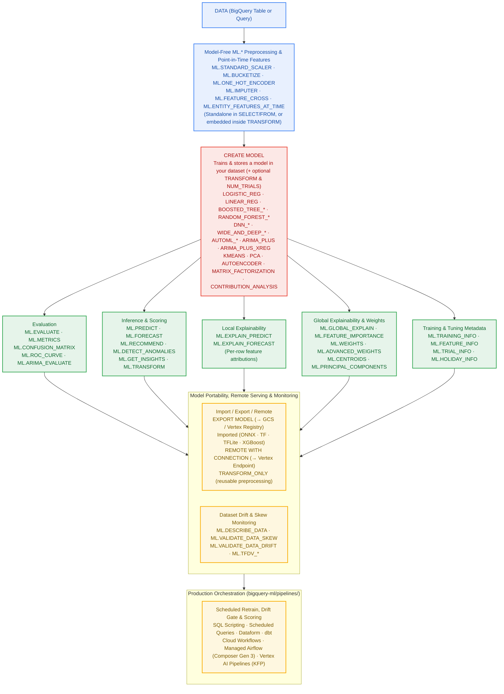

<!--- header table --->
<table>
<tr>     
  <td style="text-align: center">
    <a href="https://github.com/statmike/gcp-mlops/blob/main/data%2Bai/bq-ml/README.md">
      
      <br>View on<br>GitHub
    </a>
  </td>
</tr>
<tr>
  <td style="text-align: right">
    <b>Share On: </b> 
    <a href="https://www.linkedin.com/sharing/share-offsite/?url=https://github.com/statmike/gcp-mlops/blob/main/data%252Bai/bq-ml/README.md"></a> 
    <a href="https://reddit.com/submit?url=https://github.com/statmike/gcp-mlops/blob/main/data%252Bai/bq-ml/README.md"></a> 
    <a href="https://bsky.app/intent/compose?text=https://github.com/statmike/gcp-mlops/blob/main/data%252Bai/bq-ml/README.md"></a> 
    <a href="https://x.com/intent/post?url=https://github.com/statmike/gcp-mlops/blob/main/data%252Bai/bq-ml/README.md"></a> 
  </td>
</tr>
<tr>
  <td style="text-align: right">
    <b>Connect With Author On: </b> 
    <a href="https://www.linkedin.com/in/statmike"></a>
    <a href="https://github.com/statmike"></a> 
    <a href="https://www.youtube.com/@statmike-channel"></a>
    <a href="https://bsky.app/profile/statmike.bsky.social"></a> 
    <a href="https://x.com/statmike"></a>
  </td>
</tr>
<tr>
  <td style="text-align: right">
    <a href="https://raw.githubusercontent.com/statmike/gcp-mlops/main/data%2Bai/bq-ml/README.md"></a> <a href="https://raw.githubusercontent.com/statmike/gcp-mlops/main/data%2Bai/bq-ml/README.md">Download File</a> <i>(right-click and "Save As")</i>
  </td>
</tr>
</table><br/><br/>

---
# BigQuery ML (`bigquery-ml`)
> You are here: `gcp-mlops/data+ai/bq-ml/README.md` ([⬅ Back to Data + AI](../readme.md) · [Repository Front Door](../../readme.md) · [Agent Skills](../../agent-skills/README.md))

[](https://pypi.org/project/bigquery-data-science/)
[](https://github.com/statmike/bigquery-data-science/tree/main/bigquery-ml)
[-8E24AA?style=for-the-badge)](https://github.com/statmike/bigquery-data-science/blob/main/skills/bigquery-ml/SKILL.md)
[](../bq-ai-functions/README.md)

> [!IMPORTANT]
> **Dedicated Repository & PyPI Package (`statmike/bigquery-data-science`):**
> The complete **BigQuery ML** notebook curriculum, standalone `.sql` scripts, deep reference guides, and **4-Lens `bigquery-ml` Agent Skill** live in **[`statmike/bigquery-data-science/bigquery-ml`](https://github.com/statmike/bigquery-data-science/tree/main/bigquery-ml)** and ship on PyPI as **[`bigquery-data-science`](https://pypi.org/project/bigquery-data-science/)**.
>
> Train, evaluate, explain, monitor, and schedule machine learning models entirely in BigQuery SQL (`CREATE MODEL` + `ML.*` functions) — with zero data movement and every option, edge case, and error message verified against live BigQuery.

---

## How BigQuery ML Fits Together



---

## Navigate the BigQuery ML Hub (`statmike/bigquery-data-science/bigquery-ml`)

| Category / Folder | What It Covers | Direct Entry Points in `statmike/bigquery-data-science` |
| :--- | :--- | :--- |
| **Start Here & Reference Guides** | Interactive tour of BigQuery ML, environment/connection/IAM setup, and the complete `CREATE MODEL` + `ML.*` reference index. | [**`bigquery-ml/README.md`**](https://github.com/statmike/bigquery-data-science/blob/main/bigquery-ml/README.md) · [`overview.ipynb`](https://github.com/statmike/bigquery-data-science/blob/main/bigquery-ml/overview.ipynb) · [`RESOURCES.md`](https://github.com/statmike/bigquery-data-science/blob/main/bigquery-ml/RESOURCES.md) · [`setup/`](https://github.com/statmike/bigquery-data-science/tree/main/bigquery-ml/setup) · [`reference/`](https://github.com/statmike/bigquery-data-science/tree/main/bigquery-ml/reference) |
| **[`models/`](https://github.com/statmike/bigquery-data-science/tree/main/bigquery-ml/models)**<br/>*Per-Model Lifecycle Deep Dives (`.ipynb` + `.sql`)* | Full lifecycle (`CREATE MODEL` $\to$ `ML.EVALUATE` $\to$ `ML.PREDICT` / `ML.FORECAST` / `ML.RECOMMEND` $\to$ `ML.EXPLAIN_*` $\to$ hyperparameter tuning) across classification & regression (`LOGISTIC_REG`, `LINEAR_REG`, `BOOSTED_TREE_*`, `RANDOM_FOREST_*`, `DNN_*`, `WIDE_AND_DEEP_*`, `AUTOML_*`), unsupervised (`KMEANS`, `PCA`, `AUTOENCODER`), time series (`ARIMA_PLUS`, `ARIMA_PLUS_XREG`), recommendations (`MATRIX_FACTORIZATION`), key drivers (`CONTRIBUTION_ANALYSIS`), and portability (`TRANSFORM_ONLY`, `IMPORTED`, `EXPORT MODEL`, `REMOTE`). | [**`bigquery-ml/models/`**](https://github.com/statmike/bigquery-data-science/tree/main/bigquery-ml/models) · [`reference/create-model-model-types.md`](https://github.com/statmike/bigquery-data-science/blob/main/bigquery-ml/reference/create-model-model-types.md) · [`reference/comparison-tables.md`](https://github.com/statmike/bigquery-data-science/blob/main/bigquery-ml/reference/comparison-tables.md) |
| **[`functions/`](https://github.com/statmike/bigquery-data-science/tree/main/bigquery-ml/functions)**<br/>*Model-Free `ML.*` Function Suites (`.ipynb` + `.sql`)* | Standalone utilities and `TRANSFORM`-clause building blocks: data profiling (`ML.DESCRIBE_DATA`, `ML.CORRELATION`), point-in-time feature retrieval (`ML.FEATURES_AT_TIME`, `ML.ENTITY_FEATURES_AT_TIME`), model-free evaluation (`ML.METRICS`), distribution drift/skew monitoring (`ML.VALIDATE_DATA_SKEW`, `ML.VALIDATE_DATA_DRIFT`, `ML.TFDV_*`), time-series decomposition (`ML.TREND`, `ML.SEASONALITY`, `ML.DETECT_CHANGE_POINTS`), image tensors (`ML.DECODE_IMAGE`, `ML.RESIZE_IMAGE`), scalers, encoders, feature crosses, bucketizers, vector distances, and text features. | [**`bigquery-ml/functions/`**](https://github.com/statmike/bigquery-data-science/tree/main/bigquery-ml/functions) · [`reference/model-free-functions.md`](https://github.com/statmike/bigquery-data-science/blob/main/bigquery-ml/reference/model-free-functions.md) · [`reference/model-lifecycle-functions.md`](https://github.com/statmike/bigquery-data-science/blob/main/bigquery-ml/reference/model-lifecycle-functions.md) · [`reference/model-management-monitoring.md`](https://github.com/statmike/bigquery-data-science/blob/main/bigquery-ml/reference/model-management-monitoring.md) |
| **[`workflows/`](https://github.com/statmike/bigquery-data-science/tree/main/bigquery-ml/workflows)**<br/>*End-to-End Composed SQL Workflows* | **Causal Inference & Econometrics in SQL** (Propensity Score Matching & IPTW, Double ML Price Elasticity, Uplift/CATE T-Learner, Difference-in-Differences with Callaway–Sant'Anna, Synthetic Control, `AI.CAUSAL_EFFECT` vs `ARIMA_PLUS`, and Survival Analysis) plus **Predictive & Analytical Workflows** (Point-in-Time Feature Store leakage quantification, Hierarchical & Regression-Based Forecasting, Embeddings Classification, RFM Segmentation, Order-Lapse & GA4 Churn, Recommendations, Fraud/Anomaly Detection, Cross-Validation, and Stacked Ensembling). | [**`bigquery-ml/workflows/`**](https://github.com/statmike/bigquery-data-science/tree/main/bigquery-ml/workflows) · [`skills/bigquery-ml/reference/workflows-and-pipelines.md`](https://github.com/statmike/bigquery-data-science/blob/main/skills/bigquery-ml/reference/workflows-and-pipelines.md) |
| **[`pipelines/`](https://github.com/statmike/bigquery-data-science/tree/main/bigquery-ml/pipelines)**<br/>*Production MLOps & Orchestration* | The same drift-detection, conditional retraining, quality-gating, and batch-scoring loop implemented across **BigQuery SQL Scripting**, **Scheduled Queries**, **Dataform** (`dependOnDependencyAssertions`), **Cloud Workflows**, **dbt** (`dbt build` + custom `bqml_model` materialization), **Vertex AI Pipelines (KFP)**, and **Managed Airflow (Composer Gen 3)**. | [**`bigquery-ml/pipelines/`**](https://github.com/statmike/bigquery-data-science/tree/main/bigquery-ml/pipelines) · [`skills/bigquery-ml/reference/workflows-and-pipelines.md`](https://github.com/statmike/bigquery-data-science/blob/main/skills/bigquery-ml/reference/workflows-and-pipelines.md) |
| **[`skills/bigquery-ml/`](https://github.com/statmike/bigquery-data-science/tree/main/skills/bigquery-ml)**<br/>*4-Lens Agent Skill* | Decision trees, empirically verified gotchas, surgical `< 25 KB` per-model/per-function syntax cards ([`syntax/INDEX.md`](https://github.com/statmike/bigquery-data-science/blob/main/skills/bigquery-ml/syntax/INDEX.md)), and clean markdown textbook narratives (`narrative/*.md`). | [**`skills/bigquery-ml/SKILL.md`**](https://github.com/statmike/bigquery-data-science/blob/main/skills/bigquery-ml/SKILL.md) · [`syntax/INDEX.md`](https://github.com/statmike/bigquery-data-science/blob/main/skills/bigquery-ml/syntax/INDEX.md) · [`skills/bigquery-data-science/SKILL.md`](https://github.com/statmike/bigquery-data-science/blob/main/skills/bigquery-data-science/SKILL.md) |

---

## Quickstart — Skills, CLI, MCP & Notebooks

```bash
# 1. Install the 4-Lens Agent Skills (bigquery-data-science, bigquery-ml, bigquery-ai):
uvx bigquery-data-science install                     # into ./.agents/skills & ./.claude/skills
uvx bigquery-data-science install --global            # into ~/.agents/skills & ~/.claude/skills
npx skills add statmike/bigquery-data-science         # via skills.sh CLI
pip install bigquery-data-science && bigquery-data-science install

# 2. Triage tasks & look up exact BigQuery ML syntax from the terminal:
uvx bigquery-data-science triage "forecast daily sales with promotions"
uvx bigquery-data-science lookup ARIMA_PLUS_XREG
uvx bigquery-data-science lookup ML.ENTITY_FEATURES_AT_TIME
uvx bigquery-data-science search "point-in-time feature leakage"

# 3. Attach the zero-dependency stdio MCP server to Claude Code:
claude mcp add bigquery-data-science -- uvx bigquery-data-science mcp

# 4. Clone & run the BigQuery ML notebooks locally:
git clone https://github.com/statmike/bigquery-data-science.git
cd bigquery-data-science
uv sync --extra all && uv run bigquery-data-science kernel --user
```
