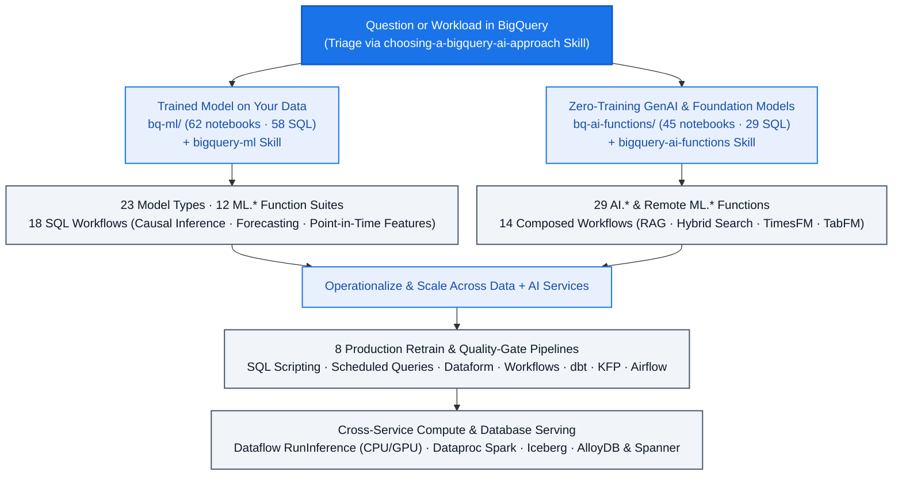

<!--- header table --->
<table>
<tr>     
  <td style="text-align: center">
    <a href="https://github.com/statmike/gcp-mlops/blob/main/data%2Bai/readme.md">
      
       View on GitHub
    </a>
  </td>
</tr>
<tr>
  <td style="text-align: right">
    <b>Share On: </b> 
     
     
     
     
  </td>
</tr>
<tr>
  <td style="text-align: right">
    <b>Connect With Author On: </b> 
    
     
    
     
    
  </td>
</tr>
<tr>
  <td style="text-align: right">
     <a href="https://raw.githubusercontent.com/statmike/gcp-mlops/main/data%2Bai/readme.md">Download File</a> <i>(right-click and "Save As")</i>
  </td>
</tr>
</table>  

---
# Data + AI
> You are here: `gcp-mlops/data+ai/readme.md` ([⬅ Back to Repository Front Door](../readme.md))

Machine learning, generative AI, causal inference, and data engineering across Google Cloud's data services — bringing model training, foundation-model inference, and production orchestration directly to where the data already lives (**124 notebooks & 87 standalone SQL scripts**).

---

## [BigQuery ML (`bq-ml/`)](./bq-ml/README.md) — 62 notebooks & 58 SQL scripts

A complete, live-verified learning and reference system for training, evaluating, explaining, and operationalizing models in SQL ([Interactive Overview](./bq-ml/overview.ipynb) · [Detailed Reference](./bq-ml/RESOURCES.md) · [Setup](./bq-ml/setup/README.md)):

- **[23 Model Types (`models/`)](./bq-ml/README.md#models)** — Per-model lifecycle deep dives (create $\to$ evaluate $\to$ predict $\to$ explain $\to$ tune), each with a runnable `.ipynb` and standalone `.sql` file:
  - *Supervised Classification & Regression*: `LOGISTIC_REG`, `LINEAR_REG`, `BOOSTED_TREE_CLASSIFIER`, `BOOSTED_TREE_REGRESSOR`, `RANDOM_FOREST_CLASSIFIER`, `RANDOM_FOREST_REGRESSOR`, `DNN_CLASSIFIER`, `DNN_REGRESSOR`, `WIDE_AND_DEEP` (`DNN_LINEAR_COMBINED_*`), and `AUTOML_*` — trained on shared datasets for direct accuracy and runtime comparison.
  - *Unsupervised, Time Series, & Specialized*: `KMEANS`, `PCA`, `AUTOENCODER`, `MATRIX_FACTORIZATION` (with on-demand reservation setup/teardown), `CONTRIBUTION_ANALYSIS`, `ARIMA_PLUS`, and `ARIMA_PLUS_XREG`.
  - *Lifecycle & Portability*: `TRANSFORM_ONLY` (reusable preprocessing pipelines), `IMPORTED` (`TENSORFLOW`, `ONNX`, `XGBOOST`), `EXPORT MODEL` (to GCS and Vertex AI Model Registry), and `REMOTE` (custom Vertex AI Endpoints).
- **[12 Model-Free `ML.*` Function Suites (`functions/`)](./bq-ml/README.md#functions)** — Standalone utilities and `TRANSFORM`-clause building blocks with empirically verified edge cases:
  - `ML.DESCRIBE_DATA` & `ML.CORRELATION` (data profiling), `ML.FEATURES_AT_TIME` & `ML.ENTITY_FEATURES_AT_TIME` (point-in-time feature store retrieval), `ML.METRICS` (model-free evaluation), `ML.VALIDATE_DATA_SKEW` & `ML.VALIDATE_DATA_DRIFT` (distribution monitoring), `ML.TREND` / `ML.SEASONALITY` / `ML.DETECT_CHANGE_POINTS` (time-series decomposition), `ML.DECODE_IMAGE` / `ML.RESIZE_IMAGE` / `ML.CONVERT_COLOR_SPACE` (in-SQL vision tensors), plus scalers, encoders, feature crosses, bucketizers, vector distances (`ML.DISTANCE`, `ML.LP_NORM`), and text (`ML.TF_IDF`, `ML.NGRAMS`, `ML.BAG_OF_WORDS`).
- **[18 End-to-End SQL Workflows (`workflows/`)](./bq-ml/README.md#workflows)** — Composing preprocessing and models into complete business and statistical workflows:
  - *Causal Inference & Econometrics in SQL*: [Propensity Score Matching & IPTW](./bq-ml/workflows/propensity_score_matching/), [Price Elasticity via Double ML (5-fold cross-fitting)](./bq-ml/workflows/price_elasticity_dml/), [Uplift Modeling / CATE (T-Learner)](./bq-ml/workflows/uplift_cate/), [Difference-in-Differences (including staggered-adoption Callaway–Sant'Anna comparison)](./bq-ml/workflows/difference_in_differences/), [Synthetic Control](./bq-ml/workflows/synthetic_control/), [Univariate Counterfactuals (`AI.CAUSAL_EFFECT` vs. `ARIMA_PLUS`)](./bq-ml/workflows/causal_effect/), and [Survival Analysis (Kaplan-Meier & discrete-time hazard in SQL vs. `lifelines` Cox PH)](./bq-ml/workflows/survival_analysis/).
  - *Predictive & Analytical Workflows*: [Point-in-Time Feature Store (measuring the exact `roc_auc` cost of training/serving leakage)](./bq-ml/workflows/feature_store/), [Hierarchical Forecasting (Bottom-Up vs. Top-Down)](./bq-ml/workflows/hierarchical_forecasting/), [Regression-Based Forecasting](./bq-ml/workflows/regression_based_forecasting/), [Embeddings for Hierarchical Classification](./bq-ml/workflows/embeddings_classification/), [Customer Segmentation (RFM)](./bq-ml/workflows/customer_segmentation/), [Order-Lapse Churn](./bq-ml/workflows/churn_retention/), [GA4 Behavioral Churn](./bq-ml/workflows/ga4_churn_prediction/), [Collaborative Filtering Recommendations](./bq-ml/workflows/recommendation/), [Ground-Truth Fraud/Anomaly Detection](./bq-ml/workflows/anomaly_fraud_detection/), [5-Fold Cross-Validation in SQL](./bq-ml/workflows/cross_validation/), and [Stacked Ensembling](./bq-ml/workflows/ensembling/).
- **[8 Production Orchestration Pipelines (`pipelines/`)](./bq-ml/README.md#pipelines)** — The same drift-detection, conditional retraining, quality-gating, and batch-scoring logic implemented across eight orchestrators:
  - [BigQuery SQL Scripting](./bq-ml/pipelines/sql_scripting/), [BigQuery Scheduled Queries](./bq-ml/pipelines/scheduled_queries/), [Dataform (with assertion gates)](./bq-ml/pipelines/dataform/), [Cloud Workflows](./bq-ml/pipelines/cloud_workflows/), [dbt (`dbt build` + custom `bqml_model` materialization)](./bq-ml/pipelines/dbt/), [Vertex AI Pipelines (KFP prebuilt BQML components)](./bq-ml/pipelines/vertex_kfp/), [Managed Airflow Gen 3](./bq-ml/pipelines/composer_airflow/), and [Managed Airflow triggering Vertex AI Pipelines](./bq-ml/pipelines/airflow_with_kfp/).

---

## [BigQuery AI Functions (`bq-ai-functions/`)](./bq-ai-functions/README.md) — 45 notebooks & 29 SQL scripts

Progressive guide to calling Gemini, embedding models, foundation models (TimesFM, TabFM), and pre-trained Cloud AI services directly from BigQuery SQL ([Interactive Overview](./bq-ai-functions/overview.ipynb) · [Detailed Reference](./bq-ai-functions/RESOURCES.md) · [Setup](./bq-ai-functions/setup/README.md)):

- **[29 Individual Function Guides (`functions/`)](./bq-ai-functions/README.md#function-map)** — Runnable notebook (`.ipynb` with SQL + BigFrames) and `.sql` script for every function:
  - *Generation & Structured Output*: `AI.GENERATE`, `AI.GENERATE_TEXT`, `ML.GENERATE_TEXT`, `AI.GENERATE_TABLE`, `AI.GENERATE_BOOL`, `AI.GENERATE_INT`, `AI.GENERATE_DOUBLE`
  - *Classification, Scoring & Aggregation*: `AI.CLASSIFY`, `AI.IF`, `AI.SCORE`, `AI.AGG`, `AI.SUMMARIZE`
  - *Embeddings, Vector Search & Hybrid Search*: `AI.EMBED`, `ML.GENERATE_EMBEDDING`, `AI.SIMILARITY`, `VECTOR_SEARCH`, `AI.SEARCH`
  - *Zero-Training Predictive & Diagnostic AI*: `AI.FORECAST`, `AI.DETECT_ANOMALIES`, `AI.EVALUATE`, `AI.PREDICT` (TabFM), `AI.CAUSAL_EFFECT`, `AI.KEY_DRIVERS`
  - *Document & Pre-Trained Cloud AI Services*: `ML.PROCESS_DOCUMENT`, `ML.ANNOTATE_IMAGE`, `ML.TRANSLATE`, `ML.UNDERSTAND_TEXT`, `ML.TRANSCRIBE`, and `AI.PARSE_DOCUMENT`
- **[14 End-to-End Composed Workflows (`workflows/`)](./bq-ai-functions/README.md#workflows)** — [Data Enrichment (Web Grounding + TabFM)](./bq-ai-functions/workflows/data_enrichment/), [Content Analysis Pipeline](./bq-ai-functions/workflows/content_analysis/), [Semantic Search (3 ways)](./bq-ai-functions/workflows/semantic_search/), [Hybrid Product Catalog Search (Rank Fusion analysis)](./bq-ai-functions/workflows/catalog_search/), [RAG Pipeline](./bq-ai-functions/workflows/rag_pipeline/), [Time Series Intelligence](./bq-ai-functions/workflows/time_series_intelligence/), [Zero-Shot Tabular Prediction](./bq-ai-functions/workflows/tabular_prediction/), [Metric Diagnostics (with placebo causal checks)](./bq-ai-functions/workflows/metric_diagnostics/), [Document Intelligence](./bq-ai-functions/workflows/document_intelligence/), [Content Moderation](./bq-ai-functions/workflows/content_moderation/), [Multimodal Document Analysis](./bq-ai-functions/workflows/multimodal_analysis/), [Support Ticket & Log Triage with Hybrid Search](./bq-ai-functions/workflows/log_analysis/), and [Image Deduplication for Train/Test Integrity](./bq-ai-functions/workflows/image_deduplication/).

---

## Cross-Service Data + AI Workflows

- **[ML Training & Batch Inference Overview (`overview/ml-training/`)](./overview/ml-training/readme.md)** (7 notebooks) — Side-by-side comparison on the same fraud dataset across **BigFrames + XGBoost**, **BigQuery ML**, **Dataproc Serverless Spark (PySpark & SparkR)**, **Vertex AI Custom Training (Python & R + Vizier)**, **Colab Enterprise (`NotebookExecutionJob`)**, **Vertex AI Model Registry**, and a **5-branch parallel KFP Pipeline**.
- **[Dataflow Streaming & GPU Inference (`dataflow/`)](./dataflow/readme.md)** (3 notebooks + benchmark report) — Apache Beam `RunInference` fundamentals, zero-downtime model hot-swapping (event-driven Pub/Sub mode and polling watch mode), a [Python-to-Java `RunInference` translation guide](./dataflow/python-to-java.md), and a full [GPU inference benchmark study](./dataflow/gpu/benchmark/reports/benchmark_report.md) comparing local Dataflow GPUs against Vertex AI Endpoints.
- **[Dataproc Managed Spark (`dataproc/`)](./dataproc/readme.md)** (4 notebooks) — Dataproc Serverless fundamentals, distributed batch inference with Pandas UDFs, Structured Streaming with `foreachBatch`, and calling Vertex AI Endpoints from Spark.
- **[Managed Airflow / Cloud Composer (`composer/`)](./composer/readme.md)** — Four production DAG patterns orchestrating batch inference across Dataproc, Dataflow, Vertex AI Pipelines (KFP), and Vertex AI Batch Prediction, plus scheduling, backfill, and retry patterns.
- **[BigQuery Managed Apache Iceberg (`bq-iceberg/`)](./bq-iceberg/readme.md)** (1 notebook) — Building a multi-shard Parquet Iceberg table in GCS from Chicago Taxi data and reading it via BigFrames, BigQuery Storage Read API, and multithreaded R `arrow`.
- **[BigQuery Continuous Queries (`bq-solutions/`)](./bq-solutions/readme.md)** (1 notebook) — Real-time GA4 funnel analytics, traffic anomaly detection, and conversion monitoring with BigQuery Continuous Queries.
- **[Tabular Data Read Benchmarks (`tabular-data/`)](./tabular-data/readme.md)** (1 notebook) — Cost and throughput benchmarks comparing BigQuery standard queries, Storage Read API, BigFrames, and `pandas-gbq` (including multi-threaded arrow/avro reads).
- **[Database SQL Inference & Portfolio Guides](./readme.md)** — Calling Vertex AI Endpoints directly from SQL in [AlloyDB AI (`alloydb/`)](./alloydb/readme.md) and [Spanner ML (`spanner/`)](./spanner/readme.md), plus cross-service architecture guides for [Model Serving / Inference](./model-serving.md) and [Google Cloud Databases for AI/ML](./gcp-databases.md).

---

## Agent Skills

[`bq-ml`](./bq-ml/README.md) and [`bq-ai-functions`](./bq-ai-functions/README.md) are the source for three packaged **Agent Skills** centralized in [`agent-skills/`](../agent-skills/README.md) at the repo root — use-case-organized, verified-gotcha references (plus 104 extracted notebook narratives) distilled for AI coding agents:

| Skill | Scope | Path |
|---|---|---|
| [`bigquery-ml`](../agent-skills/.agents/skills/bigquery-ml/SKILL.md) | Training, evaluating, deploying, and monitoring BigQuery ML models (`CREATE MODEL`, all `ML.*` functions, point-in-time features, causal workflows, and 8 pipeline patterns) | `agent-skills/.agents/skills/bigquery-ml/` |
| [`bigquery-ai-functions`](../agent-skills/.agents/skills/bigquery-ai-functions/SKILL.md) | Calling Gemini, embeddings, semantic/hybrid search, zero-shot forecasting, tabular prediction, `AI.KEY_DRIVERS`, and pre-trained Cloud AI services from SQL | `agent-skills/.agents/skills/bigquery-ai-functions/` |
| [`choosing-a-bigquery-ai-approach`](../agent-skills/.agents/skills/choosing-a-bigquery-ai-approach/SKILL.md) | Triage router that helps pick between a trained `bigquery-ml` model and a zero-training `bigquery-ai-functions` call (with worked head-to-head comparisons such as `ARIMA_PLUS` vs. `AI.FORECAST` and `CONTRIBUTION_ANALYSIS` vs. `AI.KEY_DRIVERS`) | `agent-skills/.agents/skills/choosing-a-bigquery-ai-approach/` |

**How to use them, by tool:**
- **Claude Code** — auto-discovered from the repo-root `.claude/skills/` anywhere in this repo; no setup required.
- **Google Antigravity, Gemini CLI, Codex, and other `SKILL.md` tools** — auto-discovered from the repo-root `.agents/skills/` symlinks.
- **Outside this repo** — every skill folder under `agent-skills/.agents/skills/<name>/` is self-contained and can be copied into any other project. See [`agent-skills/README.md`](../agent-skills/README.md) for the authoring standard and verification CLI (`agent-skills sweep`).
