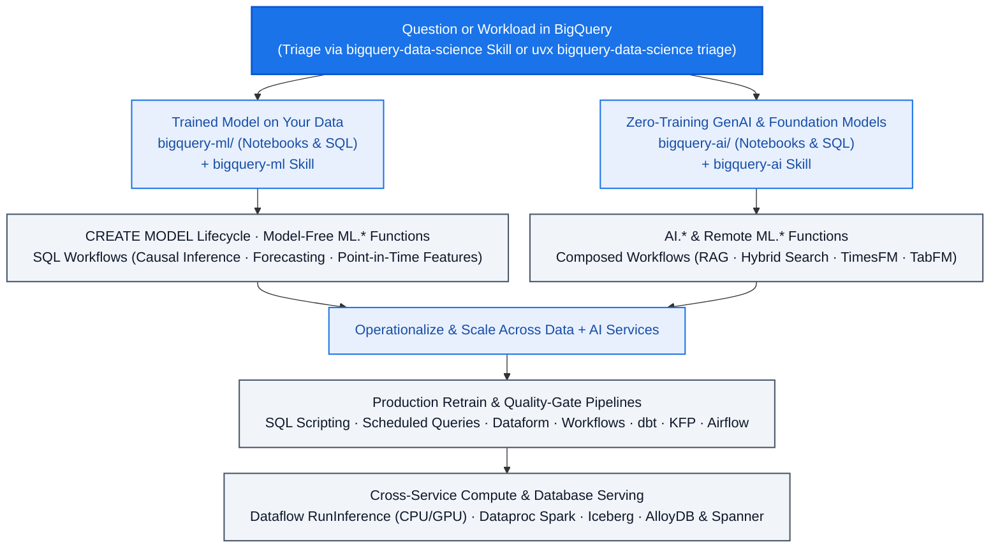

<!--- header table --->
<table>
<tr>     
  <td style="text-align: center">
    <a href="https://github.com/statmike/gcp-mlops/blob/main/data%2Bai/readme.md">
      
      <br>View on<br>GitHub
    </a>
  </td>
</tr>
<tr>
  <td style="text-align: right">
    <b>Share On: </b> 
    <a href="https://www.linkedin.com/sharing/share-offsite/?url=https://github.com/statmike/gcp-mlops/blob/main/data%252Bai/readme.md"></a> 
    <a href="https://reddit.com/submit?url=https://github.com/statmike/gcp-mlops/blob/main/data%252Bai/readme.md"></a> 
    <a href="https://bsky.app/intent/compose?text=https://github.com/statmike/gcp-mlops/blob/main/data%252Bai/readme.md"></a> 
    <a href="https://x.com/intent/post?url=https://github.com/statmike/gcp-mlops/blob/main/data%252Bai/readme.md"></a> 
  </td>
</tr>
<tr>
  <td style="text-align: right">
    <b>Connect With Author On: </b> 
    <a href="https://www.linkedin.com/in/statmike"></a>
    <a href="https://github.com/statmike"></a> 
    <a href="https://www.youtube.com/@statmike-channel"></a>
    <a href="https://bsky.app/profile/statmike.bsky.social"></a> 
    <a href="https://x.com/statmike"></a>
  </td>
</tr>
<tr>
  <td style="text-align: right">
    <a href="https://raw.githubusercontent.com/statmike/gcp-mlops/main/data%2Bai/readme.md"></a> <a href="https://raw.githubusercontent.com/statmike/gcp-mlops/main/data%2Bai/readme.md">Download File</a> <i>(right-click and "Save As")</i>
  </td>
</tr>
</table><br/><br/>

---
# Data + AI
> You are here: `gcp-mlops/data+ai/readme.md` ([⬅ Back to Repository Front Door](../readme.md))

Machine learning, generative AI, causal inference, and data engineering across Google Cloud's data services — bringing model training, foundation-model inference, and production orchestration directly to where the data already lives.

> [!IMPORTANT]
> **Dedicated Repository & PyPI Package for BigQuery ML, BigQuery AI & Agent Skills:**
> The **BigQuery ML**, **BigQuery AI**, and **4-Lens Agent Skills** (`bigquery-data-science`, `bigquery-ml`, `bigquery-ai`) curricula live in their own standalone flagship repository **[`statmike/bigquery-data-science`](https://github.com/statmike/bigquery-data-science)** and zero-dependency Python package **[`bigquery-data-science` on PyPI](https://pypi.org/project/bigquery-data-science/)**:
> - **Equip your AI coding agent:** `uvx bigquery-data-science install` or `npx skills add statmike/bigquery-data-science`
> - **Triage tasks & look up exact SQL syntax from the CLI:** `uvx bigquery-data-science triage "..."` · `uvx bigquery-data-science lookup ARIMA_PLUS`
> - **Explore the local signpost hubs:** [`bq-ml/README.md`](./bq-ml/README.md) · [`bq-ai-functions/README.md`](./bq-ai-functions/README.md) · [`../agent-skills/README.md`](../agent-skills/README.md)



---

## [BigQuery ML (`bq-ml/`)](./bq-ml/README.md) ([`statmike/bigquery-data-science/bigquery-ml`](https://github.com/statmike/bigquery-data-science/tree/main/bigquery-ml))

A complete, live-verified learning and reference system for training, evaluating, explaining, and operationalizing models in SQL ([Local Signpost](./bq-ml/README.md) · [Interactive Overview](https://github.com/statmike/bigquery-data-science/blob/main/bigquery-ml/overview.ipynb) · [Detailed Reference](https://github.com/statmike/bigquery-data-science/blob/main/bigquery-ml/RESOURCES.md) · [Setup](https://github.com/statmike/bigquery-data-science/blob/main/bigquery-ml/setup/README.md)):

- **[Model Types (`models/`)](https://github.com/statmike/bigquery-data-science/tree/main/bigquery-ml/models)** — Per-model lifecycle deep dives (create $\to$ evaluate $\to$ predict $\to$ explain $\to$ tune), each with a runnable `.ipynb` and standalone `.sql` file:
  - *Supervised Classification & Regression*: `LOGISTIC_REG`, `LINEAR_REG`, `BOOSTED_TREE_CLASSIFIER`, `BOOSTED_TREE_REGRESSOR`, `RANDOM_FOREST_CLASSIFIER`, `RANDOM_FOREST_REGRESSOR`, `DNN_CLASSIFIER`, `DNN_REGRESSOR`, `WIDE_AND_DEEP` (`DNN_LINEAR_COMBINED_*`), and `AUTOML_*` — trained on shared datasets for direct accuracy and runtime comparison.
  - *Unsupervised, Time Series, & Specialized*: `KMEANS`, `PCA`, `AUTOENCODER`, `MATRIX_FACTORIZATION` (with on-demand reservation setup/teardown), `CONTRIBUTION_ANALYSIS`, `ARIMA_PLUS`, and `ARIMA_PLUS_XREG`.
  - *Lifecycle & Portability*: `TRANSFORM_ONLY` (reusable preprocessing pipelines), `IMPORTED` (`TENSORFLOW`, `ONNX`, `XGBOOST`), `EXPORT MODEL` (to GCS and Vertex AI Model Registry), and `REMOTE` (custom Vertex AI Endpoints).
- **[Model-Free `ML.*` Function Suites (`functions/`)](https://github.com/statmike/bigquery-data-science/tree/main/bigquery-ml/functions)** — Standalone utilities and `TRANSFORM`-clause building blocks with empirically verified edge cases:
  - `ML.DESCRIBE_DATA` & `ML.CORRELATION` (data profiling), `ML.FEATURES_AT_TIME` & `ML.ENTITY_FEATURES_AT_TIME` (point-in-time feature store retrieval), `ML.METRICS` (model-free evaluation), `ML.VALIDATE_DATA_SKEW` & `ML.VALIDATE_DATA_DRIFT` (distribution monitoring), `ML.TREND` / `ML.SEASONALITY` / `ML.DETECT_CHANGE_POINTS` (time-series decomposition), `ML.DECODE_IMAGE` / `ML.RESIZE_IMAGE` / `ML.CONVERT_COLOR_SPACE` (in-SQL vision tensors), plus scalers, encoders, feature crosses, bucketizers, vector distances (`ML.DISTANCE`, `ML.LP_NORM`), and text (`ML.TF_IDF`, `ML.NGRAMS`, `ML.BAG_OF_WORDS`).
- **[End-to-End SQL Workflows (`workflows/`)](https://github.com/statmike/bigquery-data-science/tree/main/bigquery-ml/workflows)** — Composing preprocessing and models into complete business and statistical workflows:
  - *Causal Inference & Econometrics in SQL*: [Propensity Score Matching & IPTW](https://github.com/statmike/bigquery-data-science/tree/main/bigquery-ml/workflows/propensity_score_matching), [Price Elasticity via Double ML (5-fold cross-fitting)](https://github.com/statmike/bigquery-data-science/tree/main/bigquery-ml/workflows/price_elasticity_dml), [Uplift Modeling / CATE (T-Learner)](https://github.com/statmike/bigquery-data-science/tree/main/bigquery-ml/workflows/uplift_cate), [Difference-in-Differences (including staggered-adoption Callaway–Sant'Anna comparison)](https://github.com/statmike/bigquery-data-science/tree/main/bigquery-ml/workflows/difference_in_differences), [Synthetic Control](https://github.com/statmike/bigquery-data-science/tree/main/bigquery-ml/workflows/synthetic_control), [Univariate Counterfactuals (`AI.CAUSAL_EFFECT` vs. `ARIMA_PLUS`)](https://github.com/statmike/bigquery-data-science/tree/main/bigquery-ml/workflows/causal_effect), and [Survival Analysis (Kaplan-Meier & discrete-time hazard in SQL vs. `lifelines` Cox PH)](https://github.com/statmike/bigquery-data-science/tree/main/bigquery-ml/workflows/survival_analysis).
  - *Predictive & Analytical Workflows*: [Point-in-Time Feature Store (measuring the exact `roc_auc` cost of training/serving leakage)](https://github.com/statmike/bigquery-data-science/tree/main/bigquery-ml/workflows/feature_store), [Hierarchical Forecasting (Bottom-Up vs. Top-Down)](https://github.com/statmike/bigquery-data-science/tree/main/bigquery-ml/workflows/hierarchical_forecasting), [Regression-Based Forecasting](https://github.com/statmike/bigquery-data-science/tree/main/bigquery-ml/workflows/regression_based_forecasting), [Embeddings for Hierarchical Classification](https://github.com/statmike/bigquery-data-science/tree/main/bigquery-ml/workflows/embeddings_classification), [Customer Segmentation (RFM)](https://github.com/statmike/bigquery-data-science/tree/main/bigquery-ml/workflows/customer_segmentation), [Order-Lapse Churn](https://github.com/statmike/bigquery-data-science/tree/main/bigquery-ml/workflows/churn_retention), [GA4 Behavioral Churn](https://github.com/statmike/bigquery-data-science/tree/main/bigquery-ml/workflows/ga4_churn_prediction), [Collaborative Filtering Recommendations](https://github.com/statmike/bigquery-data-science/tree/main/bigquery-ml/workflows/recommendation), [Ground-Truth Fraud/Anomaly Detection](https://github.com/statmike/bigquery-data-science/tree/main/bigquery-ml/workflows/anomaly_fraud_detection), [5-Fold Cross-Validation in SQL](https://github.com/statmike/bigquery-data-science/tree/main/bigquery-ml/workflows/cross_validation), and [Stacked Ensembling](https://github.com/statmike/bigquery-data-science/tree/main/bigquery-ml/workflows/ensembling).
- **[Production Orchestration Pipelines (`pipelines/`)](https://github.com/statmike/bigquery-data-science/tree/main/bigquery-ml/pipelines)** — The same drift-detection, conditional retraining, quality-gating, and batch-scoring logic implemented across multiple orchestrators:
  - [BigQuery SQL Scripting](https://github.com/statmike/bigquery-data-science/tree/main/bigquery-ml/pipelines/sql_scripting), [BigQuery Scheduled Queries](https://github.com/statmike/bigquery-data-science/tree/main/bigquery-ml/pipelines/scheduled_queries), [Dataform (with assertion gates)](https://github.com/statmike/bigquery-data-science/tree/main/bigquery-ml/pipelines/dataform), [Cloud Workflows](https://github.com/statmike/bigquery-data-science/tree/main/bigquery-ml/pipelines/cloud_workflows), [dbt (`dbt build` + custom `bqml_model` materialization)](https://github.com/statmike/bigquery-data-science/tree/main/bigquery-ml/pipelines/dbt), [Vertex AI Pipelines (KFP prebuilt BQML components)](https://github.com/statmike/bigquery-data-science/tree/main/bigquery-ml/pipelines/vertex_kfp), [Managed Airflow Gen 3](https://github.com/statmike/bigquery-data-science/tree/main/bigquery-ml/pipelines/composer_airflow), and [Managed Airflow triggering Vertex AI Pipelines](https://github.com/statmike/bigquery-data-science/tree/main/bigquery-ml/pipelines/airflow_with_kfp).

---

## [BigQuery AI (`bq-ai-functions/`)](./bq-ai-functions/README.md) ([`statmike/bigquery-data-science/bigquery-ai`](https://github.com/statmike/bigquery-data-science/tree/main/bigquery-ai))

Progressive guide to calling Gemini, embedding models, foundation models (TimesFM, TabFM), and pre-trained Cloud AI services directly from BigQuery SQL ([Local Signpost](./bq-ai-functions/README.md) · [Interactive Overview](https://github.com/statmike/bigquery-data-science/blob/main/bigquery-ai/overview.ipynb) · [Detailed Reference](https://github.com/statmike/bigquery-data-science/blob/main/bigquery-ai/RESOURCES.md) · [Setup](https://github.com/statmike/bigquery-data-science/blob/main/bigquery-ai/setup/README.md)):

- **[Individual Function Guides (`functions/`)](https://github.com/statmike/bigquery-data-science/tree/main/bigquery-ai/functions)** — Runnable notebook (`.ipynb` with SQL + BigFrames) and `.sql` script for every function:
  - *Generation & Structured Output*: `AI.GENERATE`, `AI.GENERATE_TEXT`, `ML.GENERATE_TEXT`, `AI.GENERATE_TABLE`, `AI.GENERATE_BOOL`, `AI.GENERATE_INT`, `AI.GENERATE_DOUBLE`, `AI.COUNT_TOKENS`
  - *Classification, Scoring & Aggregation*: `AI.CLASSIFY`, `AI.IF`, `AI.SCORE`, `AI.AGG`
  - *Embeddings, Vector Search & Hybrid Search*: `AI.EMBED`, `AI.GENERATE_EMBEDDING`, `ML.GENERATE_EMBEDDING`, `AI.SIMILARITY`, `VECTOR_SEARCH`, `AI.SEARCH`
  - *Zero-Training Predictive & Diagnostic AI*: `AI.FORECAST`, `AI.DETECT_ANOMALIES`, `AI.EVALUATE`, `AI.PREDICT` (TabFM), `AI.CAUSAL_EFFECT`, `AI.KEY_DRIVERS`
  - *Document & Pre-Trained Cloud AI Services*: `ML.PROCESS_DOCUMENT`, `ML.ANNOTATE_IMAGE`, `ML.TRANSLATE`, `ML.UNDERSTAND_TEXT`, `ML.TRANSCRIBE`, and `AI.PARSE_DOCUMENT`
- **[End-to-End Composed Workflows (`workflows/`)](https://github.com/statmike/bigquery-data-science/tree/main/bigquery-ai/workflows)** — [Data Enrichment (Web Grounding + TabFM)](https://github.com/statmike/bigquery-data-science/tree/main/bigquery-ai/workflows/data_enrichment), [Content Analysis Pipeline](https://github.com/statmike/bigquery-data-science/tree/main/bigquery-ai/workflows/content_analysis), [Semantic Search (3 ways)](https://github.com/statmike/bigquery-data-science/tree/main/bigquery-ai/workflows/semantic_search), [Hybrid Product Catalog Search (Rank Fusion analysis)](https://github.com/statmike/bigquery-data-science/tree/main/bigquery-ai/workflows/catalog_search), [RAG Pipeline](https://github.com/statmike/bigquery-data-science/tree/main/bigquery-ai/workflows/rag_pipeline), [Document RAG](https://github.com/statmike/bigquery-data-science/tree/main/bigquery-ai/workflows/document_rag), [Time Series Intelligence](https://github.com/statmike/bigquery-data-science/tree/main/bigquery-ai/workflows/time_series_intelligence), [Zero-Shot Tabular Prediction](https://github.com/statmike/bigquery-data-science/tree/main/bigquery-ai/workflows/tabular_prediction), [Metric Diagnostics (with placebo causal checks)](https://github.com/statmike/bigquery-data-science/tree/main/bigquery-ai/workflows/metric_diagnostics), [Document Intelligence](https://github.com/statmike/bigquery-data-science/tree/main/bigquery-ai/workflows/document_intelligence), [Content Moderation](https://github.com/statmike/bigquery-data-science/tree/main/bigquery-ai/workflows/content_moderation), [Multimodal Document Analysis](https://github.com/statmike/bigquery-data-science/tree/main/bigquery-ai/workflows/multimodal_analysis), [Support Ticket & Log Triage with Hybrid Search](https://github.com/statmike/bigquery-data-science/tree/main/bigquery-ai/workflows/log_analysis), and [Image Deduplication for Train/Test Integrity](https://github.com/statmike/bigquery-data-science/tree/main/bigquery-ai/workflows/image_deduplication).

---

## Cross-Service Data + AI Workflows

- **[ML Training & Batch Inference Overview (`overview/ml-training/`)](./overview/ml-training/readme.md)** (7 notebooks) — Side-by-side comparison on the same fraud dataset across **BigFrames + XGBoost**, **BigQuery ML**, **Dataproc Serverless Spark (PySpark & SparkR)**, **Vertex AI Custom Training (Python & R + Vizier)**, **Colab Enterprise (`NotebookExecutionJob`)**, **Vertex AI Model Registry**, and a **5-branch parallel KFP Pipeline**.
- **[Dataflow Streaming & GPU Inference (`dataflow/`)](./dataflow/readme.md)** (3 notebooks + benchmark report) — Apache Beam `RunInference` fundamentals, zero-downtime model hot-swapping (event-driven Pub/Sub mode and polling watch mode), a [Python-to-Java `RunInference` translation guide](./dataflow/python-to-java.md), and a full [GPU inference benchmark study](./dataflow/gpu/benchmark/reports/benchmark_report.md) comparing local Dataflow GPUs against Vertex AI Endpoints.
- **[Dataproc Managed Spark (`dataproc/`)](./dataproc/readme.md)** (4 notebooks) — Dataproc Serverless fundamentals, distributed batch inference with Pandas UDFs, Structured Streaming with `foreachBatch`, and calling Vertex AI Endpoints from Spark.
- **[Managed Airflow / Cloud Composer (`composer/`)](./composer/readme.md)** — Four production DAG patterns orchestrating batch inference across Dataproc, Dataflow, Vertex AI Pipelines (KFP), and Vertex AI Batch Prediction, plus scheduling, backfill, and retry patterns.
- **[BigQuery Managed Apache Iceberg (`bq-iceberg/`)](./bq-iceberg/readme.md)** (1 notebook) — Building a multi-shard Parquet Iceberg table in GCS from Chicago Taxi data and reading it via BigFrames, BigQuery Storage Read API, and multithreaded R `arrow`.
- **[BigQuery Continuous Queries (`bq-solutions/`)](./bq-solutions/readme.md)** (1 notebook) — Real-time GA4 funnel analytics, traffic anomaly detection, and conversion monitoring with BigQuery Continuous Queries.
- **[Tabular Data Read Benchmarks (`tabular-data/`)](./tabular-data/readme.md)** (1 notebook) — Cost and throughput benchmarks comparing BigQuery standard queries, Storage Read API, BigFrames, and `pandas-gbq` (including multi-threaded arrow/avro reads).
- **[Database SQL Inference & Portfolio Guides](./readme.md)** — Calling Vertex AI Endpoints directly from SQL in [AlloyDB AI (`alloydb/`)](./alloydb/readme.md) and [Spanner ML (`spanner/`)](./spanner/readme.md), plus cross-service architecture guides for [Model Serving / Inference](./model-serving.md) and [Google Cloud Databases for AI/ML](./gcp-databases.md).

---

## Agent Skills, CLI & Stdio MCP Server ([`agent-skills/`](../agent-skills/README.md))

[`bq-ml`](./bq-ml/README.md) and [`bq-ai-functions`](./bq-ai-functions/README.md) power three **4-Lens Agent Skills** published in **[`statmike/bigquery-data-science`](https://github.com/statmike/bigquery-data-science)** and on **[PyPI (`bigquery-data-science`)](https://pypi.org/project/bigquery-data-science/)**:

| Skill | Scope | Canonical Entry Point |
|---|---|---|
| [`bigquery-data-science`](https://github.com/statmike/bigquery-data-science/blob/main/skills/bigquery-data-science/SKILL.md) | Umbrella triage router & [`ML.*` vs `AI.*` namespace matrix](https://github.com/statmike/bigquery-data-science/blob/main/skills/bigquery-data-science/reference/namespace-matrix.md) (with empirical head-to-head comparisons such as `ARIMA_PLUS` vs. `AI.FORECAST` and `CONTRIBUTION_ANALYSIS` vs. `AI.KEY_DRIVERS`) | `skills/bigquery-data-science/SKILL.md` |
| [`bigquery-ml`](https://github.com/statmike/bigquery-data-science/blob/main/skills/bigquery-ml/SKILL.md) | Training, evaluating, deploying, and monitoring BigQuery ML models (`CREATE MODEL`, all `ML.*` functions, point-in-time features, causal workflows, and orchestration pipeline patterns) | `skills/bigquery-ml/SKILL.md` |
| [`bigquery-ai`](https://github.com/statmike/bigquery-data-science/blob/main/skills/bigquery-ai/SKILL.md) | Calling Gemini, embeddings, semantic/hybrid search, zero-shot forecasting, tabular prediction, `AI.KEY_DRIVERS`, and pre-trained Cloud AI services from SQL | `skills/bigquery-ai/SKILL.md` |

**Quick install into any workspace or global agent profile:**
```bash
uvx bigquery-data-science install                     # installs into ./.agents/skills & ./.claude/skills
uvx bigquery-data-science install --global            # installs into ~/.agents/skills & ~/.claude/skills
npx skills add statmike/bigquery-data-science         # via skills.sh CLI
claude mcp add bigquery-data-science -- uvx bigquery-data-science mcp
```
See [`agent-skills/README.md`](../agent-skills/README.md) for all `uv`, `pip`, `pipx`, CLI, and MCP options.
