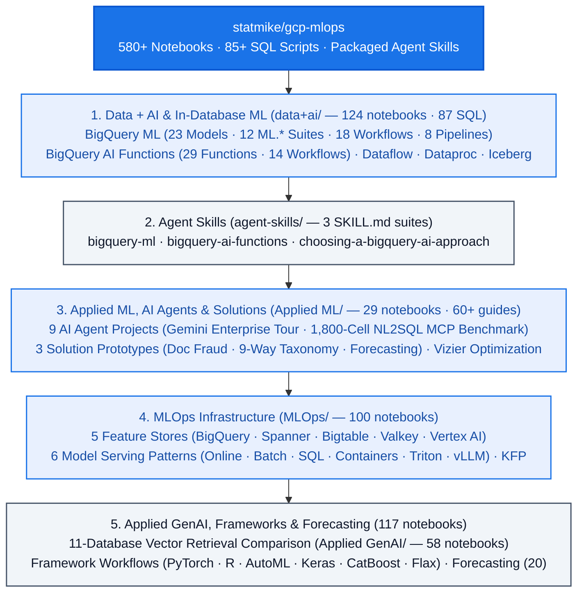

<!--- header table --->
<table>
<tr>     
  <td style="text-align: center">
    <a href="https://github.com/statmike/gcp-mlops/blob/main/readme.md">
      
       View on GitHub
    </a>
  </td>
</tr>
<tr>
  <td style="text-align: right">
    <b>Share On: </b> 
     
     
     
     
  </td>
</tr>
<tr>
  <td style="text-align: right">
    <b>Connect With Author On: </b> 
    
     
    
     
    
  </td>
</tr>
<tr>
  <td style="text-align: right">
     <a href="https://raw.githubusercontent.com/statmike/gcp-mlops/main/readme.md">Download File</a> <i>(right-click and "Save As")</i>
  </td>
</tr>
</table>  

---
# ML, MLOps, Data + AI, and Agents on Google Cloud
### Data Science Workflows for GCP

Google Cloud's AI platform has gone through several names over the years — **Cloud ML Engine**, then **AI Platform**, then **Vertex AI**, then **[Gemini Enterprise Agent Platform](https://cloud.google.com/blog/products/ai-machine-learning/introducing-gemini-enterprise-agent-platform)**, and unified under the **[Gemini Enterprise](https://cloud.google.com/gemini-enterprise)** umbrella (which brings together the developer **Agent Platform**, the employee-facing **Gemini Enterprise** app formerly known as Agentspace, and **Gemini Enterprise for Customer Experience**). Each name change tracked a real expansion in scope: from custom model training, to a unified ML platform with AutoML and managed notebooks, to the current platform where model building, agent development, evaluation, and enterprise governance live side by side.

This repository (`statmike/gcp-mlops`, formerly `vertex-ai-mlops`) has grown along that same path. It started as a collection of end-to-end training and serving workflows on Vertex AI and has expanded across the Google Cloud data and AI stack:
- **In-database ML, GenAI, and causal inference** in BigQuery (`CREATE MODEL`, `ML.*`, and `AI.*` functions)
- **AI agents and multi-agent architectures** built with ADK, MCP, MCP Toolbox for Databases, and A2A, deployed on Agent Engine
- **Cross-service MLOps infrastructure** — online and batch serving, five feature store architectures, Vertex AI Pipelines (KFP), Managed Airflow (formerly Cloud Composer), Dataflow (`RunInference`), and Dataproc Serverless Spark
- **Database-backed AI** across Spanner, AlloyDB, Cloud SQL, Bigtable, Memorystore/Valkey, and Firestore for feature serving, vector search, and SQL-based inference
- **Packaged Agent Skills** (`SKILL.md`) distilled from the notebooks and reference guides so AI coding agents can use the verified patterns and gotchas directly

Across the repository you will find **580+ interactive notebooks**, **85+ standalone SQL scripts**, and **deep reference guides**. Every workflow is written to be a clear, runnable starting point — heavy compute happens on Google Cloud services rather than your local machine, and related notebooks share datasets so you can compare approaches head to head.

---

## How the Repository Is Organized

### Quick Navigation by Question

| If you want to... | Go here |
|---|---|
| Train, evaluate, explain, or schedule models directly in BigQuery SQL | [**`data+ai/bq-ml/`**](./data+ai/bq-ml/README.md) |
| Call Gemini, generate embeddings, run hybrid search, or zero-shot forecast in SQL | [**`data+ai/bq-ai-functions/`**](./data+ai/bq-ai-functions/README.md) |
| Give your AI coding agent (Claude Code, Antigravity, Gemini CLI, Codex) verified BigQuery skills | [**`agent-skills/`**](./agent-skills/README.md) |
| Build, govern, benchmark, and deploy agents with ADK, MCP, A2A, and Agent Engine | [**`Applied ML/AI Agents/`**](./Applied%20ML/AI%20Agents/readme.md) |
| Compare 5 feature store architectures (BigQuery, Spanner, Bigtable, Valkey, Vertex AI) | [**`MLOps/Feature Store/`**](./MLOps/Feature%20Store/readme.md) |
| Compare serving patterns (Online, Batch, SQL, Cloud Run, GKE, Triton, vLLM) | [**`MLOps/Serving/`**](./MLOps/Serving/readme.md) |
| Compare 11 Google Cloud databases for vector search and RAG retrieval | [**`Applied GenAI/Retrieval/`**](./Applied%20GenAI/Retrieval/readme.md) |
| Compare ML training & batch inference across 7 GCP compute services on the same dataset | [**`data+ai/overview/ml-training/`**](./data+ai/overview/ml-training/readme.md) |
| See end-to-end multi-service applications (Document Fraud, 9-Way Taxonomy, Forecasting) | [**`Applied ML/Solution Prototypes/`**](./Applied%20ML/Solution%20Prototypes/readme.md) |
| Train and serve with PyTorch, Keras, CatBoost, Flax, AutoML, or R across GCP runtimes | [**`Framework Workflows/`**](./Framework%20Workflows/readme.md) |

---

## Repository Pillars

Each section below has its own detailed `readme.md` with vertical architecture diagrams and full notebook/SQL inventories:

### 1. [Data + AI (`data+ai/`)](./data+ai/readme.md) — 124 notebooks & 87 SQL scripts
Machine learning, generative AI, causal inference, and data engineering across Google Cloud's data services — bringing model training, foundation-model inference, and orchestration directly to where the data lives.
- **[BigQuery ML (`bq-ml/`)](./data+ai/bq-ml/README.md)** (62 notebooks · 58 SQL scripts · [Overview](./data+ai/bq-ml/overview.ipynb) · [Reference](./data+ai/bq-ml/RESOURCES.md)) — **23 model types**, **12 model-free `ML.*` function suites**, **18 end-to-end SQL workflows** (including a 7-part **Causal Inference & Econometrics** suite: Propensity Score Matching/IPTW, Double ML Price Elasticity, Uplift/CATE, Difference-in-Differences with Callaway–Sant'Anna, Synthetic Control, `AI.CAUSAL_EFFECT`, and Survival Analysis, plus Point-in-Time Feature Store leakage quantification and Hierarchical Forecasting), and **8 production orchestration pipelines** (SQL Scripting, Scheduled Queries, Dataform, Cloud Workflows, dbt, Vertex KFP, and Managed Airflow).
- **[BigQuery AI Functions (`bq-ai-functions/`)](./data+ai/bq-ai-functions/README.md)** (45 notebooks · 29 SQL scripts · [Overview](./data+ai/bq-ai-functions/overview.ipynb) · [Reference](./data+ai/bq-ai-functions/RESOURCES.md)) — **29 individual function guides** (`AI.GENERATE*`, `AI.CLASSIFY`, `AI.IF`, `AI.SCORE`, `AI.AGG`, `AI.EMBED`, `VECTOR_SEARCH`, `AI.SEARCH`, `AI.FORECAST`, `AI.DETECT_ANOMALIES`, `AI.PREDICT` TabFM, `AI.CAUSAL_EFFECT`, `AI.KEY_DRIVERS`, and pre-trained Cloud AI services) plus **14 composed workflows** (RAG, Hybrid Catalog Search with Rank Fusion, Web-Grounded Enrichment, Document & Time Series Intelligence, and Image Deduplication).
- **Cross-Service Data + AI** — [7-Way ML Training & Batch Inference Comparison](./data+ai/overview/ml-training/readme.md), [Dataflow `RunInference` & GPU Benchmark](./data+ai/dataflow/readme.md), [Dataproc Serverless Spark](./data+ai/dataproc/readme.md), [Managed Airflow](./data+ai/composer/readme.md), [BigQuery Managed Iceberg](./data+ai/bq-iceberg/readme.md), [BigQuery Continuous Queries](./data+ai/bq-solutions/readme.md), [Tabular Data Read Benchmarks](./data+ai/tabular-data/readme.md), and SQL inference in [AlloyDB](./data+ai/alloydb/readme.md) & [Spanner](./data+ai/spanner/readme.md).
- **$\rightarrow$ Full catalog & Data + AI decision flow:** **[`data+ai/readme.md`](./data+ai/readme.md)**

---

### 2. [Agent Skills (`agent-skills/`)](./agent-skills/README.md) — 3 `SKILL.md` suites & verification CLI
Packaged, cross-tool **[Agent Skills](https://code.claude.com/docs/en/skills.md)** distilled from this repository's live-tested notebooks and references so AI coding agents (Claude Code, Google Antigravity, Gemini CLI, Codex) get use-case decision trees, verified gotchas, and 104 extracted notebook narratives rather than guessing syntax:
- **[`bigquery-ml`](./agent-skills/.agents/skills/bigquery-ml/SKILL.md)** · **[`bigquery-ai-functions`](./agent-skills/.agents/skills/bigquery-ai-functions/SKILL.md)** · **[`choosing-a-bigquery-ai-approach`](./agent-skills/.agents/skills/choosing-a-bigquery-ai-approach/SKILL.md)** (triage router with head-to-head comparisons like `ARIMA_PLUS` vs. `AI.FORECAST` and `CONTRIBUTION_ANALYSIS` vs. `AI.KEY_DRIVERS`).
- Auto-discovered at the repository root via `.agents/skills/` and `.claude/skills/`, and backed by the standalone `agent-skills` CLI (`sweep`, `validate`, `check-pinned-models`).
- **$\rightarrow$ Full catalog & authoring standard:** **[`agent-skills/README.md`](./agent-skills/README.md)**

---

### 3. [Applied ML, AI Agents & Solution Prototypes (`Applied ML/`)](./Applied%20ML/readme.md) — 29 notebooks & 60+ guides
Where `MLOps/` focuses on serving and infrastructure, `Applied ML/` focuses on what you build *with* models — autonomous multi-agent systems, multi-service business applications, and black-box optimization:
- **[AI Agents (`Applied ML/AI Agents/`)](./Applied%20ML/AI%20Agents/readme.md)** (9 projects built with ADK, MCP, MCP Toolbox for Databases, and A2A) — Led by **[Agent Building: A Tour of the Gemini Enterprise Agent Platform](./Applied%20ML/AI%20Agents/agent-building/README.md)** (exercising Agent Runtime, Memory Bank, Identity, Registry, Model Armor, and a mixed Gemini 3 + Claude fleet) and the **[Data MCP Sandbox](./Applied%20ML/AI%20Agents/data-mcp-sandbox/README.md)** (a controlled **1,800-cell / 12-arm empirical NL2SQL benchmark** measuring the exact accuracy and token-cost impact of Dataplex/Looker governance and MCP tool schemas), plus **[BigQuery Context Discovery](./Applied%20ML/AI%20Agents/bigquery-context/readme.md)**, **[Data Onboarding](./Applied%20ML/AI%20Agents/data-onboarding/readme.md)**, **[RFI Response Agent](./Applied%20ML/AI%20Agents/rfi-agent/README.md)**, **[Image-to-Graph Agent](./Applied%20ML/AI%20Agents/image-to-graph/readme.md)**, **[Concept-BQ](./Applied%20ML/AI%20Agents/concept-bq/readme.md)**, **[Conversational Analytics API](./Applied%20ML/AI%20Agents/conversational-analytics-api/readme.md)**, and **[Travel Planner (A2A)](./Applied%20ML/AI%20Agents/travel-planner/README.md)**.
- **[Solution Prototypes (`Applied ML/Solution Prototypes/`)](./Applied%20ML/Solution%20Prototypes/readme.md)** (13 notebooks) — **[Document Processing & Fraud Detection](./Applied%20ML/Solution%20Prototypes/document-processing/readme.md)** (8 notebooks), **[Product Hierarchy Classification](./Applied%20ML/Solution%20Prototypes/product-hierarchy/README.md)** (9 approaches across flat, top-down cascade, and Keras Multi-Task Learning, both Python-first and SQL-first), and **[Conversational Time Series Forecasting](./Applied%20ML/Solution%20Prototypes/time-series/readme.md)** (3 notebooks).
- **[Optimization with Vertex AI Vizier](./Applied%20ML/Optimization/readme.md)**, **[Hierarchical Forecasting](./Applied%20ML/Forecasting/readme.md)**, and **[Anomaly Detection](./Applied%20ML/Anomaly%20Detection/readme.md)**.
- **$\rightarrow$ Full catalog & Applied ML architecture map:** **[`Applied ML/readme.md`](./Applied%20ML/readme.md)**

---

### 4. [MLOps Infrastructure (`MLOps/`)](./MLOps/readme.md) — 100 notebooks
Everything between training a model and operating a fleet of models in production:
- **[Feature Stores (`MLOps/Feature Store/`)](./MLOps/Feature%20Store/readme.md)** (45 notebooks + [5 Architecture Slide Decks](./MLOps/Feature%20Store/Feature%20Store%20Overview.pdf)) — Five architectures built on the same BigQuery offline data across the latency/cost spectrum: **[BigQuery](./MLOps/Feature%20Store/BigQuery/readme.md)** (3), **[Spanner](./MLOps/Feature%20Store/Spanner/readme.md)** (12), **[Bigtable](./MLOps/Feature%20Store/Bigtable/readme.md)** (15), **[Valkey / Memorystore](./MLOps/Feature%20Store/Valkey/readme.md)** (9), and **[Vertex AI Feature Store](./MLOps/Feature%20Store/vertex/readme.md)** (6).
- **[Model Serving (`MLOps/Serving/`)](./MLOps/Serving/readme.md)** (32 notebooks) — **[Online Endpoints](./MLOps/Serving/Online/readme.md)** (7), **[Batch Inference](./MLOps/Serving/Batch/readme.md)** (4), **[SQL Inference](./MLOps/Serving/SQL%20Inference/readme.md)** (5), **[Cloud Run / GKE / Cloud Functions](./MLOps/Serving/Platforms/readme.md)** (4), **[NVIDIA Triton](./MLOps/Serving/Triton/readme.md)** (5), and **[vLLM](./MLOps/Serving/vLLM/readme.md)** (6).
- **[Vertex AI Pipelines / KFP](./MLOps/Pipelines/readme.md)** (13 notebooks), **[Model Evaluation](./MLOps/Model%20Evaluation/readme.md)** (3), **[Model Monitoring](./MLOps/Model%20Monitoring/readme.md)** (2), **[Experiment Tracking](./MLOps/Experiment%20Tracking/readme.md)** (1), and **[Development Environments](./MLOps/Development%20Environments/readme.md)** (2).
- **$\rightarrow$ Full catalog & MLOps stack diagram:** **[`MLOps/readme.md`](./MLOps/readme.md)**

---

### 5. [Applied GenAI (`Applied GenAI/`)](./Applied%20GenAI/readme.md) — 58 active notebooks
Grounding generative models with your own data across the full RAG and multimodal pipeline:
- **[Vector Search & Retrieval Across 11 Databases (`Retrieval/`)](./Applied%20GenAI/Retrieval/readme.md)** (14 notebooks comparing BigQuery, Vertex Vector Search, Feature Store, Spanner, AlloyDB, Cloud SQL, Memorystore/Valkey, Firestore, Bigtable, Local, and ChromaDB), **[Generate](./Applied%20GenAI/Generate/readme.md)** (13), **[Embeddings](./Applied%20GenAI/Embeddings/readme.md)** (9), **[Solutions & Hybrid Search (Dense + BM25 + RRF)](./Applied%20GenAI/Solutions/readme.md)** (7), **[RAG Engine](./Applied%20GenAI/rag-engine/readme.md)** (1), **[Structure-Aware Chunking](./Applied%20GenAI/Chunking/readme.md)** (3), **[Evaluation](./Applied%20GenAI/Evaluation/readme.md)** (2), **[Ranking](./Applied%20GenAI/Ranking/readme.md)** (1), and **[Validate](./Applied%20GenAI/Validate/readme.md)** (1).
- **$\rightarrow$ Full catalog & GenAI pipeline diagram:** **[`Applied GenAI/readme.md`](./Applied%20GenAI/readme.md)**

---

### 6. [Framework Workflows](./Framework%20Workflows/readme.md), [Applied Forecasting](./Applied%20Forecasting/readme.md) & Foundational Series
- **[Framework Workflows (`Framework Workflows/`)](./Framework%20Workflows/readme.md)** (39 notebooks) — Shared BigQuery dataset, Feature Store, and Model Registry exercised across **[PyTorch](./Framework%20Workflows/PyTorch/readme.md)** (20 notebooks across 19 serving targets), **[R on Google Cloud](./Framework%20Workflows/R/readme.md)** (6 notebooks across 4 runtimes + Iceberg/`arrow`), **[Vertex AI AutoML](./Framework%20Workflows/Vertex%20AI%20AutoML/readme.md)** (6), **[Keras 3](./Framework%20Workflows/Keras/readme.md)** (3), **[CatBoost](./Framework%20Workflows/CatBoost/readme.md)** (3), and **[Flax / JAX](./Framework%20Workflows/Flax/readme.md)** (1).
- **[Applied Forecasting (`Applied Forecasting/`)](./Applied%20Forecasting/readme.md)** (20 notebooks) — Progressive time-series curriculum on NYC Citi Bike data: `ARIMA_PLUS`, `ARIMA_PLUS_XREG`, regression lags, AutoML Forecasting, Seq2Seq+, TFT, TiDE, Prophet (training, containers, online CPR), **TimesFM & TimesFM 2.5**, and KFP forecasting tournaments.
- **Foundational Numbered Series & Utilities**: **[`00 - Setup`](./00%20-%20Setup/readme.md)** · **[`01 - Data Sources`](./01%20-%20Data%20Sources/readme.md)** · **[`02 - Vertex AI AutoML`](./02%20-%20Vertex%20AI%20AutoML/readme.md)** (6) · **[`03 - BigQuery ML (BQML)`](./03%20-%20BigQuery%20ML%20%28BQML%29/readme.md)** (26) · **[`04 - scikit-learn`](./04%20-%20scikit-learn/readme.md)** (12) · **[`05 - TensorFlow`](./05%20-%20TensorFlow/readme.md)** (28) · **[`Working With/Document AI`](./Working%20With/readme.md)** (8) · **[`Tips`](./Tips/readme.md)** (13) · **[`architectures/`](./architectures/readme.md)** (28) · **[`readme-legacy.md`](./readme-legacy.md)** (complete historical index).

---

## How to Use These Notebooks

Every notebook in this repository is designed around three practical rules:
1. **Self-contained and portable** — Narrative explanations, architecture diagrams, setup cells, and cleanup cells live in a single `.ipynb` file (with one-click links in the header to open in **Colab**, **Colab Enterprise**, **BigQuery Studio**, or **Vertex AI Workbench**).
2. **Cloud-orchestrated compute** — Notebooks orchestrate BigQuery, Vertex AI, Dataflow, Dataproc, and Cloud Run rather than crunching large datasets locally, so almost every notebook runs comfortably on the smallest standard runtime.
3. **Application Default Credentials (ADC) only** — No service account JSON keys are ever created or stored; local workflows use `gcloud auth application-default login` and cloud runtimes use attached service accounts.

---

## Contributing & License

- **Contributing**: Issues, discussions, and pull requests are welcome — see [CONTRIBUTING.md](./CONTRIBUTING.md), [CODE_OF_CONDUCT.md](./CODE_OF_CONDUCT.md), and [SECURITY.md](./SECURITY.md).
- **License**: Apache 2.0 — see [LICENSE](./LICENSE).

*This repository is maintained by Mike Henderson ([@statmike](https://github.com/statmike)). It is built on Google Cloud products for learning and reference and is not an officially supported Google product.*
