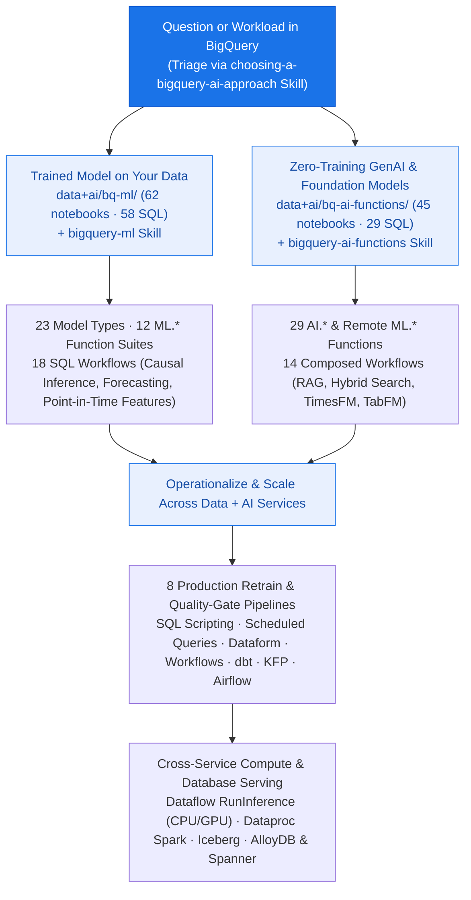
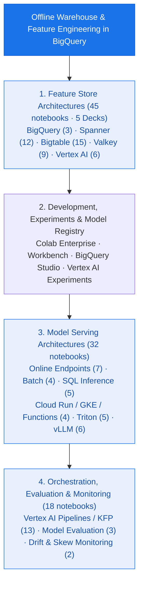

<!--- header table --->
<table>
<tr>     
  <td style="text-align: center">
    <a href="https://github.com/statmike/gcp-mlops/blob/main/readme.md">
      
       View on GitHub
    </a>
  </td>
</tr>
<tr>
  <td style="text-align: right">
    <b>Share On: </b> 
     
     
     
     
  </td>
</tr>
<tr>
  <td style="text-align: right">
    <b>Connect With Author On: </b> 
    
     
    
     
    
  </td>
</tr>
<tr>
  <td style="text-align: right">
     <a href="https://raw.githubusercontent.com/statmike/gcp-mlops/main/readme.md">Download File</a> <i>(right-click and "Save As")</i>
  </td>
</tr>
</table>  

---
# MLOps, Data + AI, and Agents on Google Cloud

Google Cloud's AI platform has gone through several names over the years — **Cloud ML Engine**, then **AI Platform**, then **Vertex AI**, and as of April 2026, **[Gemini Enterprise Agent Platform](https://cloud.google.com/blog/products/ai-machine-learning/introducing-gemini-enterprise-agent-platform)**. Each name change tracked a real expansion in scope: from custom model training, to a unified ML platform with AutoML and managed notebooks, to the current platform where model building, agent development, evaluation, and governance live side by side.

This repository (`statmike/gcp-mlops`, formerly `vertex-ai-mlops`) has grown along that same path. It started as a collection of end-to-end training and serving workflows on Vertex AI and has expanded across the Google Cloud data and AI stack:
- **In-database ML, GenAI, and causal inference** in BigQuery (`CREATE MODEL`, `ML.*`, and `AI.*` functions)
- **AI agents and multi-agent architectures** built with ADK, MCP, MCP Toolbox for Databases, and A2A, deployed on Agent Engine
- **Cross-service MLOps infrastructure** — online and batch serving, five feature store architectures, Vertex AI Pipelines (KFP), Managed Airflow (formerly Cloud Composer), Dataflow (`RunInference`), and Dataproc Serverless Spark
- **Database-backed AI** across Spanner, AlloyDB, Cloud SQL, Bigtable, Memorystore/Valkey, and Firestore for feature serving, vector search, and SQL-based inference
- **Packaged Agent Skills** (`SKILL.md`) distilled from the notebooks and reference guides so AI coding agents can use the verified patterns and gotchas directly

Across the repository you will find **580+ interactive notebooks**, **85+ standalone SQL scripts**, and **deep reference guides**. Every workflow is written to be a clear, runnable starting point — heavy compute happens on Google Cloud services rather than your local machine, and related notebooks share datasets so you can compare approaches head to head.

---

## How the Repository Is Organized

```mermaid
flowchart TD
    Start["statmike/gcp-mlops<br/>580+ Notebooks · 85+ SQL Scripts · Agent Skills"]

    subgraph Layer1["1. Data + AI & In-Database ML (data+ai/)"]
        direction TB
        BQML["BigQuery ML (bq-ml/)<br/>23 Model Types · 12 ML.* Function Suites<br/>18 SQL Workflows (incl. Causal Inference) · 8 Pipelines"]
        BQAI["BigQuery AI Functions (bq-ai-functions/)<br/>29 AI.* & Remote ML.* Functions<br/>14 Composed GenAI, Search & Forecasting Workflows"]
        DataServices["Cross-Service Data + AI<br/>7-Way Training Comparison · Dataflow RunInference<br/>Dataproc Spark · Managed Airflow · Iceberg · AlloyDB & Spanner"]
        BQML --> BQAI --> DataServices
    end

    subgraph Layer2["2. AI Agents, GenAI & Solution Prototypes"]
        direction TB
        Agents["Applied AI Agents (Applied ML/AI Agents/)<br/>Gemini Enterprise Platform Tour · 1,800-Cell NL2SQL MCP Benchmark<br/>BigQuery Context Discovery · Data Onboarding · RFI & Image-to-Graph"]
        Solutions["Solution Prototypes (Applied ML/Solution Prototypes/)<br/>Document Processing & Fraud Agent (8 notebooks)<br/>9-Way Product Hierarchy Classification · Time Series Chat Agent"]
        GenAI["Applied GenAI (Applied GenAI/)<br/>11-Database Vector Retrieval Comparison · Multimodal Embeddings<br/>Structure-Aware Chunking · Ranking · Grounding · Hybrid Search"]
        Agents --> Solutions --> GenAI
    end

    subgraph Layer3["3. MLOps Infrastructure (MLOps/)"]
        direction TB
        Serving["Model Serving (32 notebooks)<br/>Online Endpoints · Batch · SQL Inference<br/>Cloud Run / GKE / Functions · Triton · vLLM"]
        FeatureStore["Feature Stores (45 notebooks)<br/>5 Architectures on Shared Data:<br/>BigQuery · Spanner · Bigtable · Valkey · Vertex AI"]
        Pipelines["Pipelines, Monitoring & Evaluation (20 notebooks)<br/>Vertex AI Pipelines (KFP) · Drift & Skew Monitoring<br/>Model Registry Evaluation · Experiments · Dev Environments"]
        Serving --> FeatureStore --> Pipelines
    end

    subgraph Layer4["4. Frameworks, Forecasting & Agent Skills"]
        direction TB
        Skills["Agent Skills (agent-skills/)<br/>bigquery-ml · bigquery-ai-functions<br/>choosing-a-bigquery-ai-approach"]
        Frameworks["Framework & Forecasting Series<br/>PyTorch (20) · R on GCP (6) · Keras · CatBoost · Flax · AutoML<br/>Applied Forecasting (20) · TensorFlow (28) · scikit-learn (12)"]
        Skills --> Frameworks
    end

    Start --> Layer1
    Layer1 --> Layer2
    Layer2 --> Layer3
    Layer3 --> Layer4

    classDef root fill:#1a73e8,stroke:#0b57d0,color:#fff
    classDef highlight fill:#e8f0fe,stroke:#1a73e8,color:#174ea6
    class Start root
    class BQML,BQAI,Agents,Serving,FeatureStore,Skills highlight
```

### Quick Navigation by Question

| If you want to... | Go here |
|---|---|
| Train, evaluate, explain, or schedule models directly in BigQuery SQL | [**`data+ai/bq-ml/`**](./data+ai/bq-ml/README.md) |
| Call Gemini, generate embeddings, run hybrid search, or zero-shot forecast in SQL | [**`data+ai/bq-ai-functions/`**](./data+ai/bq-ai-functions/README.md) |
| Give your AI coding agent (Claude Code, Antigravity, Gemini CLI, Codex) verified BigQuery skills | [**`agent-skills/`**](./agent-skills/README.md) |
| Build, govern, benchmark, and deploy agents with ADK, MCP, A2A, and Agent Engine | [**`Applied ML/AI Agents/`**](./Applied%20ML/AI%20Agents/readme.md) |
| Compare 5 feature store architectures (BigQuery, Spanner, Bigtable, Valkey, Vertex AI) | [**`MLOps/Feature Store/`**](./MLOps/Feature%20Store/readme.md) |
| Compare serving patterns (Online, Batch, SQL, Cloud Run, GKE, Triton, vLLM) | [**`MLOps/Serving/`**](./MLOps/Serving/readme.md) |
| Compare 11 Google Cloud databases for vector search and RAG retrieval | [**`Applied GenAI/Retrieval/`**](./Applied%20GenAI/Retrieval/readme.md) |
| Compare ML training & batch inference across 7 GCP compute services on the same dataset | [**`data+ai/overview/ml-training/`**](./data+ai/overview/ml-training/readme.md) |
| See end-to-end multi-service applications (Document Fraud, 9-Way Taxonomy, Forecasting) | [**`Applied ML/Solution Prototypes/`**](./Applied%20ML/Solution%20Prototypes/readme.md) |
| Train and serve with PyTorch, Keras, CatBoost, Flax, AutoML, or R across GCP runtimes | [**`Framework Workflows/`**](./Framework%20Workflows/readme.md) |

---

## [Data + AI](./data+ai/readme.md) — 124 notebooks & 87 SQL scripts

Machine learning and generative AI across Google Cloud's data services — bringing model training, inference, and orchestration to where the data already lives.

### [BigQuery ML (`data+ai/bq-ml/`)](./data+ai/bq-ml/README.md) — 62 notebooks & 58 SQL scripts
A complete, live-verified learning and reference system for training, evaluating, explaining, and operationalizing models in SQL ([Interactive Overview](./data+ai/bq-ml/overview.ipynb) · [Detailed Reference](./data+ai/bq-ml/RESOURCES.md) · [Setup](./data+ai/bq-ml/setup/README.md)):
- **[23 Model Types (`models/`)](./data+ai/bq-ml/README.md#models)** — Per-model lifecycle deep dives (create $\to$ evaluate $\to$ predict $\to$ explain $\to$ tune), each with a runnable `.ipynb` and standalone `.sql` file:
  - *Supervised Classification & Regression*: `LOGISTIC_REG`, `LINEAR_REG`, `BOOSTED_TREE_CLASSIFIER`, `BOOSTED_TREE_REGRESSOR`, `RANDOM_FOREST_CLASSIFIER`, `RANDOM_FOREST_REGRESSOR`, `DNN_CLASSIFIER`, `DNN_REGRESSOR`, `WIDE_AND_DEEP` (`DNN_LINEAR_COMBINED_*`), and `AUTOML_*` — trained on shared datasets for direct accuracy and runtime comparison.
  - *Unsupervised, Time Series, & Specialized*: `KMEANS`, `PCA`, `AUTOENCODER`, `MATRIX_FACTORIZATION` (with on-demand reservation setup/teardown), `CONTRIBUTION_ANALYSIS`, `ARIMA_PLUS`, and `ARIMA_PLUS_XREG`.
  - *Lifecycle & Portability*: `TRANSFORM_ONLY` (reusable preprocessing pipelines), `IMPORTED` (`TENSORFLOW`, `ONNX`, `XGBOOST`), `EXPORT MODEL` (to GCS and Vertex AI Model Registry), and `REMOTE` (custom Vertex AI Endpoints).
- **[12 Model-Free `ML.*` Function Suites (`functions/`)](./data+ai/bq-ml/README.md#functions)** — Standalone utilities and `TRANSFORM`-clause building blocks with empirically verified edge cases:
  - `ML.DESCRIBE_DATA` & `ML.CORRELATION` (data profiling), `ML.FEATURES_AT_TIME` & `ML.ENTITY_FEATURES_AT_TIME` (point-in-time feature store retrieval), `ML.METRICS` (model-free evaluation), `ML.VALIDATE_DATA_SKEW` & `ML.VALIDATE_DATA_DRIFT` (distribution monitoring), `ML.TREND` / `ML.SEASONALITY` / `ML.DETECT_CHANGE_POINTS` (time-series decomposition), `ML.DECODE_IMAGE` / `ML.RESIZE_IMAGE` / `ML.CONVERT_COLOR_SPACE` (in-SQL vision tensors), plus scalers, encoders, feature crosses, bucketizers, vector distances (`ML.DISTANCE`, `ML.LP_NORM`), and text (`ML.TF_IDF`, `ML.NGRAMS`, `ML.BAG_OF_WORDS`).
- **[18 End-to-End SQL Workflows (`workflows/`)](./data+ai/bq-ml/README.md#workflows)** — Composing preprocessing and models into complete business and statistical workflows:
  - *Causal Inference & Econometrics in SQL*: [Propensity Score Matching & IPTW](./data+ai/bq-ml/workflows/propensity_score_matching/), [Price Elasticity via Double ML (5-fold cross-fitting)](./data+ai/bq-ml/workflows/price_elasticity_dml/), [Uplift Modeling / CATE (T-Learner)](./data+ai/bq-ml/workflows/uplift_cate/), [Difference-in-Differences (including staggered-adoption Callaway–Sant'Anna comparison)](./data+ai/bq-ml/workflows/difference_in_differences/), [Synthetic Control](./data+ai/bq-ml/workflows/synthetic_control/), [Univariate Counterfactuals (`AI.CAUSAL_EFFECT` vs. `ARIMA_PLUS`)](./data+ai/bq-ml/workflows/causal_effect/), and [Survival Analysis (Kaplan-Meier & discrete-time hazard in SQL vs. `lifelines` Cox PH)](./data+ai/bq-ml/workflows/survival_analysis/).
  - *Predictive & Analytical Workflows*: [Point-in-Time Feature Store (measuring the exact `roc_auc` cost of training/serving leakage)](./data+ai/bq-ml/workflows/feature_store/), [Hierarchical Forecasting (Bottom-Up vs. Top-Down)](./data+ai/bq-ml/workflows/hierarchical_forecasting/), [Regression-Based Forecasting](./data+ai/bq-ml/workflows/regression_based_forecasting/), [Embeddings for Hierarchical Classification](./data+ai/bq-ml/workflows/embeddings_classification/), [Customer Segmentation (RFM)](./data+ai/bq-ml/workflows/customer_segmentation/), [Order-Lapse Churn](./data+ai/bq-ml/workflows/churn_retention/), [GA4 Behavioral Churn](./data+ai/bq-ml/workflows/ga4_churn_prediction/), [Collaborative Filtering Recommendations](./data+ai/bq-ml/workflows/recommendation/), [Ground-Truth Fraud/Anomaly Detection](./data+ai/bq-ml/workflows/anomaly_fraud_detection/), [5-Fold Cross-Validation in SQL](./data+ai/bq-ml/workflows/cross_validation/), and [Stacked Ensembling](./data+ai/bq-ml/workflows/ensembling/).
- **[8 Production Orchestration Pipelines (`pipelines/`)](./data+ai/bq-ml/README.md#pipelines)** — The same drift-detection, conditional retraining, quality-gating, and batch-scoring logic implemented across eight orchestrators:
  - [BigQuery SQL Scripting](./data+ai/bq-ml/pipelines/sql_scripting/), [BigQuery Scheduled Queries](./data+ai/bq-ml/pipelines/scheduled_queries/), [Dataform (with assertion gates)](./data+ai/bq-ml/pipelines/dataform/), [Cloud Workflows](./data+ai/bq-ml/pipelines/cloud_workflows/), [dbt (`dbt build` + custom `bqml_model` materialization)](./data+ai/bq-ml/pipelines/dbt/), [Vertex AI Pipelines (KFP prebuilt BQML components)](./data+ai/bq-ml/pipelines/vertex_kfp/), [Managed Airflow Gen 3](./data+ai/bq-ml/pipelines/composer_airflow/), and [Managed Airflow triggering Vertex AI Pipelines](./data+ai/bq-ml/pipelines/airflow_with_kfp/).

### [BigQuery AI Functions (`data+ai/bq-ai-functions/`)](./data+ai/bq-ai-functions/README.md) — 45 notebooks & 29 SQL scripts
Progressive guide to calling Gemini, embedding models, foundation models (TimesFM, TabFM), and pre-trained Cloud AI services directly from BigQuery SQL ([Interactive Overview](./data+ai/bq-ai-functions/overview.ipynb) · [Detailed Reference](./data+ai/bq-ai-functions/RESOURCES.md) · [Setup](./data+ai/bq-ai-functions/setup/README.md)):
- **[29 Individual Function Guides (`functions/`)](./data+ai/bq-ai-functions/README.md#function-map)** — Runnable notebook (`.ipynb` with SQL + BigFrames) and `.sql` script for every function:
  - *Generation & Structured Output*: `AI.GENERATE`, `AI.GENERATE_TEXT`, `ML.GENERATE_TEXT`, `AI.GENERATE_TABLE`, `AI.GENERATE_BOOL`, `AI.GENERATE_INT`, `AI.GENERATE_DOUBLE`
  - *Classification, Scoring & Aggregation*: `AI.CLASSIFY`, `AI.IF`, `AI.SCORE`, `AI.AGG`, `AI.SUMMARIZE`
  - *Embeddings, Vector Search & Hybrid Search*: `AI.EMBED`, `ML.GENERATE_EMBEDDING`, `AI.SIMILARITY`, `VECTOR_SEARCH`, `AI.SEARCH`
  - *Zero-Training Predictive & Diagnostic AI*: `AI.FORECAST`, `AI.DETECT_ANOMALIES`, `AI.EVALUATE`, `AI.PREDICT` (TabFM), `AI.CAUSAL_EFFECT`, `AI.KEY_DRIVERS`
  - *Document & Pre-Trained Cloud AI Services*: `ML.PROCESS_DOCUMENT`, `ML.ANNOTATE_IMAGE`, `ML.TRANSLATE`, `ML.UNDERSTAND_TEXT`, `ML.TRANSCRIBE`, and `AI.PARSE_DOCUMENT`
- **[14 End-to-End Composed Workflows (`workflows/`)](./data+ai/bq-ai-functions/README.md#workflows)** — [Data Enrichment (Web Grounding + TabFM)](./data+ai/bq-ai-functions/workflows/data_enrichment/), [Content Analysis Pipeline](./data+ai/bq-ai-functions/workflows/content_analysis/), [Semantic Search (3 ways)](./data+ai/bq-ai-functions/workflows/semantic_search/), [Hybrid Product Catalog Search (Rank Fusion analysis)](./data+ai/bq-ai-functions/workflows/catalog_search/), [RAG Pipeline](./data+ai/bq-ai-functions/workflows/rag_pipeline/), [Time Series Intelligence](./data+ai/bq-ai-functions/workflows/time_series_intelligence/), [Zero-Shot Tabular Prediction](./data+ai/bq-ai-functions/workflows/tabular_prediction/), [Metric Diagnostics (with placebo causal checks)](./data+ai/bq-ai-functions/workflows/metric_diagnostics/), [Document Intelligence](./data+ai/bq-ai-functions/workflows/document_intelligence/), [Content Moderation](./data+ai/bq-ai-functions/workflows/content_moderation/), [Multimodal Document Analysis](./data+ai/bq-ai-functions/workflows/multimodal_analysis/), [Support Ticket & Log Triage with Hybrid Search](./data+ai/bq-ai-functions/workflows/log_analysis/), and [Image Deduplication for Train/Test Integrity](./data+ai/bq-ai-functions/workflows/image_deduplication/).

### Cross-Service Data + AI Workflows
- **[ML Training & Batch Inference Overview (`data+ai/overview/ml-training/`)](./data+ai/overview/ml-training/readme.md)** (7 notebooks) — Side-by-side comparison on the same fraud dataset across **BigFrames + XGBoost**, **BigQuery ML**, **Dataproc Serverless Spark (PySpark & SparkR)**, **Vertex AI Custom Training (Python & R + Vizier)**, **Colab Enterprise (`NotebookExecutionJob`)**, **Vertex AI Model Registry**, and a **5-branch parallel KFP Pipeline**.
- **[Dataflow Streaming & GPU Inference (`data+ai/dataflow/`)](./data+ai/dataflow/readme.md)** (3 notebooks + benchmark report) — Apache Beam `RunInference` fundamentals, zero-downtime model hot-swapping (event-driven Pub/Sub mode and polling watch mode), a [Python-to-Java `RunInference` translation guide](./data+ai/dataflow/python-to-java.md), and a full [GPU inference benchmark study](./data+ai/dataflow/gpu/benchmark/reports/benchmark_report.md) comparing local Dataflow GPUs against Vertex AI Endpoints.
- **[Dataproc Managed Spark (`data+ai/dataproc/`)](./data+ai/dataproc/readme.md)** (4 notebooks) — Dataproc Serverless fundamentals, distributed batch inference with Pandas UDFs, Structured Streaming with `foreachBatch`, and calling Vertex AI Endpoints from Spark.
- **[Managed Airflow / Cloud Composer (`data+ai/composer/`)](./data+ai/composer/readme.md)** — Four production DAG patterns orchestrating batch inference across Dataproc, Dataflow, Vertex AI Pipelines (KFP), and Vertex AI Batch Prediction.
- **[BigQuery Managed Apache Iceberg (`data+ai/bq-iceberg/`)](./data+ai/bq-iceberg/readme.md)** (1 notebook) — Building a multi-shard Parquet Iceberg table in GCS from Chicago Taxi data and reading it via BigFrames, BigQuery Storage Read API, and multithreaded R `arrow`.
- **[BigQuery Continuous Queries (`data+ai/bq-solutions/`)](./data+ai/bq-solutions/readme.md)** (1 notebook) — Real-time GA4 funnel analytics, traffic anomaly detection, and conversion monitoring with BigQuery Continuous Queries.
- **[Tabular Data Read Benchmarks (`data+ai/tabular-data/`)](./data+ai/tabular-data/readme.md)** (1 notebook) — Cost and throughput benchmarks comparing BigQuery standard queries, Storage Read API, BigFrames, and `pandas-gbq` (including multi-threaded arrow/avro reads).
- **[Database SQL Inference (`AlloyDB`, `Spanner`, & Portfolio Guides)](./data+ai/readme.md)** — Calling Vertex AI Endpoints directly from SQL in [AlloyDB AI](./data+ai/alloydb/readme.md) and [Spanner ML](./data+ai/spanner/readme.md), plus cross-service architecture guides for [Model Serving / Inference](./data+ai/model-serving.md) and [Google Cloud Databases for AI/ML](./data+ai/gcp-databases.md).

---

## [Agent Skills (`agent-skills/`)](./agent-skills/README.md)

Packaged, cross-tool **[Agent Skills](https://code.claude.com/docs/en/skills.md)** distilled from this repository's live-tested notebooks and `RESOURCES.md` references. Instead of leaving an AI coding agent to guess SQL syntax or rediscover undocumented option interactions, these skills provide use-case decision trees, verified gotchas (with exact error messages and measured metric swings), canonical snippets, and 104 extracted notebook narratives.

| Skill | Scope | Path |
|---|---|---|
| **[`bigquery-ml`](./agent-skills/.agents/skills/bigquery-ml/SKILL.md)** | Training, evaluating, explaining, exporting, and orchestrating models in BigQuery SQL (`CREATE MODEL`, all `ML.*` functions, point-in-time features, causal workflows, and 8 pipeline patterns) | `agent-skills/.agents/skills/bigquery-ml/` |
| **[`bigquery-ai-functions`](./agent-skills/.agents/skills/bigquery-ai-functions/SKILL.md)** | Calling Gemini, embeddings (`AI.EMBED`), semantic/hybrid search (`VECTOR_SEARCH`, `AI.SEARCH`), zero-shot forecasting (`AI.FORECAST`), tabular prediction (`AI.PREDICT`), `AI.KEY_DRIVERS`, and pre-trained Cloud AI services in SQL | `agent-skills/.agents/skills/bigquery-ai-functions/` |
| **[`choosing-a-bigquery-ai-approach`](./agent-skills/.agents/skills/choosing-a-bigquery-ai-approach/SKILL.md)** | Triage router that helps an agent or user pick between a trained `bigquery-ml` model and a zero-training `bigquery-ai-functions` call (with worked head-to-head comparisons such as `ARIMA_PLUS` vs. `AI.FORECAST` and `CONTRIBUTION_ANALYSIS` vs. `AI.KEY_DRIVERS`) | `agent-skills/.agents/skills/choosing-a-bigquery-ai-approach/` |

- **Zero-setup discovery in this repo**: Exposed at the repository root via `.agents/skills/` (Google Antigravity, Gemini CLI, Codex) and `.claude/skills/` (Claude Code).
- **Standalone verification suite (`agent-skills/tooling/`)**: Includes the `agent-skills` CLI (`sweep`, `validate`, `check-links`, `check-reference`, `check-pinned-models`, `check-narratives`, `convert-notebook`) enforcing link hygiene, model-endpoint allowlists ([`pinned-models.json`](./agent-skills/pinned-models.json)), and narrative parity across all 220+ files.

---

## [Applied ML, AI Agents & Solution Prototypes](./Applied%20ML/readme.md) — 29 notebooks & 60+ guides

Where `MLOps/` focuses on serving and infrastructure, `Applied ML/` focuses on what you build *with* models — autonomous agents, multi-service business applications, hierarchical forecasting, and black-box optimization.

### [Applied AI Agents (`Applied ML/AI Agents/`)](./Applied%20ML/AI%20Agents/readme.md) — 9 projects (16 notebooks)
Built with the **[Agent Development Kit (ADK)](https://google.github.io/adk-docs/)**, **Model Context Protocol (MCP)**, **MCP Toolbox for Databases**, and the **Agent-to-Agent (A2A)** protocol:
- **[Agent Building — A Tour of the Gemini Enterprise Agent Platform](./Applied%20ML/AI%20Agents/agent-building/README.md)** — One multi-agent retail system exercised across every pillar of the platform:
  - *Build*: Concierge router delegating to sub-agents for unstructured Q&A (`AI.GENERATE` over BigQuery Object Tables), live analytics (Conversational Analytics API), and a remote specialist over **A2A** — running an intentional mixed-model fleet (Gemini 3 Pro, Flash, Flash-Lite, and Claude on Vertex).
  - *Scale, Govern, & Optimize*: Deployed to Agent Runtime with Sessions and Memory Bank; governed with Agent Identity, Agent Registry, and Agent Gateway / Model Armor; evaluated with two evaluation engines and BigQuery event-log observability; integrated with hosted MCP servers, Example Store, RAG Engine, and Skill Registry.
- **[Data MCP Sandbox — Comparing NL2SQL Approaches on Google Cloud](./Applied%20ML/AI%20Agents/data-mcp-sandbox/README.md)** — A controlled 1,800-cell empirical experiment (not a demo) asking a practical question: *does data governance actually make an agent more accurate, and what does each BigQuery connection pattern cost?*
  - Tests **12 MCP/agent arms** across **4 architectures** (**Raw Data Builder**, **Semantic Router** over Looker, **Governed Context** with Dataplex catalog/aspects/glossary/quality scans, and **Managed Conversational Analytics** over BigQuery and Looker) at **2 governance tiers** across 15 questions (5 replicates each) against a deliberately hostile warehouse (`txn_amt_x2` gross-not-net traps, inverted `status_flg` booleans, dormant `is_active` flags).
  - *Measured findings*: Documenting your data roughly **triples** accuracy on every architecture — yet an agent writing its own SQL still reads a two-part business rule, restates it out loud, and applies only half of it; and token cost is dominated by **tool schema size, not tool count** ($r = 0.97$ vs. $r = 0.14$, with one vendor tool declaration weighing in at 78,214 characters re-sent every turn). Includes an offline re-scorer requiring no cloud account.
- **[BigQuery Context Discovery (`bigquery-context/`)](./Applied%20ML/AI%20Agents/bigquery-context/readme.md)** — Benchmarks 5 parallel multi-agent strategies for finding the right BigQuery tables (`ADK BigQueryToolset`, `Dataplex Search`, cached `Dataplex lookupContext`, LLM Pre-Filter, and Combined Semantic Context) with a shared Gemini reranker and precision/recall scoring.
- **[Data Onboarding & Multi-Persona Chat (`data-onboarding/`)](./Applied%20ML/AI%20Agents/data-onboarding/readme.md)** — Two multi-agent systems: an **onboarding pipeline** (`acquire → discover → understand → design → implement → validate`) that ingests files/archives from URLs into BigQuery with Dataplex lineage, and a **3-persona chat agent** (Data Analyst, Data Engineer, Catalog Explorer).
- **[RFI Response Agent (`rfi-agent/`)](./Applied%20ML/AI%20Agents/rfi-agent/README.md)** — Multi-agent pipeline (`extract → qualify → answer → critique → write back`) that extracts questions with cell/paragraph coordinates from DOCX, Excel, and PDF files, answers them using hybrid internal knowledge + Google Search grounding, critiques quality, and writes answers back into the native document formats.
- **[Image-to-Graph Agent (`image-to-graph/`)](./Applied%20ML/AI%20Agents/image-to-graph/readme.md)** — Converts complex flowcharts, schematics, and network diagrams into structured JSON/Pydantic graphs using iterative visual cropping, optional OpenCV contour detection, interactive HTML/Mermaid rendering, and a graph Q&A sub-agent.
- **[Agentic Retrieval with BigQuery (`concept-bq/`)](./Applied%20ML/AI%20Agents/concept-bq/readme.md)** (6 notebooks) — Compares custom Python BigQuery tools, MCP Toolbox for Databases, ADK built-in BigQuery tools, Conversational Analytics API, and `AI.FORECAST` visualization tools, complete with Agent Engine deployment templates.
- **[Conversational Analytics API (`conversational-analytics-api/`)](./Applied%20ML/AI%20Agents/conversational-analytics-api/readme.md)** — Walkthrough of stateful, stateless, and inline modes over BigQuery, Looker, and Looker Studio.
- **[Travel Planner with A2A (`travel-planner/`)](./Applied%20ML/AI%20Agents/travel-planner/README.md)** & **[Vertex AI Agent Engine Deployment (`vertex-agent-engine/`)](./Applied%20ML/AI%20Agents/vertex-agent-engine/readme.md)** — Remote multi-agent communication over the A2A protocol and a minimal, repeatable pattern for deploying ADK packages to Agent Engine.

### [Solution Prototypes (`Applied ML/Solution Prototypes/`)](./Applied%20ML/Solution%20Prototypes/readme.md) — 13 notebooks
- **[Document Processing & Fraud Detection (`document-processing/`)](./Applied%20ML/Solution%20Prototypes/document-processing/readme.md)** (8 notebooks) — End-to-end vendor invoice pipeline: Document AI Custom Extractor (zero-shot, few-shot, fine-tuned), BigQuery Object Tables + `ML.PROCESS_DOCUMENT`, multimodal embeddings (`ML.GENERATE_EMBEDDING`), `VECTOR_SEARCH` vendor classification, anomaly detection for layout/format shifts, Gemini side-by-side visual comparison, and an ADK investigative agent deployed to Agent Engine.
- **[Product Hierarchy Classification (`product-hierarchy/`)](./Applied%20ML/Solution%20Prototypes/product-hierarchy/README.md)** (2 comprehensive notebooks) — Classifies products into a `Department → Category` taxonomy using **9 approaches across 3 paradigms** (Flat: Spark Levenshtein, Embedding k-NN, Centroid Matching, Gradient Boosting; Local Top-Down Cascades; and Keras Multi-Task Learning with shared layers), implemented both Python-first and SQL/BigQuery-first (~29K products), plus exporting the Keras MTL model back into BigQuery ML (`ML.PREDICT`).
- **[Conversational Time Series Forecasting (`time-series/`)](./Applied%20ML/Solution%20Prototypes/time-series/readme.md)** (3 notebooks) — ADK agent paired with MCP Toolbox for Databases and BigQuery's `AI.FORECAST` to answer natural-language demand questions with interactive charts.

### [Optimization & Hierarchical Forecasting](./Applied%20ML/readme.md)
- **[Optimization with Vertex AI Vizier (`Applied ML/Optimization/`)](./Applied%20ML/Optimization/readme.md)** — Black-box optimization, hyperparameter tuning, multi-objective Pareto frontiers, safety thresholds, contextual bandits, and comparisons with `scipy.optimize` and Google OR-Tools.
- **[Hierarchical Forecasting (`Applied ML/Forecasting/`)](./Applied%20ML/Forecasting/readme.md)** — Bottom-up and top-down forecast reconciliation in BigQuery ML.

---

## [MLOps Infrastructure (`MLOps/`)](./MLOps/readme.md) — 100 notebooks

Everything between training a model and running a fleet of models reliably in production: serving architectures, online/offline feature stores, orchestration pipelines, monitoring, and evaluation.

- **[Feature Store (`MLOps/Feature Store/`)](./MLOps/Feature%20Store/readme.md)** (45 notebooks + 5 architecture slide decks) — A ground-up comparison of **five feature store architectures** built on the same BigQuery offline data ([Overview Deck](./MLOps/Feature%20Store/Feature%20Store%20Overview.pdf)):
  - **[BigQuery Feature Store](./MLOps/Feature%20Store/BigQuery/readme.md)** (3 notebooks · [Deck](./MLOps/Feature%20Store/BigQuery/BigQuery%20Feature%20Store%20-%20Overview.pdf)) — Storage Read API, session caching, async serving, Dataplex governance, and a 3-way latency comparison.
  - **[Spanner Feature Store](./MLOps/Feature%20Store/Spanner/readme.md)** (12 notebooks · [Deck](./MLOps/Feature%20Store/Spanner/Spanner%20Feature%20Store%20-%20Overview.pdf)) — SQL serving, secondary indexes, interleaved tables, ACID transactions, schema evolution, native vector search, multi-region replication, local emulator, and a recommendation capstone.
  - **[Bigtable Feature Store](./MLOps/Feature%20Store/Bigtable/readme.md)** (15 notebooks · [Deck](./MLOps/Feature%20Store/Bigtable/Bigtable%20Feature%20Store%20-%20Overview.pdf)) — Single-digit-ms key-value serving, serialization formats, direct writes, streaming sync, schema evolution, vector search, replication, and a recommendation engine capstone.
  - **[Valkey / Memorystore Feature Store](./MLOps/Feature%20Store/Valkey/readme.md)** (9 notebooks · [Deck](./MLOps/Feature%20Store/Valkey/Valkey%20Feature%20Store%20-%20Overview.pdf)) — Sub-millisecond in-memory serving, HNSW vector search, atomic counters, TTL management, and a real-time trading capstone.
  - **[Vertex AI Feature Store](./MLOps/Feature%20Store/vertex/readme.md)** (6 notebooks) — Managed online serving (Bigtable and Optimized nodes), feature views, registry, and embedding search.
- **[Model Serving (`MLOps/Serving/`)](./MLOps/Serving/readme.md)** (32 notebooks) — Every major serving pattern on Google Cloud:
  - **[Online Endpoints](./MLOps/Serving/Online/readme.md)** (7 notebooks) — Dedicated, shared, and Private Service Connect (PSC) endpoints, Custom Prediction Routines (CPR), and autoscaling.
  - **[Batch Inference](./MLOps/Serving/Batch/readme.md)** (4 notebooks) — Vertex AI Batch Prediction, Dataflow, Dataproc, and Managed Airflow.
  - **[SQL Inference](./MLOps/Serving/SQL%20Inference/readme.md)** (5 notebooks) — Calling models from SQL in BigQuery ML, AlloyDB, and Spanner.
  - **[Multi-Platform Deployment](./MLOps/Serving/Platforms/readme.md)** (4 notebooks) — Serving custom containers on Cloud Run, GKE, and Cloud Functions.
  - **[Triton Inference Server](./MLOps/Serving/Triton/readme.md)** (5 notebooks) — Multi-model concurrency, dynamic batching, and ensemble pipelines on NVIDIA Triton.
  - **[vLLM for LLM Serving](./MLOps/Serving/vLLM/readme.md)** (6 notebooks) — High-throughput open-model LLM serving with PagedAttention, quantization, and LoRA adapters.
- **[Vertex AI Pipelines (`MLOps/Pipelines/`)](./MLOps/Pipelines/readme.md)** (13 notebooks) — Kubeflow Pipelines (KFP) from scratch: lightweight Python and container components, artifact I/O, branching/loops/caching, scheduling, email notifications, lineage tracking, and reusable modular pipeline patterns.
- **[Model Evaluation (`MLOps/Model Evaluation/`)](./MLOps/Model%20Evaluation/readme.md)** (3 notebooks) — Binary, multi-class, and multi-label classification evaluation integrated with Vertex AI Model Registry.
- **[Model Monitoring (`MLOps/Model Monitoring/`)](./MLOps/Model%20Monitoring/readme.md)** (2 notebooks + SQL) — Feature skew and drift detection with BigQuery ML (`ML.VALIDATE_DATA_DRIFT`) and Vertex AI Model Monitoring v2.
- **[Experiment Tracking (`MLOps/Experiment Tracking/`)](./MLOps/Experiment%20Tracking/readme.md)** (1 notebook) & **[Development Environments (`MLOps/Development Environments/`)](./MLOps/Development%20Environments/readme.md)** (2 notebooks) — Vertex AI Experiments autologging and programmatic notebook execution across Colab Enterprise, BigQuery Studio, and Vertex AI Workbench.

---

## [Applied GenAI (`Applied GenAI/`)](./Applied%20GenAI/readme.md) — 58 active notebooks (+ 23 legacy)

Practical generative AI engineering focused on grounding models with your own data — chunking, multimodal embeddings, vector retrieval across 11 databases, re-ranking, evaluation, and hybrid search.

- **[Retrieval & Vector Search Across 11 Databases (`Retrieval/`)](./Applied%20GenAI/Retrieval/readme.md)** (14 notebooks) — Implements and benchmarks exact and approximate nearest-neighbor search across **BigQuery**, **Vertex AI Vector Search (Matching Engine)**, **Vertex AI Feature Store**, **Spanner**, **AlloyDB (`pgvector` / `ScaNN`)**, **Cloud SQL (`pgvector`)**, **Memorystore for Redis / Valkey**, **Firestore**, **Bigtable**, **Chrome/Local Vector Stores**, and **ChromaDB**, comparing setup complexity, recall, latency, and cost.
- **[Generate (`Generate/`)](./Applied%20GenAI/Generate/readme.md)** (13 notebooks) — Google Gen AI SDK (`google-genai`), Gemini multimodal prompting, controlled structured output, context caching, token management, long-context retrieval, Imagen, and Veo.
- **[Embeddings (`Embeddings/`)](./Applied%20GenAI/Embeddings/readme.md)** (9 notebooks) — Text and multimodal embeddings (`gemini-embedding-2`), task-type optimization, dimensionality reduction, the linear algebra of cosine/dot-product/Euclidean similarity, cross-modal retrieval, and interactive visualization.
- **[Solutions (`Solutions/`)](./Applied%20GenAI/Solutions/readme.md)** (7 notebooks) & **[RAG Engine (`rag-engine/`)](./Applied%20GenAI/rag-engine/readme.md)** — Production-grade multi-format document parsing combined with hybrid search (dense vector + sparse BM25 + Reciprocal Rank Fusion reranking) and Vertex AI RAG Engine custom backends.
- **[Chunking (`Chunking/`)](./Applied%20GenAI/Chunking/readme.md)** (3 notebooks) — Structure-aware document parsing and chunking with Document AI Layout Parser and PyMuPDF.
- **[Evaluation (`Evaluation/`)](./Applied%20GenAI/Evaluation/readme.md)** (2 notebooks), **[Ranking (`Ranking/`)](./Applied%20GenAI/Ranking/readme.md)** (1 notebook), & **[Validate (`Validate/`)](./Applied%20GenAI/Validate/readme.md)** (1 notebook) — LLM-as-a-judge evaluation, prompt optimization, cross-encoder re-ranking with the Vertex AI Ranking API, and grounding verification with Check Grounding.

---

## [Framework Workflows (`Framework Workflows/`)](./Framework%20Workflows/readme.md) — 39 notebooks

End-to-end workflows for specific ML frameworks. Every framework trains on the same BigQuery dataset and shares a common Vertex AI Model Registry entry, Feature Store, and prediction endpoint so you can compare them directly:

- **[PyTorch (`PyTorch/`)](./Framework%20Workflows/PyTorch/readme.md)** (20 notebooks) — Custom autoencoder training plus 19 serving patterns spanning Vertex AI Endpoints, BigQuery ML (via ONNX), AlloyDB, Spanner, Dataflow `RunInference`, TorchServe, and load testing.
- **[R on Google Cloud (`R/`)](./Framework%20Workflows/R/readme.md)** (6 notebooks) — One shared Generalized Linear Model (GLM) workflow executed across four GCP runtimes (interactive notebook, Vertex AI Custom Training container, Dataproc Serverless SparkR, and Vertex AI Pipelines), plus high-throughput BigQuery-to-R reads via Apache Iceberg/`arrow` and custom R model serving.
- **[Vertex AI AutoML (`Vertex AI AutoML/`)](./Framework%20Workflows/Vertex%20AI%20AutoML/readme.md)** (6 notebooks) — Tabular classification, neural architecture inspection, TabNet, Wide & Deep, and feature engineering.
- **[Keras (`Keras/`)](./Framework%20Workflows/Keras/readme.md)** (3 notebooks) — Multi-backend Keras 3 running on JAX and TensorFlow backends, autoencoder training, and BigQuery serving.
- **[CatBoost (`CatBoost/`)](./Framework%20Workflows/CatBoost/readme.md)** (3 notebooks) — Gradient boosted trees served via custom FastAPI containers with Feature Store integration.
- **[Flax / JAX (`Flax/`)](./Framework%20Workflows/Flax/readme.md)** (1 notebook) — Neural network training and serving with JAX and Flax.

---

## [Applied Forecasting (`Applied Forecasting/`)](./Applied%20Forecasting/readme.md) — 20 notebooks

A progressive time-series forecasting curriculum on Google Cloud using NYC Citi Bike public trip data (including cold-start stations and missing-data gaps):
- **SQL & Parametric Models** — Univariate `ARIMA_PLUS`, multivariate `ARIMA_PLUS_XREG` with weather covariates, regression-based lag/window forecasting, and temporal granularity handling
- **AutoML & Deep Learning** — Vertex AI AutoML Forecasting (Console, Python SDK, and Tabular Workflows), Seq2Seq+, Temporal Fusion Transformer (TFT), and Time-series Dense Encoder (TiDE)
- **Custom & Foundation Models** — Facebook Prophet (in-notebook, custom training containers, and online Custom Prediction Routines) and zero-shot foundation model forecasting with **TimesFM** and **TimesFM 2.5**
- **Forecasting MLOps** — KFP pipelines for automated BQML `ARIMA_PLUS`, Prophet, and multi-model forecasting tournaments

---

## Foundational Series & Additional Resources

Earlier end-to-end series and utility collections remain available and maintained across the repository:
- **Foundational Numbered Series (`00`–`08`)**:
  - **[`00 - Setup`](./00%20-%20Setup/readme.md)** & **[`01 - Data Sources`](./01%20-%20Data%20Sources/readme.md)** — GCP project setup and BigQuery data preparation used across the numbered series
  - **[`02 - Vertex AI AutoML`](./02%20-%20Vertex%20AI%20AutoML/readme.md)** (6 notebooks) — No-code console, Python SDK, automated pipelines, and TabNet
  - **[`03 - BigQuery ML (BQML)`](./03%20-%20BigQuery%20ML%20%28BQML%29/readme.md)** (26 notebooks) — The original BQML classification, anomaly detection (`PCA`, `KMEANS`, `AUTOENCODER`), feature engineering, and remote model series (now succeeded by the expanded [`data+ai/bq-ml/`](./data+ai/bq-ml/README.md) project)
  - **[`04 - scikit-learn`](./04%20-%20scikit-learn/readme.md)** (12 notebooks) & **[`05 - TensorFlow`](./05%20-%20TensorFlow/readme.md)** (28 notebooks) — Custom training jobs (script, source distribution, custom container), hyperparameter tuning, Vertex AI Pipelines, explainability (LIT, WIT, feature/example attributions), batch/online/Triton serving, and monitoring
- **Specialized Topics & Repo Architecture**:
  - **[`Working With/Document AI`](./Working%20With/readme.md)** (8 notebooks) — OCR, form parsing, custom extractors, and human-in-the-loop workflows
  - **[`Tips`](./Tips/readme.md)** (13 notebooks) — Practical GCP tips: BigQuery slots & reservations, custom containers, GCS operations, Python packaging, and Vertex AI SDK patterns
  - **[`architectures/`](./architectures/readme.md)** (28 notebooks) — Architecture diagrams, repository header automation ([`sync_headers.py`](./architectures/headers/sync_headers.py)), and the privacy-preserving serverless telemetry pipeline (Cloud Functions + Pub/Sub + BigQuery) that powers usage analytics for this repo
  - For the complete historical directory index, see **[`readme-legacy.md`](./readme-legacy.md)**.

---

## How to Use These Notebooks

Every notebook in this repository is designed around three practical rules:
1. **Self-contained and portable** — Narrative explanations, architecture diagrams, setup cells, and cleanup cells live in a single `.ipynb` file (with one-click links in the header to open in **Colab**, **Colab Enterprise**, **BigQuery Studio**, or **Vertex AI Workbench**).
2. **Cloud-orchestrated compute** — Notebooks orchestrate BigQuery, Vertex AI, Dataflow, Dataproc, and Cloud Run rather than crunching large datasets locally, so almost every notebook runs comfortably on the smallest standard runtime.
3. **Application Default Credentials (ADC) only** — No service account JSON keys are ever created or stored; local workflows use `gcloud auth application-default login` and cloud runtimes use attached service accounts.

---

## Contributing & License

- **Contributing**: Issues, discussions, and pull requests are welcome — see [CONTRIBUTING.md](./CONTRIBUTING.md), [CODE_OF_CONDUCT.md](./CODE_OF_CONDUCT.md), and [SECURITY.md](./SECURITY.md).
- **License**: Apache 2.0 — see [LICENSE](./LICENSE).

*This repository is maintained by Mike Henderson ([@statmike](https://github.com/statmike)). It is built on Google Cloud products for learning and reference and is not an officially supported Google product.*
